# Where CYGNSS L1 DA helps and hurts (Arizona domain), and why

*2026-11-20. Arizona limited domain (lon −118..−106, lat 29..40), EASEv2 M36 (909 tiles, 552 in the L1 mask), fixed-operator
runs, 2020-01-01 to 2022-12-31. Primary arm `DA_L1_full_xc015_coh040216_fixedop` (coherency filter, errstd 2.75) against
`OLv8_M36_AZ_fixedop`, with `DA_L3_fixedop` as control. **Everything here is exploratory:** the covariate list was fixed before
looking, but no outcome-specific hypothesis was. Companion reports: [IV/TC](cygl1_iv_tc_az_report.md),
[L1/L3/SMAP O−F](cygl1_fixedop_2020_2022_l1_l3_smap_report.md), [operator skill](cygl1_operator_skill_report.md).
Code: [Reproducing](#reproducing).*

## Summary

1. **L1 DA is about neutral overall, and the result depends on the reference.** Against SMAP and SMOS it improves O−F in most of the
   domain (the SMAP group is positive in 68% of tiles, with about 1.3% lower O−F stddev). Against ASCAT it is worse, mainly on the high
   plateau. The independent TC ΔR²_mod averages −0.007, against +0.035 for L3-only DA.
2. **The SMAP and ASCAT measures disagree, so one score hides the story.** The SMAP-reference measures agree with each other (r = 0.73)
   and so do the ASCAT-reference ones (r = 0.71), but the two groups barely agree (r = 0.21). Tiles that are better on both are
   south-central and southeast, with more obs. Tiles better against SMAP and worse against ASCAT are on the northeast plateau.
3. **L1 helps where the soil moisture actually varies.** The benefit follows the operator's soil-moisture (SM) skill, the OL SM
   variability and the obs count. The operator's sensitivity per unit soil moisture is about the same everywhere. The SM signal is only about 1 dB,
   against a 2.8 dB geometry term and 2.75 dB obs error, so it is lost where the soil seldom changes (western deserts, barren tiles). It also weakens
   in spring, when the gain against SMAP falls from +2.7% (DJF) to about +0.5% (MAM, JJA). The sensitivity numbers are model-derived and
   preliminary ([§5](#5-why-the-sm-signal-varies-preliminary)).
4. **Vegetation does not explain it here.** LAI, opacity and cover type add nothing once soil moisture and elevation are controlled for.
   Arizona is too sparse to test it (median opacity 0.05). The one hint is a smaller SMAP gain with more spring LAI among open-shrub tiles.
5. **Roughness is the open question.** The local data neither support nor rule out the fixed roughness term as the weak link. The
   operator-residual diagnostics tied to roughness add nothing beyond SM-term skill, and terrain effects flip sign between the SMAP and ASCAT
   groups. The decisive test is an IGOT run with the roughness perturbed ([Next](#next)).

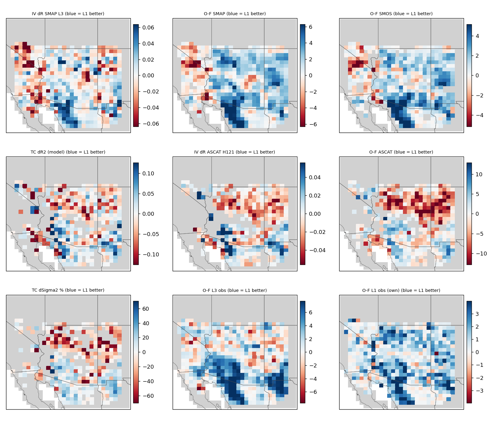

**Fig. 1.** Per-tile benefit of L1 DA against OL. Top row: IV against SMAP L3, O−F against SMAP and SMOS. Middle row: TC ΔR²_mod, IV against
ASCAT H121, O−F against ASCAT. Bottom row: TC Δσ² (%), O−F of the L3 obs and of the L1 obs themselves. Blue = L1 better. Grey = outside the L1 mask
or no valid value. The SMAP measures are mostly blue in the south and east; the ASCAT measures are red across the northeast plateau.

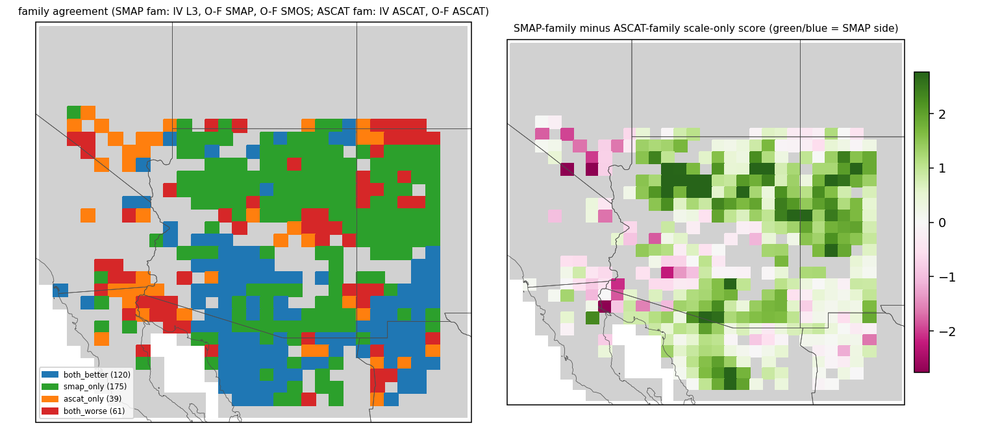

**Fig. 2.** Left: per-tile agreement between the SMAP group (IV SMAP L3, O−F SMAP, O−F SMOS) and the ASCAT group (IV ASCAT, O−F ASCAT). Counts are of the
552 mask tiles; 157 tiles have no ASCAT. Right: the SMAP-group minus ASCAT-group score (scale-only), green = SMAP side.

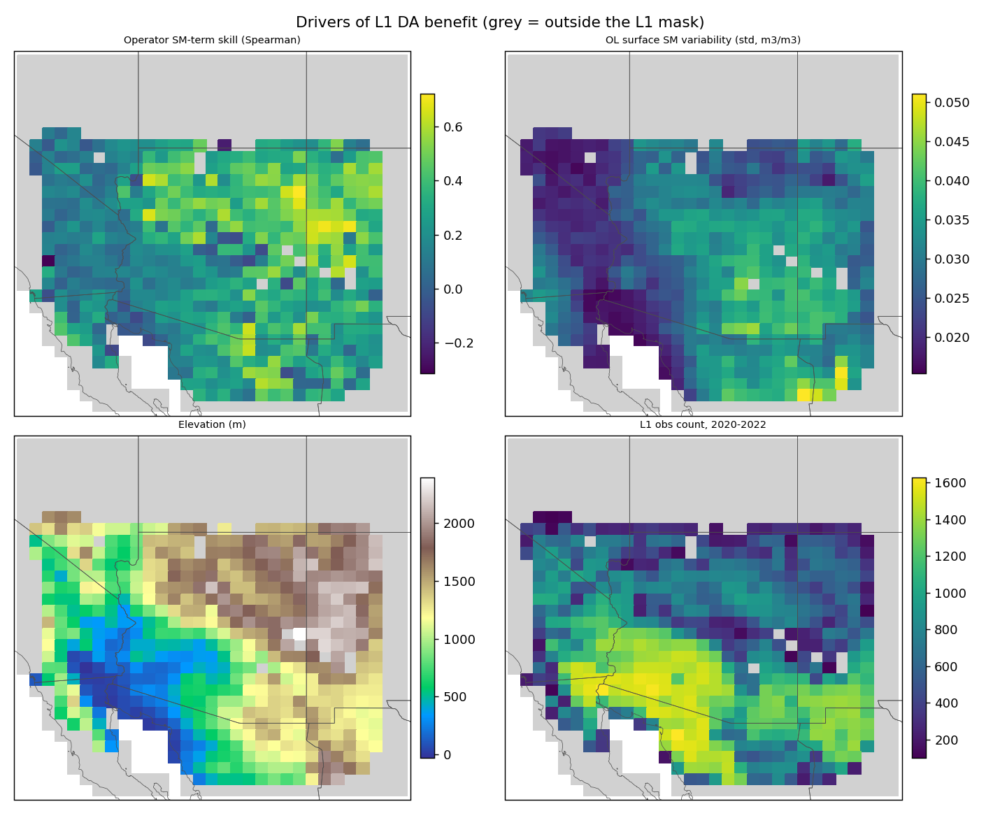

**Fig. 3.** The main drivers on the same tiles. SM-term skill and OL SM variability are highest in the same south-central and eastern tiles that benefit most
against SMAP. The obs count is highest in the south-central domain.

## Data and method

| Item | Setting |
|---|---|
| Tiles | 909 AZ tiles; analysis on the L1 mask (`n_l1_obs ≥ 100`, 552 tiles). TC is valid in 365 of them, ASCAT IV in 357, SMAP L3 IV in 548 |
| Outcomes (positive = L1 better than OL) | TC ΔR²_mod (= −ΔfMSE) vs SMAP L3 / ASCAT H121; IV anomaly-correlation change vs each reference; percent O−F stddev reduction (sign flipped) for SMAP, SMOS, ASCAT, L3 obs; L1 minus L3 versions |
| Covariates | obs supply and quality; operator skill (per tile and season); signal/noise (H(x) spread, gain, innovation/spread); terrain, CTI, soil, canopy height; IGBP fractions; LAI/NDVI/opacity climatology; precipitation and aridity; OL soil-moisture climate; baseline OL skill |
| Uncertainty | 2° × 2° block bootstrap (28 blocks, 2000 draws), Benjamini–Hochberg FDR per outcome; spatial-block CV (5-fold, 10 repeats) for models |
| Sources | Local: O−F stats, operator tables, obs-quality bundle. Discover: per-tile TC/IV, operator skill, static covariates, vegetation, climate, OL soil-moisture climate. MODIS MCD12C1 v061 (2021) for IGBP fractions |

Caveats on the inputs:
- Vegetation is one repeating annual climatology from the boundary files, the same for all three years; there is no real VOD series.
- PET uses land skin temperature, not 2 m air temperature, so the aridity index is approximate.
- Outcomes exist per tile (full period or per year) or per domain-season. **Nothing is tile-season.** Seasonal swings cannot be tested against benefit within a tile.
- The `DA_SMAP_fixedop` arm is not included: its ASCAT IV columns do not exist yet (job drafted, not run).
- The IGBP dominant class agrees with the existing land-cover columns in only about 72% of tiles; the existing columns are per-obs samples.

## Results

### 1. The outcomes form two groups

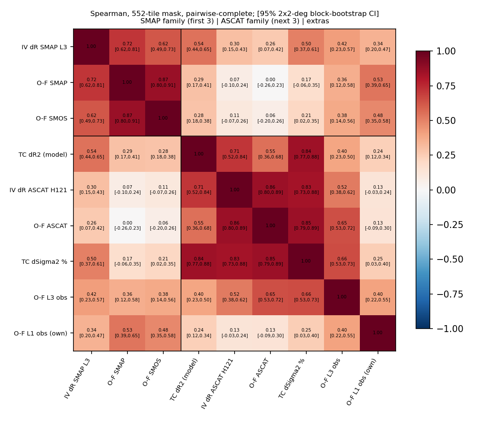

- Within the SMAP group r = 0.73 [0.65, 0.80]; within the ASCAT group r = 0.71 [0.59, 0.79]; between groups 0.21 [0.08, 0.35]. Two factors explain 83% of the variance.
- ASCAT O−F and ASCAT IV correlate at 0.86, so the ASCAT group is effectively two sources.
- **TC ΔR²_mod is mostly an ASCAT quantity.** The TC triplet is SMAP L3 + model + ASCAT H121. On the 337 tiles where clamping does not interfere, the ASCAT leg
  carries about two thirds of the ΔR²_mod variance and the SMAP leg about one third.

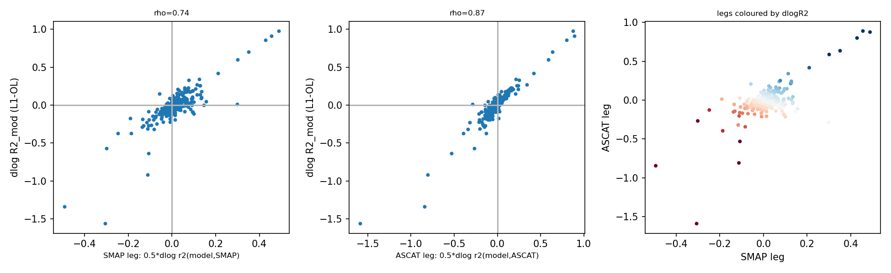

- It is not only the Four Corners hotspot. The re-derived hotspot (130 tiles) holds 71% of the ASCAT O−F penalty but only 40% of the TC penalty. Outside it the ASCAT-group
  correlations persist (TC against ASCAT IV r = 0.72). Inside it, ASCAT O−F is worse in 98% of tiles (median −7.4%) while SMAP O−F improves (+2.4%).
  The same tiles show no ASCAT penalty for L3 DA (median +2.8%), so the penalty belongs to the L1 arm.

### 2. A combined score, and the disagreeing tiles

The first combined score (mean of z(TC) and z(SMAP/SMOS O−F)) tracks the SMAP group at 0.85 and the ASCAT group at 0.54, so it is dominated by SMAP-type measures.
**Recommended primary:** the equal-weight average of the two groups' ranks. The SMAP group is IV SMAP L3, SMAP O−F and SMOS O−F. The ASCAT group is ASCAT IV and ASCAT O−F. TC is kept as a sensitivity check,
because it is the least spatially reliable component, and dropping it adds 30 tiles. Always report the four categories, not only the scalar (Fig. 2):

| Category | Tiles | Where |
|---|---|---|
| Better on both | 120 | south-central and southeast; more obs (median 1,314 against 708) |
| SMAP better, ASCAT worse | 175 | north-central and northeast plateau; grassland, +625 m, higher SM-term skill, more humid |
| ASCAT better only | 39 | western edge and northeast rim |
| Worse on both | 61 | western edge and northeast rim; many barren tiles |

On the 339 tiles where TC and the SMAP/SMOS O−F gain both exist, 149 are better on both, 134 on O−F only, 19 on TC only and 37 on neither.
Year-to-year consistency of the O−F measures is only 0.34–0.57.

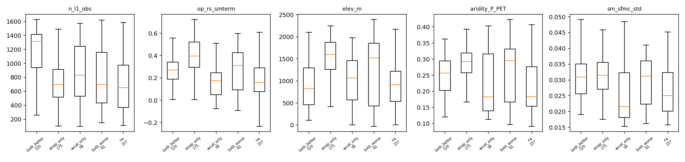

### 3. What explains the pattern

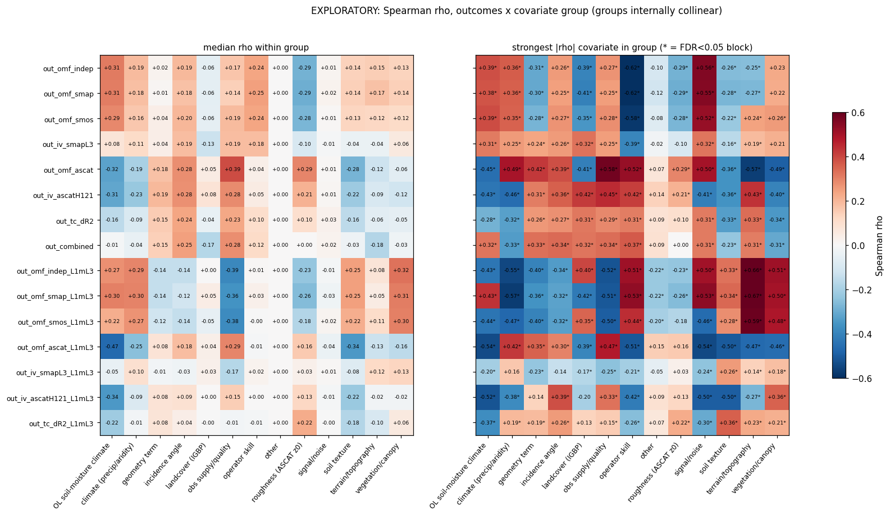

Spatial-block CV R² (gradient boosting) against a lat/lon-only model and a permuted null:

| Outcome | GB | lat/lon only | null |
|---|---|---|---|
| SMAP/SMOS O−F gain | 0.50 | 0.34 | −0.07 |
| ASCAT O−F gain | 0.49 | 0.18 | −0.06 |
| IV vs SMAP L3 | 0.26 | 0.18 | −0.06 |
| IV vs ASCAT | 0.31 | −0.06 | −0.05 |
| TC ΔR²_mod | 0.14 | −0.03 | −0.10 |
| TC ΔR²_mod, L1 minus L3 | 0.01 | −0.03 | n/a |

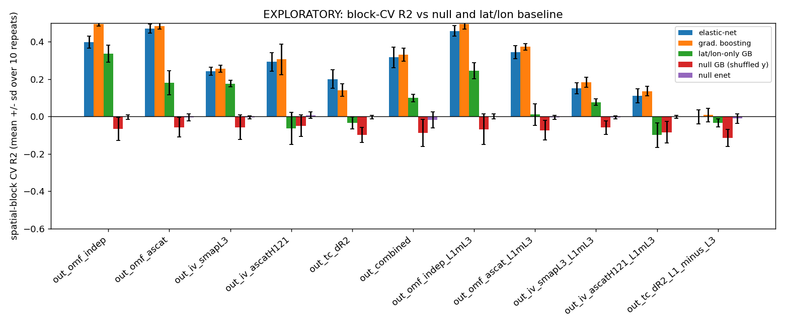

- **Structure beyond smoothness:** gradient boosting beats lat/lon-only for every outcome except TC L1 minus L3, which has no demonstrable predictive structure.
- **Circularity:** some of the explained variance is by construction. The SMAP Tb correlation `op_r_SMAPh` and the OL SMAP O−F stddev (the denominator of the outcome) are the top covariates for the SMAP O−F gain.
  OL baseline skill comes from the same TC/IV triplets as the outcomes. Do not read those as drivers.
- **SMAP group, real signals (modest):** SM-term skill in JJA (ρ +0.41 [0.20, 0.56]), OL soil-moisture variability (≈ +0.38), barren fraction (−0.39). Top versus bottom quintile: about +2.5 to +3 points of O−F reduction.
- **ASCAT group:** the ASCAT O−F gain falls with elevation and slope (ρ ≈ −0.56 [−0.69, −0.36], top versus bottom quintile about −8.5 points) and rises with clean-flag fraction and CTI spread.
  IV and TC are baseline-limited: the OL skill is the top predictor.
- **The two groups have different covariate profiles** (profile correlation −0.14). Elevation and aridity covariates have opposite signs.
- **L1 minus L3:** elevation is the main driver of the SMAP-group difference (ρ +0.66 [0.53, 0.74]); L3 degrades at elevation more than L1 does.
- **Collinearity:** elevation, slope, DEM, precipitation, aridity, SM mean and spring greenness are one gradient, so the "top 12" covariates are only a few independent axes. Group-level results are more trustworthy than single-covariate ranks.

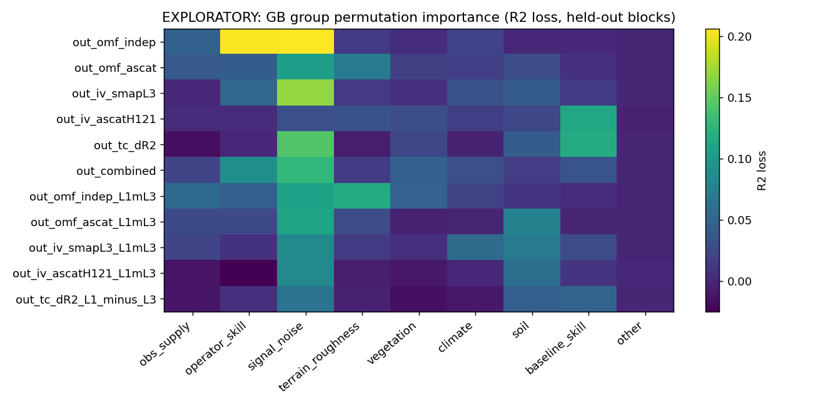

### 4. Time

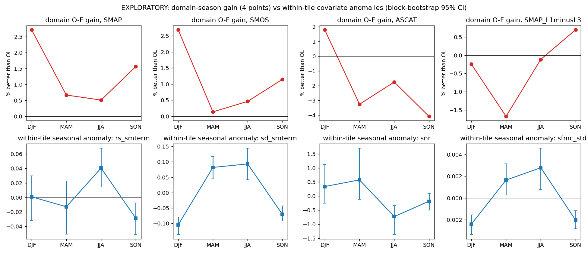

- Domain level: the L1 O−F gain against SMAP falls from +2.7% (DJF) to +0.7% (MAM) and +0.5% (JJA). ASCAT is negative in every season (worst in SON, −4.1%).
  L1 minus L3 against SMAP is worst in MAM (−1.7).
- Operator SM-term skill rises slightly in JJA (+0.04) and dips in SON (−0.03); it does not dip in spring. SM-term variance, LAI, H(x) std and the outlier fraction rise in MAM/JJA.
- Year-to-year variation is mostly noise (tile ICC 0.34–0.52) and no covariate varies by year, so year-anomaly tests were not possible.
- With only 4 seasons, the rank correlations of seasonal anomalies with the domain gain are descriptive, and they cannot separate vegetation from the shared seasonal cycle.

### 5. Why the SM signal varies (preliminary)

These numbers come from the OL soil moisture run through the operator, so they are model-derived sensitivities and not independent measurements
([mechanism_vegetation_check.py](../scripts/benefit_drivers/mechanism_vegetation_check.py)).

| Quantity (mask tiles) | Q25 | Median | Q75 |
|---|---|---|---|
| SM-driven std of H(x), dB | 0.88 | 1.01 | 1.14 |
| Geometry-driven std of H(x), dB | 2.08 | 2.78 | 3.51 |
| SM term as a share of SM + geometry variance | 0.07 | 0.11 | 0.19 |
| Sensitivity, dB per m³/m³ (SM std / SM-term std) | 33 | 37 | 42 |

- **The operator is not more sensitive in the good tiles.** The sensitivity per unit soil moisture is nearly constant (about ±15%). The SM-term std follows OL SM variability (ρ 0.85), and the SM-term skill follows SM variability (ρ 0.46) and mean SM (0.56).
- **The sensitivity rises as the soil dries** (ρ −0.94 with mean SM), the expected shape of Fresnel reflectivity in dB. It is lower under more vegetation (LAI −0.58, canopy height −0.57, opacity −0.53), but this is tangled with mean SM.
- **So the difference between tiles is how much the soil moisture moves**, not how sensitive the operator is. In dry tiles the roughly 1 dB SM signal is swamped by the 2.8 dB geometry term and the 2.75 dB obs error.
- This sharpens the roughness hypothesis: the geometry term carries the fixed roughness, and an error of even 30% in it (about 0.8 dB) would be as large as the entire SM signal. This is a plausible mechanism, not a measurement.

### 6. Vegetation and cover type

Partial Spearman correlations of LAI, opacity and canopy height with the outcomes, controlling for OL SM variability, OL mean SM and elevation, on all mask tiles and within open shrub only (310 tiles,
IGBP class 7). Intervals are 2° × 2° block bootstrap. All 100 tests are in `output/benefit_drivers/vegetation_check.csv`.

| Test | Result |
|---|---|
| Annual LAI and opacity, all five outcomes, all tiles | raw ρ ≤ 0.15; partial −0.04 to +0.13; every interval includes 0 |
| Same, open shrub only | partial −0.09 to +0.0; every interval includes 0 |
| Spring (MAM) LAI, SMAP O−F gain | partial −0.12 [−0.24, +0.02] on all tiles; −0.26 [−0.42, −0.07] within open shrub |
| Spring LAI, IV against SMAP L3 | −0.11 [−0.20, −0.01] on all tiles; −0.17 [−0.31, −0.01] within open shrub |
| Canopy height, SMAP O−F gain | −0.11 [−0.24, +0.03] on all tiles; −0.22 [−0.34, −0.07] within open shrub |
| ASCAT outcomes and TC | partial within ±0.13; every interval includes 0 |

- The spring-greening association with the ASCAT outcomes in the univariate screen (ρ −0.3 to −0.5) disappears once soil moisture and elevation are controlled for.
- The one signal that survives is a smaller SMAP-group gain with more spring LAI and taller canopy within open shrub. The effect is small and the direction fits vegetation attenuating the L-band signal, but 4 of the
  40 bootstrap intervals exclude zero, and all are in the SMAP group in one cover class. Treat it as a hint.
- Cover type: grassland tiles are over-represented where SMAP is better and ASCAT worse (60 of 175 tiles, against 6 of 120 for better on both) and barren tiles among worse on both (19 of 61).
  Open shrub is the dominant class in 310 of 552 tiles, while forest, cropland and urban tiles number 3–4 each, so there is no contrast to learn from.
- Arizona has too little vegetation to test this (median operator opacity 0.05, interquartile range 0.03–0.08).

### 7. The fixed-roughness hypothesis

How roughness enters, per the docs: it is fixed inside the IGOT pixel factor and only reshapes the geometry weights, which are frozen in preprocessing. The reflectivity is flat Fresnel
with no roughness or vegetation term, and H is purely coherent. The σ_S and σ_L values are not yet recovered from MiXIL.

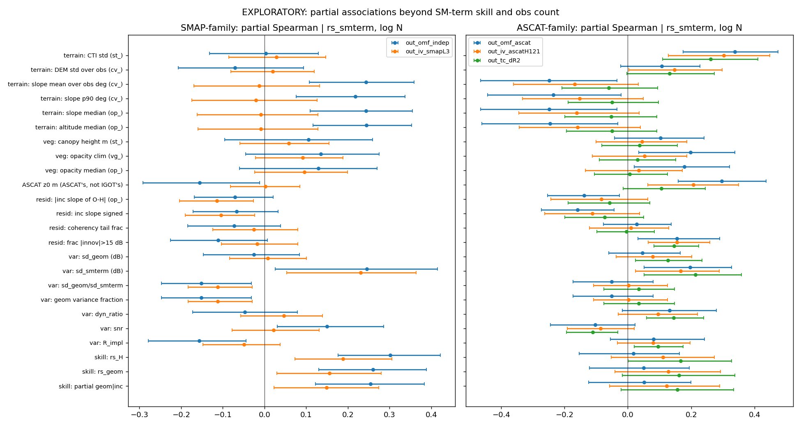

- The operator-residual diagnostics tied to a wrong roughness (incidence-angle slope, coherency tail, outlier fraction, dynamic ratio, SNR) add essentially nothing out of block (block-CV ΔR² ≈ 0 or negative)
  over SM-term skill and log obs count. None is in any top-five importance list.
- The static terrain block (terrain, canopy, ASCAT z0, incidence slope, geometry fraction) adds block-CV ΔR² of +0.08 to +0.11 for the SMAP and ASCAT O−F gains, and under +0.03 for TC, ASCAT IV and SMAP IV.
  Its sign flips between families (slope +0.24 for the SMAP O−F, −0.25 for the ASCAT O−F). The multivariate model gives a similar picture: terrain/roughness added to signal/noise gains +0.03 for the ASCAT O−F, none
  for the SMAP O−F and TC, and the ASCAT IV gain falls from +0.066 to +0.009 once baseline skill is included.
- Earlier OL residual diagnostics (O − scaled H(x)): the incidence-angle slope is +0.30 dB per 10° and positive in 90% of tile-seasons; it is 0.24 in flat tiles and 0.42 in the roughest tercile. Returns with coherency below 0.5
  sit about 1 dB below coherent ones in every season, and the diffuse fraction is 0.28 in rough terrain against 0.15 in flat. Both fit a wrong roughness damping, but weakly, and terrain, latitude, coherency and
  opacity covary. There is no seasonal bias in the tile-demeaned residual (within ±0.05 dB), which does not support a season-dependent roughness. Scaling may absorb a seasonal bias.

**Reading.** The hypothesis is not supported and not tested. The local data cannot separate a roughness effect from terrain and aridity, and the fixed term can only be probed through proxies.

## Limits

- One domain, 28 blocks: the intervals are rough and the FDR is optimistic. Spatial confounding cannot be separated from mechanism.
- Outcome sample sizes differ (339–548 tiles), so the SMAP and ASCAT groups use different tiles, and the 157 tiles without ASCAT are not random (low elevation, barren, low SM-term skill).
- Spearman screens are univariate and monotone. Model importance is shared among collinear covariates.
- Several top covariates restate their outcome; the SMAP O−F R² is partly predictable by construction.
- The Four Corners hotspot was re-derived (130 tiles); the report's 73-tile mask is not on disk.
- TC is the least spatially reliable outcome (split-half reliability near 0.44, 0.18 once neighbours are excluded).
- The sensitivity numbers in §5 are model-derived.

## Next

1. **IGOT roughness perturbation** (the decisive test). On about five tiles per terrain/vegetation stratum (200–500 OL obs each), recompute H(x) with σ_S and, separately, σ_L at 0.5×, 1× and 2×, using the same
   OL soil-moisture states. Apply the existing per-tile scaling and compare O−H skill and the O−F gain in MAM and DJF. If H only changes by a common factor that scaling absorbs, the hypothesis is rejected cheaply.
   If roughness is the weak link, SM-term skill and benefit should shift more on high-slope tiles and in spring. The same design with the opacity perturbed would test vegetation.
2. **DA_SMAP_fixedop reference arm:** run the drafted ASCAT IV job on Discover, to separate L1-specific effects from generic DA effects on the plateau.
3. **Seasonal TC/IV:** needs a new Discover run with season-restricted dates; it is the only way to test seasonal swings per tile.
4. **A second domain** with a different climate and more vegetation, to break the spatial confounding.

## Reproducing

All scripts are in `projects/CYGNSS_L1_AZ/scripts/benefit_drivers/`; outputs are in `output/benefit_drivers/` (git-ignored) with one README per analysis folder. The figures above are snapshots
in [benefit_drivers_figures/](benefit_drivers_figures/). Run with `/Users/amfox/mamba/envs/regrid/bin/python -I`.

1. `build_benefit_table.py`, `build_covariate_table.py`, `roughness_diagnostics.py`: local O−F, covariate and residual tables.
2. Discover extraction (per-tile TC/IV, operator skill, static, vegetation, climate, OL soil moisture): built on Discover; copy to `output/benefit_drivers/discover/`.
3. `build_igbp_landcover.py`: needs the MCD12C1 v061 files in `data/landcover_igbp/` (LP DAAC download; the script reads HDF4 via `hdp dumpsds` from the cygnss env).
4. `build_analysis_table.py`: joins all of the above into `analysis_table.csv` (909 × 350).
5. Analyses: `univariate_screen.py`, `multivariate_attribution.py`, `seasonal_roughness_analysis.py`, `outcomes_{common,structure,combined,disagree}.py`, `mechanism_vegetation_check.py`.
6. Maps: `tile_map` in `outcomes_common.py` draws M36 cells with `pcolormesh`; `outcomes_maps_drivers.py` makes Fig. 3.
