# CYGNSS L1, L3 and SMAP assimilation in Arizona, 2020–2022

*Figure companion to [cygl1_fixedop_2020_2022_omf_figures_l1_l3_smap.ipynb](../notebooks/cygl1_fixedop_2020_2022_omf_figures_l1_l3_smap.ipynb). Figure snapshot added 2026-10-30.*

These figures compare three fixed-operator assimilation runs over January 2020–December 2022 on the Arizona EASEv2 M36 domain (909 land tiles). The source bundle is `output/cygl1_fixedop_2020_2022_stats/`. Images and summary CSVs are copied alongside this report so they display on GitHub without the local output directory.

| Figure label | Experiment | Assimilation |
|---|---|---|
| L1 | `DA_L1_full_xc015_coh040216_fixedop` | CYGNSS L1, coherency filter 0.40–2.16, rebuilt scaling climatology, errstd 2.75 dB, xcorr 0.15° |
| L3-only | `DA_L3_fixedop` | CYGNSS L3 soil moisture |
| SMAP-only | `DA_SMAP_fixedop` | SMAP L1C brightness temperature |

L1 is the arm called “Filter only” in the [full arm-comparison report](cygl1_fixedop_2020_arm_comparison_report.md). The filtered L1 arm with errstd 3.9 dB is excluded here. Each DA run is compared with `OLv8_M36_AZ_fixedop`, evaluated using that arm’s scaled observations and matching observation mask.

## How to read the figures

O−F is the observation minus the model forecast in observation space. The percent-change figures show `100 × (DA − OL) / OL` of O−F standard deviation. **Negative means lower DA residuals; positive means higher residuals.** Blue is negative and red is positive in the change maps. An assimilated system’s own fit is distinguished from its fit to independent monitors: for example, SMAP is independent in the L1 and L3-only runs, but assimilated in SMAP-only.

The notebook uses several summaries, which should not be interchanged:

- **Headline statistics (Fig. 1):** pool monthly counts, means and variances into a full-period standard deviation for each species, calculate the percent change, then average species changes within a system.
- **Maps and their annotations (Figs. 3–4):** calculate per-tile changes after N-weighting species within each system (`NMIN = 10`), then N-weight the tile changes for the annotation. Each system has its own valid footprint.
- **Monthly curves:** calculate changes for each month; they are not the pooled 36-month statistic.
- **dMSE diagnostics (Figs. 10–11):** use mean-squared residuals, including the mean residual, rather than standard deviation alone.

## 1. Whole-period and annual comparison

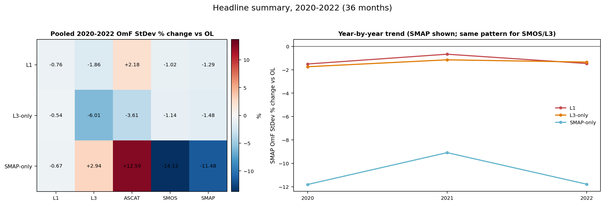

**Fig. 1.** Pooled 36-month percent changes for all five observing systems, and annual changes for SMAP. L1 lowers the pooled SMOS and SMAP residual standard deviations by about 1%, while increasing ASCAT by about 2%. L3-only improves all five systems. SMAP-only gives much larger Tb reductions but increases the ASCAT and L3 residuals. Its SMAP reduction includes fitting the assimilated observations; SMOS is an independent Tb monitor.

The annual SMAP comparison shows positive benefit in all three years for each arm, with the weakest reduction in 2021. Annual improvements can coexist with months of degradation.

## 2. Monthly comparison

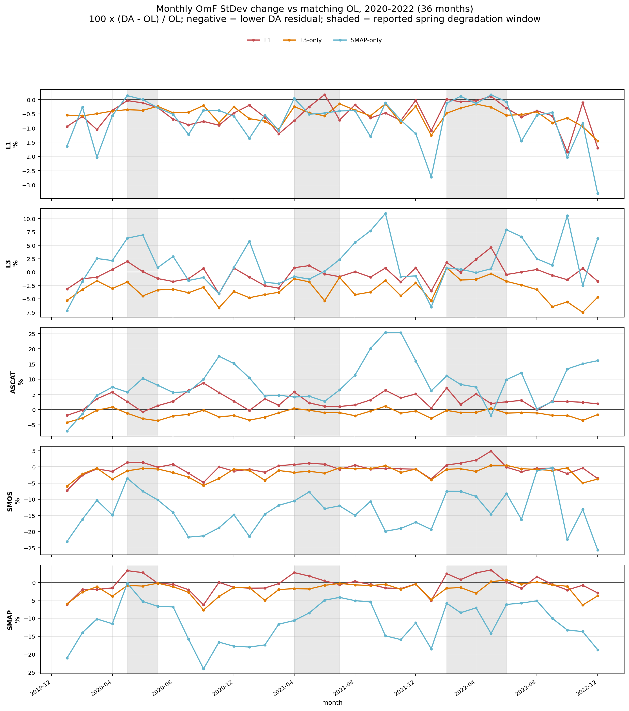

**Fig. 2.** Monthly changes for each observing system. Shading marks the L1 spring degradation windows identified in the source report: May–June 2020, April–June 2021 and February–May 2022. The timing moves, so one fixed May–August exclusion would not cover every year. These windows summarize the reported events; they are not a prospective screening rule.

## 3. Where the changes occur

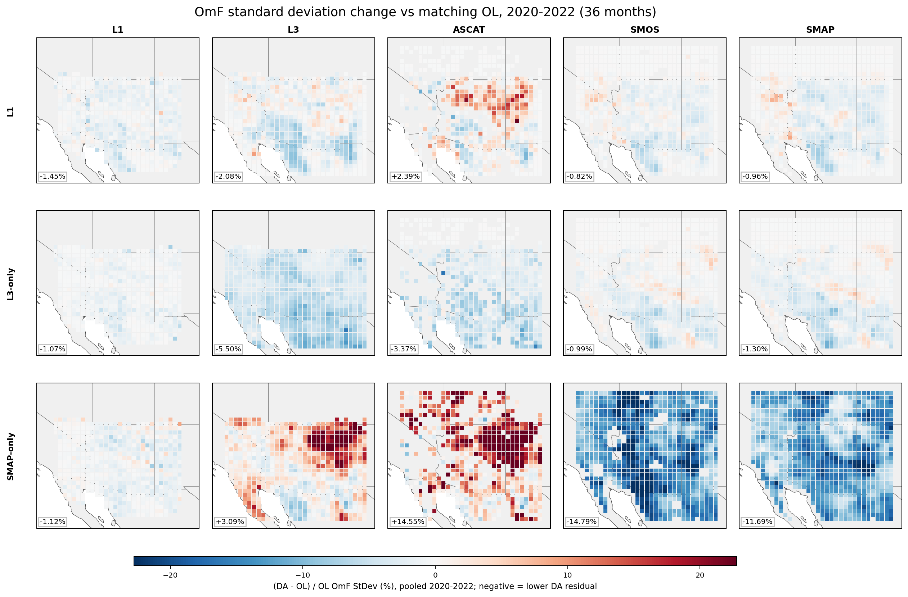

**Fig. 3.** Rows are L1, L3-only and SMAP-only; columns are the evaluated observing systems. All panels share the same color scale. L1 and SMAP-only both show an ASCAT penalty in the northeastern plateau region, while their Tb patterns show improvements elsewhere. The [operator skill report](cygl1_operator_skill_report.md), especially its Four Corners analysis, examines the monitor disagreement behind that pattern.

These are the N-weighted map annotations, not the headline pooling method in Fig. 1:

| Assimilated system | L1 | L3 | ASCAT | SMOS | SMAP |
|---|---:|---:|---:|---:|---:|
| L1 | -1.45% | -2.08% | +2.39% | -0.82% | -0.96% |
| L3-only | -1.07% | -5.50% | -3.37% | -0.99% | -1.30% |
| SMAP-only | -1.12% | +3.09% | +14.55% | -14.79% | -11.69% |

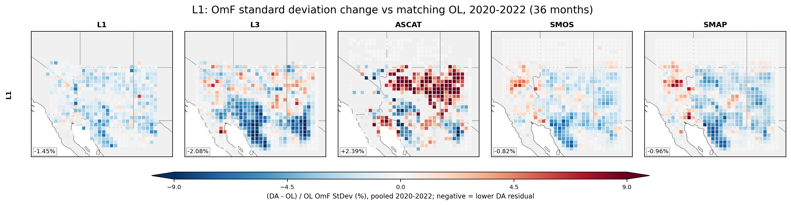

**Fig. 4.** The L1 row of Fig. 3, with identical data and annotations. The common scale across the five panels uses the 98th percentile of absolute L1-row changes, rounded up to a whole percent (±9% in this snapshot). Colorbar extensions mark values outside the limits. This makes the smaller L1 changes visible without setting the range from the larger SMAP-only changes.

## 4. Observation coverage

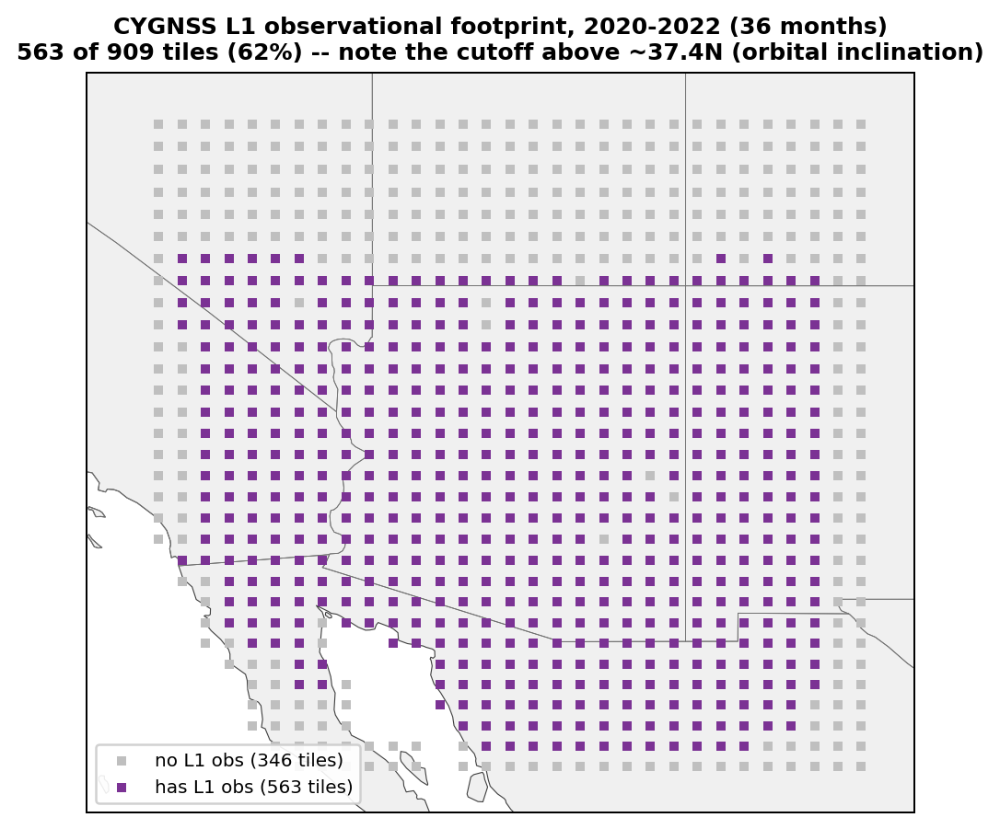

**Fig. 5.** Tiles with any L1 observations in the selected L1 DA arm. The northern coverage limit leaves part of the domain unobserved by L1. The notebook also compares L1 and L3-only within this same footprint; the numerical results are in [the footprint comparison CSV](cygl1_fixedop_2020_2022_l1_l3_smap_figures/l1_vs_l3_footprint_restricted_comparison.csv).

Restricting to L1-observed tiles does not reverse the independent-monitor ranking. SMAP changes are −1.33% for L1 and −1.67% for L3-only; SMOS changes are −1.16% and −1.28%. ASCAT is +3.50% for L1 and −3.87% for L3-only. These are N-weighted per-tile changes on the restricted support.

## 5. L1 changes by year and month

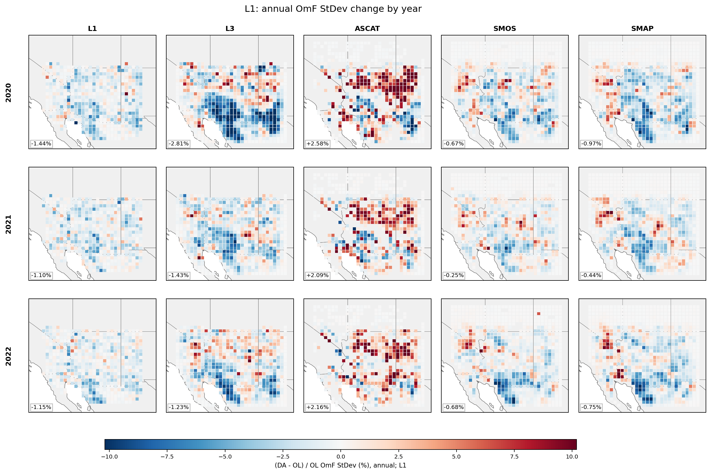

**Fig. 6.** Annual L1 maps, one row per year. These show how the location and magnitude of the impact vary. They use annual files and do not isolate the spring windows spatially.

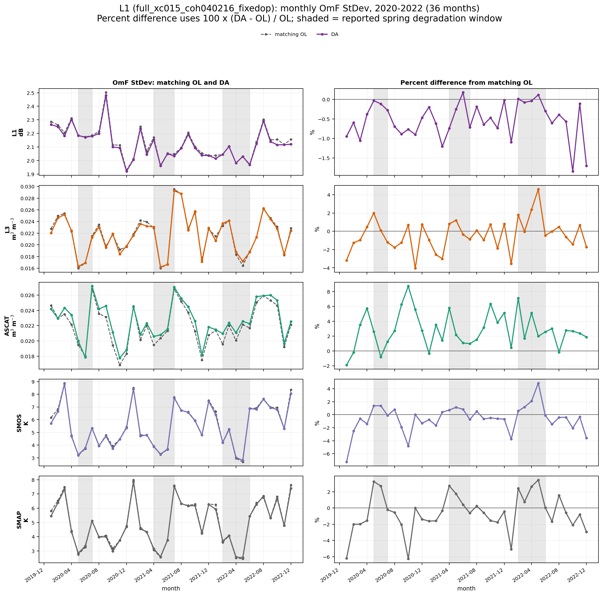

**Fig. 7.** Monthly absolute residual standard deviations for L1 DA and matching OL (left), and their percent difference (right). The absolute curves provide context for the percentage changes. Shading marks the same spring windows as Fig. 2.

## 6. Why some months degrade

Let `inn = O − F_OL` and `dF = F_DA − F_OL`, both evaluated at the monitor observations. Then the change in squared residual is `dF² − 2 × inn × dF`. The report calls these contributions **noise** and **gain**. Here “noise” is the squared forecast change, not a direct measurement of random instrument noise.

`alpha_opt` is the multiplier on `dF` that minimizes monitor MSE. A value near 1 supports the existing amplitude; between 0 and 1 favors smaller changes; above 1 favors larger changes. A small value alongside weak correlation indicates little useful monitor correction.

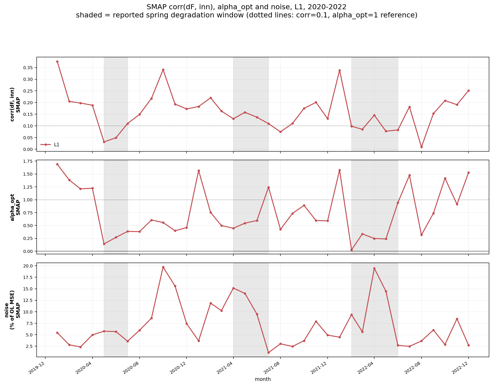

**Fig. 8.** L1 forecast-change correlation with the SMAP innovation, optimal amplitude and noise. May–June 2020 has very weak correlation. April–June 2021 retains correlation but has large noise and favors smaller increments. February–May 2022 combines weak correlation with low optimal amplitude. For this selected L1 arm, window-mean correlations are approximately 0.040, 0.142 and 0.101, and window-mean `alpha_opt` values are 0.21, 0.53 and 0.21. These are averages of monthly diagnostics, not fits pooled over each window.

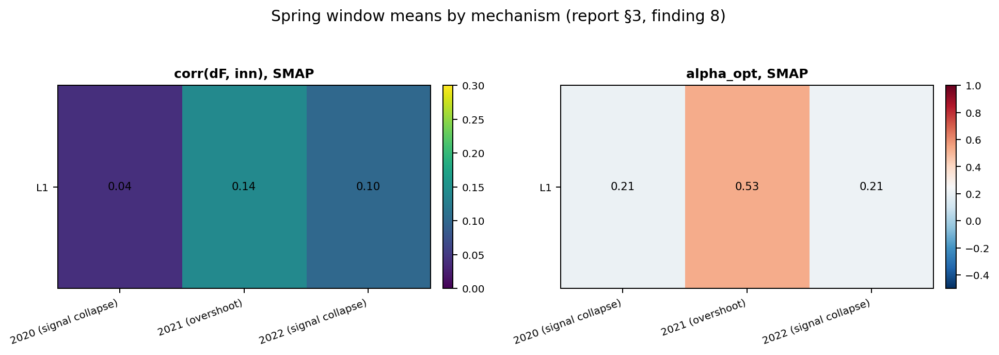

**Fig. 9.** The same spring-window distinction summarized as heatmaps. The terms “signal collapse” and “overshoot” follow the original report’s interpretation. The later [operator skill report](cygl1_operator_skill_report.md) adds evidence linking spring losses to reduced SM-term skill and differences in gain; this figure alone does not attribute the underlying physical cause.

## 7. MSE and forecast-change correlation across arms

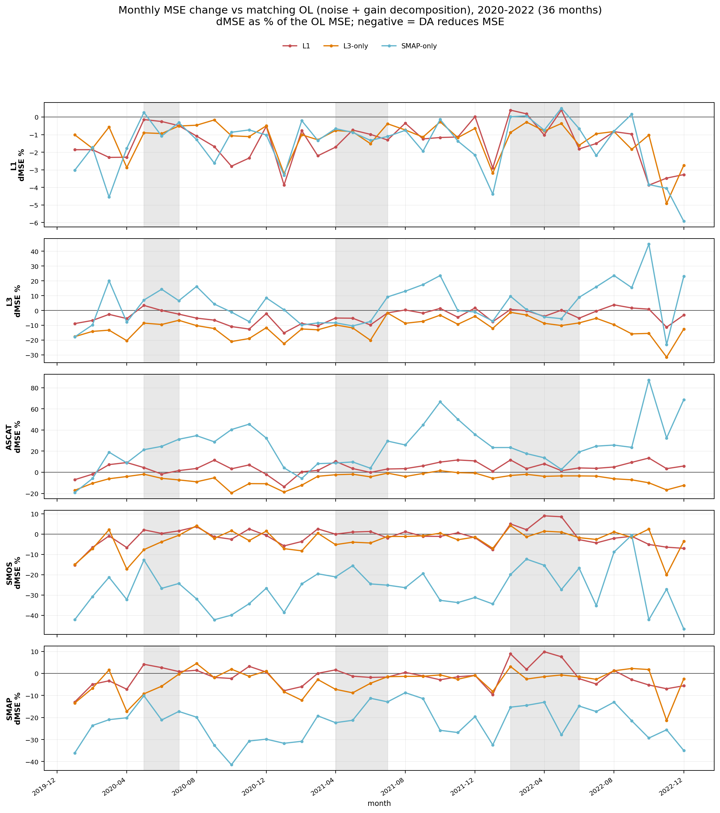

**Fig. 10.** Monthly MSE change, expressed as a percentage of OL MSE. Negative values indicate reduced MSE. This includes the mean residual and therefore differs from the standard-deviation changes in Fig. 2.

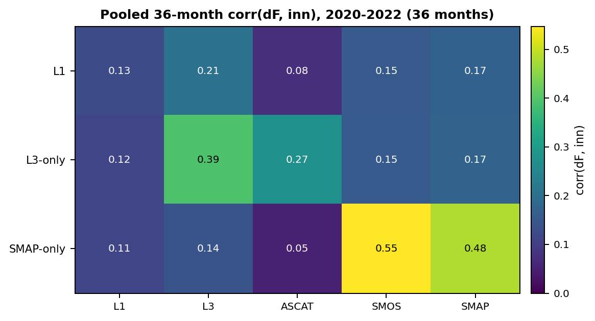

**Fig. 11.** Pooled 36-month correlation between each arm’s forecast change and the OL innovation, by observing system. It measures whether the forecast changes align with the monitor residuals. It does not establish that their amplitude is optimal; Fig. 8 separates those questions for L1 and SMAP.

## Source and reproduction

Run [the notebook](../notebooks/cygl1_fixedop_2020_2022_omf_figures_l1_l3_smap.ipynb) from top to bottom with the three-year statistics bundle available under `output/cygl1_fixedop_2020_2022_stats/`. It writes the figures and CSVs to `figures_l1_l3_smap/` within that bundle. This report embeds copies in [cygl1_fixedop_2020_2022_l1_l3_smap_figures/](cygl1_fixedop_2020_2022_l1_l3_smap_figures/); rerunning the notebook does not automatically refresh those copies.

The source bundle contains the whole-period temporal NetCDF files, 36-month spatial pickle files, annual files in `stats/per_year/`, and noise/gain CSVs in `summary/`. The notebook retains the 2020-only context arms in a separate table; the figures embedded here focus on the three continuing arms above.

For experiment setup, pooling definitions and the full sensitivity comparison, see [the arm-comparison report](cygl1_fixedop_2020_arm_comparison_report.md). For spatial operator skill, spring diagnostics and the Four Corners ASCAT penalty, see [the operator skill report](cygl1_operator_skill_report.md). Lower monitor residuals are evidence of improved fit to those observations, not a direct measure of soil-moisture truth.
