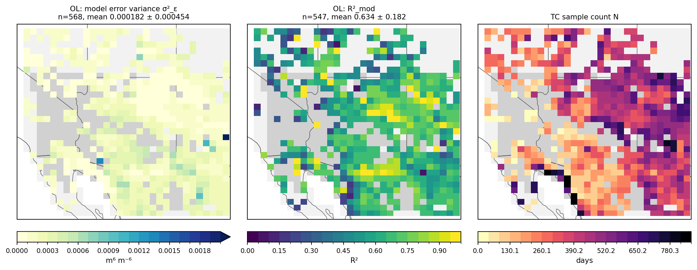
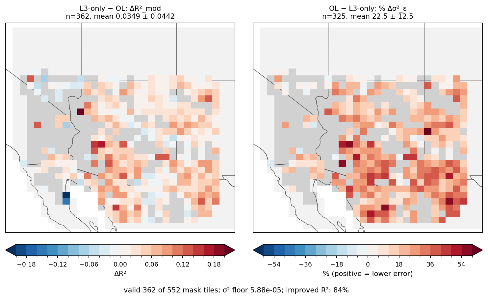
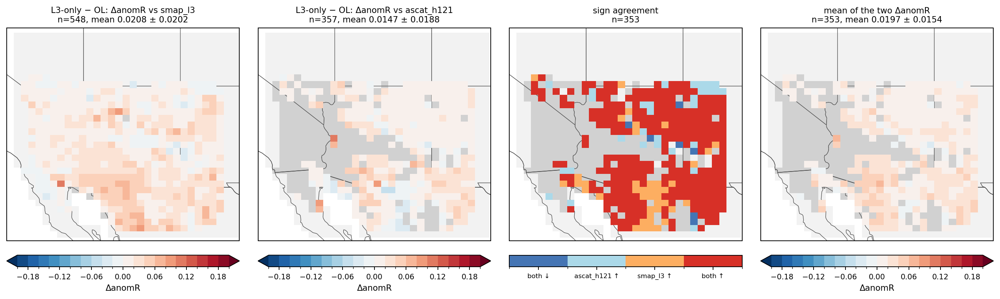
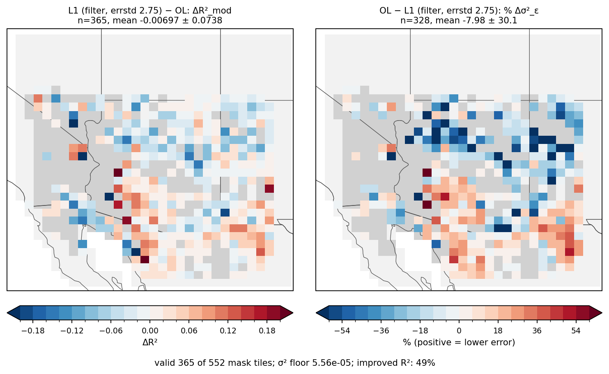
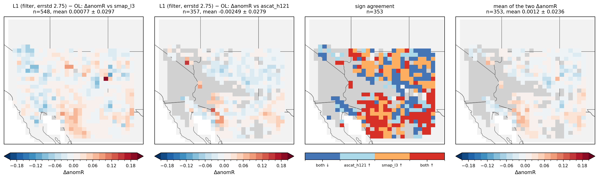

# Triple collocation and independent validation of the CYGNSS L1 and L3 DA arms (Arizona domain)

*2026-11-12. Arizona limited domain (lon −118..−106, lat 29..40), EASEv2 M36 (909 tiles), fixed-operator runs, 2020-01-01 to
2022-12-31. Figures and summary table: [iv_tc_az_figures/](iv_tc_az_figures/). Code: see [Reproducing](#reproducing).*

## Summary

Per-tile triple collocation (TC) and independent validation (IV) against SMAP L3 and ASCAT H121, for the open loop (OL) and two
DA arms.

- **L3-only DA improves the model broadly.** ΔR²_mod is +0.035 (84% of tiles improve), the median error variance falls by 22%, and
  the anomaly correlation with SMAP L3 rises by +0.021 (95% CI [+0.016, +0.025], 87% of tiles).
- **L1 DA (coherency filter, errstd 2.75) is neutral overall.** ΔR²_mod is −0.007 (49% of tiles improve) and the
  anomaly correlation with SMAP L3 changes by +0.0008 (95% CI [−0.005, +0.007]). Against ASCAT H121 it is slightly negative
  (−0.002, 42% of tiles improve).
- **L1 does improve in the south.** In the 29–32°N band the anomaly correlation with SMAP L3 rises by +0.013
  (95% CI [+0.0006, +0.024], 72% of tiles). The northern bands lean negative, with intervals that include zero. The band split was
  chosen after seeing the maps, so treat this as a lead, not a confirmed result.
- **Dropping ASCAT does not turn L1 into a win.** That was checked because L1 does worse against ASCAT. Against SMAP L3 alone the
  domain mean is still zero. The SMAP-only choice is post hoc, so both references are shown.

## Method

| Item | Setting |
|---|---|
| Arms | `OL` = `OLv8_M36_AZ_fixedop`; `L1_filt275` = `DA_L1_full_xc015_coh040216_fixedop` (two-sided coherency filter, errstd 2.75); `L3` = `DA_L3_fixedop` |
| Excluded arm | `DA_SMAP_fixedop`, because it assimilates SMAP Tb and SMAP L3 would not be independent for it |
| TC triplet | SMAP L3 (primary), model, ASCAT H121 (secondary); annual (full period); at least 20 paired days per tile |
| IV | model anomaly correlation with each reference, lag 2 days, at least 100 paired days; pentad climatology (31-day window) |
| Period | 2020-01-01 to 2022-12-31 (1096 days). SMAP L3 has 50 missing days; ASCAT H121 has none |
| Tile set | All 909 tiles are mapped. Statistics use the L1-domain mask (`in_l1_mask`, 552 tiles) |
| Validity | A tile needs enough samples in both arms and a finite value. Tiles that fail are drawn grey, not dropped |
| Sign convention | Positive = arm better than OL. For error variance, the plot shows −% change |
| Percent change in σ² | tiles with baseline σ² below the 10th percentile are masked before taking a percentage |
| Uncertainty | 2° × 2° block bootstrap (2000 draws), because neighbouring tiles are correlated |

Neither SMAP L3 nor ASCAT H121 is assimilated in the three arms, and both are independent of CYGNSS.

## Results

### Baseline (OL)

The OL model has a mean R²_mod of 0.63 over the valid tiles, with a small error variance almost everywhere. The TC sample count
is highest in the east of the domain and lowest in the south-west.

### L3-only DA

L3 improves R²_mod and lowers the error variance in most tiles. The improvement is spread over the eastern and central domain and
is strongest in the southern half. Against SMAP L3 it is positive in every latitude band, and most tiles show "both ↑" in the
sign-agreement map. The far-west tiles are mixed.

### L1 DA (filter, errstd 2.75)

The maps show a spatial split.

- **Improvement** is concentrated in the southern third of the domain: southern Arizona and, mostly, northern Mexico (Sonora and
  Chihuahua). ΔR²_mod there is about +0.05 to +0.12, many tiles show an 18–50% lower error variance, and the "both ↑" class in the
  sign-agreement map sits in the same block.
- **Degradation** is in the north and north-east (Colorado Plateau, Four Corners, northern New Mexico), where the "both ↓" class
  dominates and a dense band of tiles has a higher error variance. The far west edge is also negative in the IV maps.
- Central Arizona is mixed: better against SMAP L3 and worse against ASCAT H121.
- The effects are small. Most ΔanomR values lie between −0.06 and +0.06.

The geography above is read from the maps. Only the SMAP IV was also split numerically into latitude bands (below).

### Summary table

Domain statistics over the 552-tile mask. Full table: [iv_tc_az_figures/iv_tc_summary.csv](iv_tc_az_figures/iv_tc_summary.csv).

| Arm | TC tiles valid | R²_mod OL → arm | ΔR²_mod | tiles improved | median % lower σ² | ΔanomR vs SMAP L3 (n, improved) | ΔanomR vs ASCAT H121 (n, improved) |
|---|---|---|---|---|---|---|---|
| L1 | 365 | 0.643 → 0.636 | −0.007 | 49% | −2.3% | +0.0008 (548, 54%) | −0.0025 (357, 42%) |
| L3 | 362 | 0.640 → 0.675 | +0.035 | 84% | +22.4% | +0.0208 (548, 87%) | +0.0147 (357, 86%) |

The OL mean anomaly correlation with SMAP L3 is 0.595.

### SMAP-L3-only IV, with uncertainty

ΔR = anomaly correlation of the arm minus that of OL, against SMAP L3. Intervals are 95% block-bootstrap intervals.

| Arm | Subset | Tiles | Mean ΔR | 95% CI | Tiles improved |
|---|---|---|---|---|---|
| L1 | all SMAP-valid | 548 | +0.0008 | [−0.0053, +0.0068] | 54% |
| L1 | 29–32°N | 151 | +0.0126 | [+0.0006, +0.0243] | 72% |
| L1 | 32–35°N | 237 | −0.0022 | [−0.0086, +0.0045] | 49% |
| L1 | 35–40°N | 160 | −0.0060 | [−0.0155, +0.0031] | 43% |
| L1 | also ASCAT-valid | 353 | +0.0046 | [−0.0017, +0.0109] | 59% |
| L1 | SMAP-only tiles | 195 | −0.0062 | [−0.0128, +0.0023] | 45% |
| L3 | all SMAP-valid | 548 | +0.0208 | [+0.0164, +0.0254] | 87% |
| L3 | 29–32°N | 151 | +0.0327 | [+0.0245, +0.0410] | 92% |
| L3 | 32–35°N | 237 | +0.0188 | [+0.0140, +0.0234] | 87% |
| L3 | 35–40°N | 160 | +0.0127 | [+0.0087, +0.0192] | 83% |
| L3 | also ASCAT-valid | 353 | +0.0245 | [+0.0193, +0.0295] | 90% |
| L3 | SMAP-only tiles | 195 | +0.0142 | [+0.0087, +0.0191] | 84% |

The tile set does not explain the L1 result: tiles with and without ASCAT coverage give intervals that both include zero.

## Caveats

- **No intervals yet for the TC and ASCAT IV numbers.** Only the SMAP-L3 IV has bootstrap intervals. The TC and ASCAT values in the
  summary table are descriptive.
- **The southern L1 improvement is not confirmed.** The three latitude bands were chosen after looking at the maps, and only the
  southern band excludes zero, with a lower bound of +0.0006.
- **Cause not established.** The south differs from the north in land cover, soil-moisture range and observation density, and
  none of these has been checked against the improvement. It could reflect any of them, not CYGNSS quality alone.
- **Grey tiles.** A large block in south-western Arizona and the Mojave side has no valid TC or IV value in the arms. Nothing can be
  said about those tiles. TC is valid for 365 of the 552 mask tiles, and the ASCAT IV for 357.
- **SMAP-only was a post hoc choice.** SMAP L3 has more valid tiles (548 vs 357) and is independent of all three arms, but the
  decision to look at it alone was made after seeing the ASCAT result.
- **Operator build.** The `*_fixedop` arms run on the old install (species numbering before the `e6a32ae` rebuild), as recorded in
  the project README.

## Reproducing

All code is in `projects/CYGNSS_L1_AZ/`. The analysis outputs are under
`/discover/nobackup/projects/land_da/cygl1_operator_test/iv_tc_output/` (about 110 MB), not in git.

1. `jobs/run_iv_tc_az_step2.sbatch`: daily model–observation pairs, one array task per arm (about 2 h 47 min).
2. `jobs/run_iv_tc_az_step34.sbatch`: pentad climatology, IV and TC (under a minute per arm). Settings are in `jobs/iv_tc_az_arms.sh`.
3. `scripts/build_iv_tc_tile_map.py`: tile map joining the M36 cell index to the 909 AZ tiles, plus the L1 mask.
4. `scripts/iv_tc_az_maps.py --root <iv_tc_output> --out <dir>`: the six figures and `iv_tc_summary.csv`
   (also `notebooks/iv_tc_az_maps.ipynb`).
5. `scripts/iv_smap_only_summary.py`: the SMAP-only table with block-bootstrap intervals.

Underlying TC/IV code: `projects/iv_tc/` in this repo.
