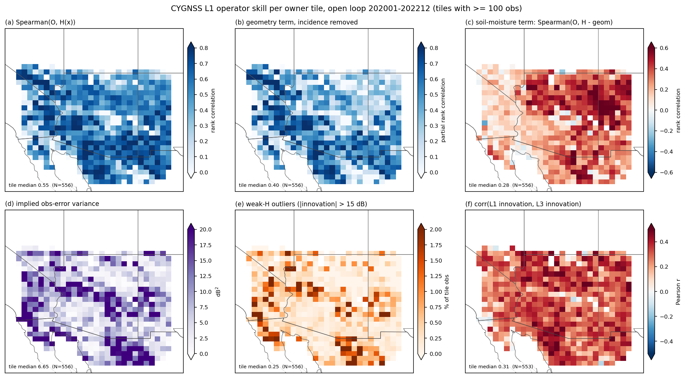
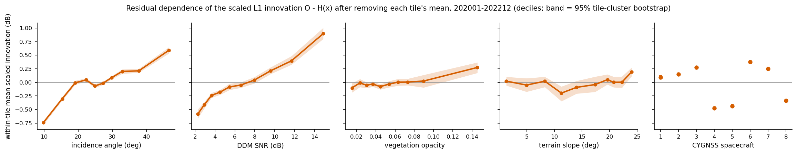
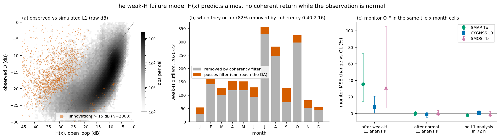
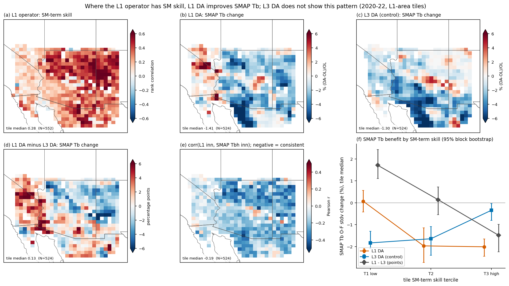
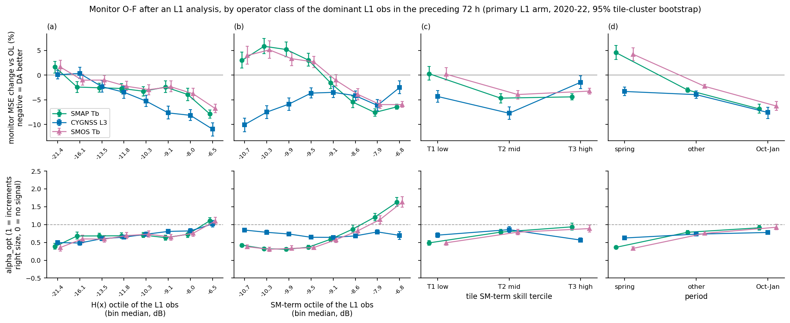
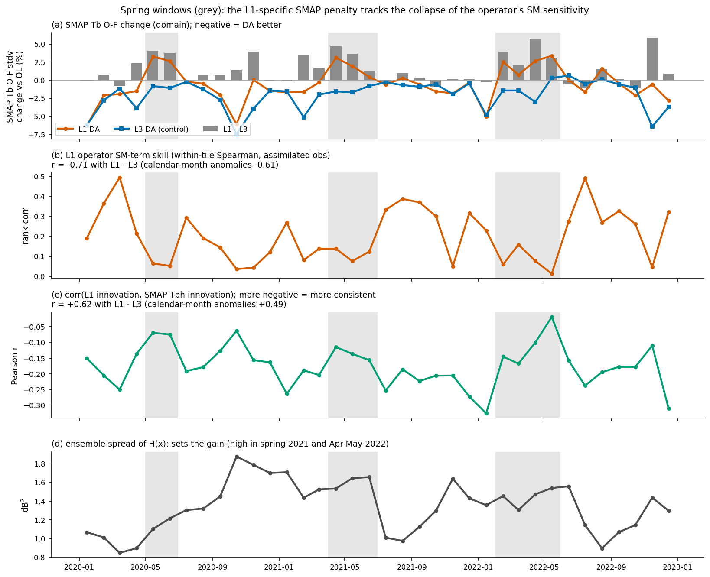
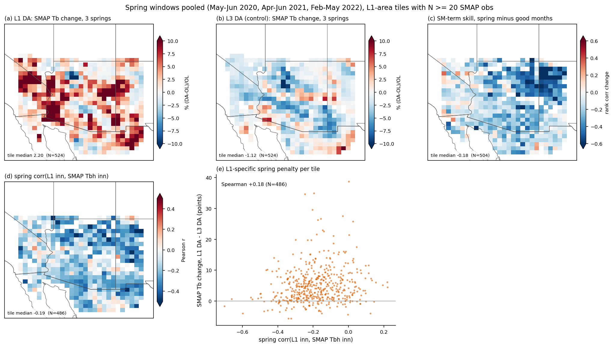
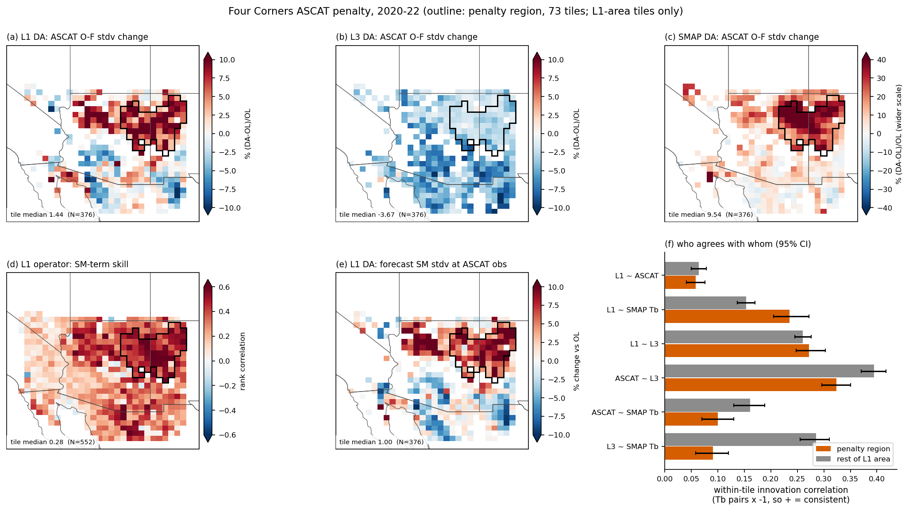

# Where the CYGNSS L1 operator does well and badly, and how that links to DA benefit

*2026-10-23. Arizona limited domain (lon −118..−106, lat 29..40), EASEv2 M36 (909 tiles), fixed L1 operator build (GEOSldas.x md5
6a70b496), 2020-01..2022-12. Feeds paper TODO Priority 1 ([../paper/TODO.md](../paper/TODO.md)).*

## Summary

The L1 operator H(x) is evaluated against the observations of the unscaled open loop: 470,719 L1 obs, 556 owner tiles with ≥ 100
obs. The result is then linked to what the primary L1 DA arm does with the observations.

**Operator skill.**
- The tile-median Spearman(O, H) is 0.55.
- The terrain-aware geometry term carries information beyond incidence angle (partial rank correlation 0.40). That holds in 85% of
  tiles.
- The soil-moisture (SM) term carries skill only in the east and in the higher, wetter tiles (0.4–0.6): New Mexico, the Mogollon Rim
  and the Sierra Madre. In the western low deserts it is about 0 (tile median 0.28).
- Within a tile the geometry term varies 2.8× as much as the SM term (std 2.8 vs 1.0 dB).
- There is one distinct failure mode, the **weak-H outliers**. In 2,003 obs H(x) predicts almost no coherent return (−34 dB) while
  the observation is normal (−16 dB). The coherency filter removes 82% of them.
- Residual trends remain after scaling: about ±0.6–0.9 dB with incidence angle and DDM SNR, and ±0.45 dB between spacecraft.

**Link to DA benefit** (primary arm `DA_L1_full_xc015_coh040216_fixedop` vs `OLv8_M36_AZ_fixedop`; L3-only DA as the control):

1. **L1 DA improves SMAP/SMOS Tb only where the operator's SM term has skill, and the pattern is specific to L1.**
   - Top vs bottom SM-skill tercile, L1 minus L3 SMAP Tb change: **−3.2 pp [−4.2, −2.4]**.
   - The sign holds and is significant in each year and within every aridity tercile.
   - Low-SM-skill tiles get no Tb benefit from L1 DA (+0.07%), but do get it from L3 DA (−1.83%).
2. **The spring degradation is the same mechanism in time.**
   - Each spring the SM-term skill collapses domain-wide (from 0.24–0.39 to 0.06–0.12) as the surface dries.
   - Month by month this tracks the L1-specific SMAP penalty (r = −0.71; −0.61 for calendar-month anomalies) and follows the moving
     window.
   - The difference between 2020/2022 ("signal collapse") and 2021 ("overshoot") comes from the ensemble spread of H(x), i.e. the
     gain, not from the operator.
3. **Analyses with too-large increments and weak SM signal hurt the monitors; weak-H outliers do not matter in aggregate.**
   - The 345 weak-H outliers that get past the coherency filter are assimilated without any QC rejection. They do clear local harm
     (SMAP Tb MSE +36% [+16, +72] in the following 72 h), but in aggregate they matter little: removing their updates would move the
     pooled SMAP change by 0.02 points.
   - L1 analyses from low-H or low-SM-term obs, and spring obs, are what fail to help SMAP Tb (alpha_opt 0.3–0.4).
   - The largest increments are about 2× too large (alpha_opt 0.55).
4. **The Four Corners ASCAT penalty is not an L1 operator problem.**
   - Inside the penalty region the operator is better than elsewhere (SM-term skill 0.49 vs 0.25), and the L1 innovations agree
     *more* with SMAP Tb.
   - The penalty is added SM variance on high-plateau grassland, where ASCAT and L3 decouple from SMAP Tb. SMAP-only DA shows the
     same pattern 3–4× stronger.
   - There is no edge effect.

The value of the L1 observations is conditional on the SM term carrying signal. That points to a **state-dependent observation
error** — larger R where and when the SM term has no skill (dry western desert tiles, spring dry-down) — rather than a fixed calendar
gate (§4).

## Data and method

**Runs.** Same build and configuration as [cygl1_fixedop_2020_arm_comparison_report.md](cygl1_fixedop_2020_arm_comparison_report.md).

| Run | Role |
|---|---|
| `OLv8_M36_AZ_fixedop` | Unscaled open loop, full L1 stream including the coherency tails |
| `DA_L1_full_xc015_coh040216_fixedop` | Primary L1 arm: coherency filter 0.40–2.16, clim rebuilt on the screened obs, errstd 2.75 dB, xcorr 0.15° |
| `DA_L3_fixedop` | L3-only DA; control |
| `DA_SMAP_fixedop` | SMAP-only DA; reference |
| `DA_L1_full_xc015_coh040216_err39_fixedop` | errstd 3.9; sensitivity |

**Per-observation table** (step 1, `scripts/operator_skill/extract_obs_table.py`):
- every L1 obs in the OL with O (raw dB), H(x), the geometry term `geom_db` = 10 log10 Σ C_t, the SM term H − geom, and footprint
  diagnostics (n_eff, w_max, w_owner);
- the QC fields from the raw granules;
- the offline z-score scaling, verified against the DA arm to 3e-6 dB;
- collocated monitor innovations: the DA arm's scaled monitor obs minus the OL forecast, same tile, nearest ±12 h.

July 2020 uses the pre-gate obs files that the runs actually read (`CYGNSS_L1_backup/Y2020_M07_pregate_20260629/`).

**Tile operator metrics** (step 2, `scripts/operator_skill/analyze.py`):
- Spearman(O, H);
- geometry-term skill, also partial with incidence removed;
- SM-term skill, Spearman(O, H − geom), written `rs_smterm`;
- the implied obs-error variance R_impl = var(innovation) − fcstvar;
- the weak-H outlier fraction (|scaled innovation| > 15 dB);
- correlations of the L1 innovations with the SMAP Tb and L3 innovations.

**DA link** (step 4, `scripts/operator_skill/da_link/`, four analyses):
- **Per tile:** % (DA − OL)/OL of O-F stdv per tile and species. Each DA arm is paired with the OL scored on the same arm's scaled obs
  (`OL_paired_monitor_xmask_<tag>`). A tile needs N ≥ 50 for the whole period, or ≥ 20 for spring windows. Windows were pooled
  exactly from the monthly sums; this reproduces the toolkit stats to 6e-8.
- **Per observation:** a noise-vs-gain split of the monitor obs, each attributed to the operator class of the preceding L1 analysis.
- **Negative = DA better**, for every species.
- **The L1 area** (tiles with ≥ 100 L1 obs over 2020–22, 552 tiles) is the primary sample.
- **Uncertainty:**
  - tile results: spatial block bootstrap with 3×3-tile blocks (5×5 gives the same verdicts);
  - obs-level results: tile-cluster bootstrap.

Each analysis has a `SUMMARY.md` with all numbers in `output/operator_skill/da_link/<task>/` (not in git).

## 1. Operator skill



**Fig. 1.** Operator skill per owner tile, OL 2020–22, tiles with ≥ 100 obs.

| Metric | Tile median | Where it is high / low |
|---|---|---|
| Spearman(O, H) | 0.55 | Broadly positive everywhere |
| Geometry term, incidence removed | 0.40 | Highest in the west and south (terrain-driven) |
| SM-term skill | 0.28 | 0.4–0.6 in the east and the higher, wetter tiles; about 0 in the western low deserts |
| R_impl | 6.65 dB² | Large in the western deserts and on the southern Sonoran fringe |
| corr(L1 innovation, L3 innovation) | 0.31 | Positive almost everywhere |

SM-term skill rank-correlates with altitude (0.64), slope (0.63), mean OL SFMC (0.56) and longitude (0.51). It is the only skill
metric with a strong spatial gradient.



**Fig. 2.** Within-tile mean scaled innovation by decile, with the tile mean removed and a 95% tile-cluster bootstrap. The residual
trends that survive per-tile z-score scaling are:

| Driver | Range of the within-tile mean innovation |
|---|---|
| Incidence angle | −0.74 dB [−0.78, −0.70] at 10° to +0.59 dB at 47° |
| DDM SNR | −0.58 dB at 2 dB to +0.90 dB at 15 dB |
| Spacecraft | +0.38 (sc 6) to −0.47 (sc 4); sc 4, 5 and 8 are low |

Opacity (−0.10 to +0.27 dB) and slope (< 0.2 dB) matter less. These are the inputs to the paper's residual geometry diagnostic
(TODO P1, simpler-operator comparison). The incidence and SNR terms are the same size as the within-tile std of the SM term (1.0 dB).



**Fig. 3.** The weak-H failure mode.
- **(a)** 2,003 obs (0.4%) have |scaled innovation| > 15 dB, on 455 tiles. In 97% of them H(x) is in its lowest octile: median H(x)
  −34.2 dB vs O −15.7 dB. The operator predicts almost no coherent return while the observation looks normal.
- **(b)** They peak in Jul, Aug and Oct. Their median coherency is 0.23, so the coherency filter removes 82%.
- **(c)** The rest, 345 obs on 143 tiles, are assimilated (§2.2).

## 2. Link to DA benefit

### 2.1 Per tile, whole period: SM-term skill predicts L1-specific Tb benefit



**Fig. 5.** SM-term skill (a) against the SMAP Tb O-F change for L1 DA (b), L3 DA (c) and their difference (d), with the L1–SMAP
innovation correlation (e) and the change by SM-skill tercile (f). Tile medians, 2020–22.

| SM-term skill tercile | L1 DA SMAP Tb | L3 DA SMAP Tb | L1 − L3 (pp) |
|---|---|---|---|
| T1 (low, < 0.19) | +0.07 [−0.42, +0.56] | −1.83 | +1.71 [+1.11, +2.43] |
| T3 (high, > 0.36) | −2.01 [−2.45, −1.65] | −0.35 | −1.49 [−2.24, −0.99] |
| T3 − T1 | −2.08 [−2.76, −1.46] | +1.49 [+0.71, +1.85] | **−3.20 [−4.22, −2.38]** |

- **The pattern is specific to L1.** L3 DA shows the opposite gradient: its Tb benefit is largest in the dry low-SM-skill tiles.
- **SMOS Tb** agrees: L1 − L3, T3 − T1 = −1.90 [−2.91, −1.29].
- **Controls.** Controlling for mean SFMC, L1 obs count, latitude and longitude, the partial Spearman of SM-term skill with L1 − L3
  SMAP Tb is −0.25 [−0.36, −0.13]. It is significant in 2020, 2021 and 2022 separately, and within each aridity tercile.
- **Topography.** SM-term skill co-varies with altitude and slope (rank 0.63); controlling for them too weakens the partial to −0.14
  (still significant).
- **Other predictors:**
  - The strongest single predictor of the Tb benefit is r_SMAPh, the correlation of the OL L1 innovation with the SMAP Tb innovation:
    +0.50 partial with the L1 SMAP Tb change, +0.31 with L1 − L3. It combines obs and operator, so it is not a pure operator metric.
  - The weak-H fraction does **not** survive the controls (partial +0.06, n.s.).
  - Generic skill metrics (rs_H, geometry skill, SNR) predict the Tb benefit of the L3 arm equally well, so they are not L1-specific.
- **L3 and ASCAT do not show the Tb pattern.** In the L1 arm they get *worse* as SM-term skill rises (ASCAT T3 − T1 +5.3 pp). The SMAP
  arm shows the same, more strongly (+13.1 pp). That is a hydroclimate/monitor effect of the eastern plateau tiles that any non-L3
  DA produces, not an L1-operator effect (see §2.4).

### 2.2 Per observation: which analyses help or hurt



**Fig. 4.** Monitor MSE change vs OL (top) and alpha_opt (bottom; 1 = increments of the right size) after an L1 analysis, by the
operator class of the dominant L1 obs. The dominant obs is the one with the largest |A−F| in the same tile in the preceding 72 h.
Primary arm, 2020–22.

**Cross-check.** The obs-level join reproduces the aggregate scores:

| Group | Change (this join) | Existing value |
|---|---|---|
| L1 own fit | −0.77% | −0.76% |
| SMAP Tb | −1.31% | −1.29% |
| L3 | −1.86% | −1.86% |
| ASCAT | +2.17% | +2.18% |

**Which L1 obs are assimilated.**
- No GEOSldas QC rejects any L1 obs (`assim_flag` = 1 for all 370,533).
- The coherency tails (20.8%) never reach the DA.
- The weak-H outliers that do reach it have median normalized innovations of 4.8, against 0.46 for all obs. Their increments are about
  4× the typical size.

**Monitor harm by operator class.**
- **After a weak-H-dominant analysis** SMAP Tb MSE is +35.6% [+15.9, +71.8] (1,197 obs, 120 tiles), SMOS +31.0% and L3 +7.9%.
  - After a normal analysis in the same tile × calendar-month cells it is +0.35% [−2.4, +2.9]. So the harm comes from the outliers
    themselves, not from where or when they occur.
  - Their pooled contribution is negligible (SMAP −2.51 → −2.54 without them).
- **SM term (b).**
  - Analyses from low-SM-term (dry) obs make SMAP/SMOS Tb 3–6% worse, with alpha_opt 0.3–0.4. High-SM-term obs improve Tb by 6–8%.
  - L3 shows the opposite: it gains most (−10%) after the dry obs. The monitors disagree on the dry end; see §2.4.
- **H(x) octile (a).** The lowest octile hurts SMAP (+1.7% [+0.4, +2.8]); the highest octile gives −7.9%.
- **Period (d).** Spring-dominant analyses give SMAP +4.5% [+3.1, +6.0] (alpha_opt 0.36), against −6.8% in Oct–Jan.
- **Increment size.** The largest-increment quintile (|A−F| > 0.34 dB) is over-weighted: SMAP alpha_opt 0.55 [0.51, 0.59]. It
  realizes −1.5% where optimally scaled increments would give −4.5%. Quintiles 3–4 are about right (alpha_opt 1.1–1.3).

### 2.3 Spring windows: the same mechanism in time



**Fig. 7.** Monthly series with the spring windows shaded: SMAP Tb change for L1 and L3 DA and their difference, the operator's SM-term
skill, corr(L1, SMAP Tbh innovation), and the ensemble spread of H(x).



**Fig. 8.** The three spring windows pooled: per-tile SMAP Tb change for L1 DA and L3 DA, the spring-minus-good change in SM-term skill,
the spring L1–SMAP innovation correlation, and the L1-specific penalty against that correlation.

**SM-term skill (within-tile, assimilated obs):**

| Year | Spring | Good months | Spring minus good (paired per-tile median) |
|---|---|---|---|
| 2020 | 0.09 | 0.25 | −0.15 [−0.19, −0.09] |
| 2021 | 0.06 | 0.24 | −0.21 [−0.23, −0.16] |
| 2022 | 0.12 | 0.24 | −0.12 [−0.16, −0.09] |

"Good" = Jan + Oct–Dec of the same year. All other months: 0.30–0.39.

- **What happens in spring.** As the surface dries, the within-tile SM-term std falls to 0.53–0.70 dB (0.92–1.14 dB in the rest of
  the year) and the OL SFMC std falls about 2× (0.012–0.017 vs 0.027–0.033). O keeps tracking the geometry term (geometry skill rises to 0.53).
- **Month by month,** the L1-specific SMAP penalty (L1 minus L3, domain) tracks:
  - SM-term skill: r = −0.71 (calendar-month anomalies −0.61; Feb–Jun across years −0.71);
  - corr(L1, SMAPh innovation): +0.62.
  - The correlations are lag 0; ±1-month lags are much weaker.
- **The moving window follows the dry-down.** Feb SM-term skill was 0.36 in 2020 (SMAP −2.1%) but 0.06 in 2022 (+2.5%). Jun was 0.05
  in 2020 (+2.6%) but 0.28 in 2022 (0.0%).
- **Low skill is necessary but not sufficient.** Oct–Nov months also have low SM-term skill, but both arms gain strongly in autumn,
  so L1 still beats the OL there.
- **Two mechanisms are one weak-signal state at two gain levels.** Ensemble spread of H(x) in spring: 1.16, 1.61 and 1.44 dB² in
  2020, 2021 and 2022. SMAP noise: 5.7, 12.9 and 12.2% of OL MSE. The 2021 "overshoot" is the same weak signal assimilated with a
  larger gain.
- **The collapse does not select tiles.** It is domain-wide. The tile-level predictor of the spring penalty is the spring L1–SMAP
  innovation correlation, and it is modest: L1 − L3 Spearman +0.18 [+0.05, +0.29] over the 3 springs.
- **Spring change (tile means):**

| Spring | L1 DA SMAP Tb | L3 DA SMAP Tb |
|---|---|---|
| 2020 | +6.4% [4.9, 7.8] | −0.1% |
| 2021 | +5.6% [3.8, 7.4] | −1.8% |
| 2022 | +3.5% [2.2, 4.7] | −1.3% |

With N = 36 months and many candidate metrics screened, p-values around 0.01–0.05 are suggestive only.

### 2.4 Four Corners ASCAT penalty: not the operator



**Fig. 6.** ASCAT O-F change for L1, L3 and SMAP DA (a–c), L1 SM-term skill (d), the L1 DA change in forecast SM stdv at ASCAT obs
times (e), and within-tile innovation correlations, region vs rest (f). The outline is the penalty region: the L1-area tiles at or
above the 75th percentile of the 3×3-smoothed ASCAT change, connected around Four Corners. It has 73 tiles in NE Arizona and NW New
Mexico.

**The region.**
- It is 19% of the L1-area ASCAT tiles but about 70% of the summed per-tile ASCAT penalty.
- **L1 DA ASCAT:** +8.8% [7.7, 9.8] in the region, +0.9% in the rest; difference +7.9 [6.4, 9.3].
- **All arms do relatively worse on ASCAT and L3 there,** L3 DA included: region minus rest is +1.6 pp for L3 DA and +25 pp for
  SMAP DA.
- **L1 DA has its best SMAP Tb result there:** −2.3% vs −1.2% in the rest.

**The operator is as good or better in the region:**

| Metric | Region | Rest |
|---|---|---|
| SM-term skill | 0.49 | 0.25 (diff +0.24 [0.20, 0.29]) |
| R_impl | 6.7 dB² | 10.9 dB² |
| \|innovation\| > 15 dB | 0.2% | 0.6% |
| Spearman(O, H) | 0.52 | 0.50 |

**Who agrees with whom (panel f):**
- L1 innovations agree more with SMAP Tb in the region (r −0.235 vs −0.153) and equally with L3 (0.27 vs 0.26).
- The SM retrievals decouple from Tb there: L3–SMAP r is −0.09 vs −0.29, and ASCAT–L3 0.32 vs 0.39.

**The mechanism is variance.**
- In the region L1 DA raises the forecast SFMC stdv at ASCAT obs times by 7.7% (0.5% in the rest).
- ASCAT and L3, scaled to the OL variance, penalize that added variance. SMAP Tb, whose OL forecast is under-dispersive there (F/O
  stdv 0.70 vs 0.88), rewards it.
- The penalty is present in every season, largest in SON (+12.9%), and not tied to snow or frozen periods. June has no ASCAT obs in
  the region in any year.
- It follows high-plateau grassland: altitude 1,941 vs 953 m, grassland 55% vs 8% of obs. Against attribute-matched tiles the
  difference is +1.9 [−3.2, 7.2], n.s. (only 25 matched tiles).

**No edge effect.** The penalty is flat with distance from the preprocessing boundary. In the rest of the domain it *grows* away from
the boundary, and it does not spill into the non-L1 tiles to the north (−0.1%).

**In situ cannot settle this.** There are 2 SNOTEL stations on 1 region tile.

## 3. Interpretation

- **The physical structure survives z-score scaling.** The terrain-aware geometry term explains much of what the observations do,
  beyond incidence angle. That supports the paper's operator claim.
- **The geometry term is not what makes L1 useful for DA.** The DA value comes from the SM term. Where and when that term has no skill —
  western low deserts, spring dry-down, part of autumn — the L1 increments are noise relative to SMAP Tb (alpha_opt 0.3–0.4). They are
  still assimilated with the same R.
- **The weak-H outliers** are the one clear operator breakdown. The coherency filter already removes most of them, and the rest are
  locally harmful but negligible in aggregate.
- **The ASCAT penalty is a monitor-disagreement region, not an operator failure.** It should be reported in the paper (§5.1/§6) as
  such.

## 4. Implications and next steps

- **State-dependent R instead of a calendar gate** (replaces the "errstd ×2 Feb–Jun" proposal in the arm-comparison report §4).
  - Inflate R when the SM term carries no signal.
  - Candidate predictors, available before the analysis: the OL within-tile SFMC variability, or a rolling SM-term skill.
    Their monthly correlations with the L1-specific penalty are −0.70 and −0.71.
  - Per tile, use the whole-period SM-term skill.
  - Define and freeze the predictors on a development period first (TODO "Seasonal/adaptive R sensitivity").
- **A normalized-innovation gross check for L1.** Reject |O−F|/√(R+HPHᵀ) > 4. It would hit mainly the 345 assimilated weak-H outliers
  (median normalized innovation 4.8). It is cheap and removes a clear local harm, but expect almost no change in aggregate.
- **Increment amplitude.** The largest-increment quintile is over-weighted (alpha_opt 0.55), while winter alpha_opt is about 2. That
  agrees with the noise-gain split in the arm-comparison report: a constant R is wrong in both directions.
- **Residual geometry.** The incidence (±0.7 dB), SNR (±0.7 dB) and spacecraft (±0.45 dB) trends feed the P1 simpler-operator /
  residual-geometry comparison. Per-spacecraft or incidence-binned scaling is a candidate refinement.
- **Not done:**
  - the diffuse-scatter test of the weak-H outliers;
  - the Oct 2020 / Nov 2021 ASCAT spikes and the June ASCAT gap in the Four Corners region;
  - per-year recomputation of the tile operator metrics;
  - multi-tile attribution of the obs-level monitor effects (attribution currently uses the owner tile only).

## Caveats

- **Associations, not causation.**
  - Tile results are spatially autocorrelated (handled with a block bootstrap).
  - SM-term skill co-varies with topography and wetness.
  - The monthly series has N = 36 with strong seasonality.
- **Monitors.** All monitor obs are z-score scaled to the OL climatology. A change in model SM variance is therefore penalized by
  ASCAT/L3 and can be rewarded by Tb, whatever the truth.
- **Obs-level attribution.** Monitor obs are attributed to the dominant L1 obs in the owner tile in the preceding 72 h, while L1
  increments spread to support tiles. Only the weak-H contrast is context-matched.
- **r_SMAPh** (L1–SMAP innovation correlation) mixes obs and operator quality.

## Reproduce

From `projects/CYGNSS_L1_AZ`, with the GEOSpyD python3. Outputs go to `output/operator_skill/`, which is not in git.

```
python3 scripts/operator_skill/extract_obs_table.py ...        # step 1 (submit_extract.sh, one SLURM job per year)
python3 scripts/operator_skill/analyze.py --start 202001 --end 202212
python3 scripts/operator_skill/da_link/tile_whole_period_link.py         # + tile_whole_period_sensitivity.py
python3 scripts/operator_skill/da_link/spring_windows_analysis.py        # ~25 min
python3 scripts/operator_skill/da_link/four_corners_ascat.py             # ~1.5 min
python3 scripts/operator_skill/da_link/obs_level_extract.py ...          # SLURM, then obs_level_analyze.py
python3 scripts/operator_skill/report_figures.py --figs all              # all figures in this report
```

`report_figures.py` needs `output/operator_skill/da_link/tile_axis_ig_jg.csv`, the map from stats tile axis to ig/jg/lon/lat
(lon/lat verified to 1e-5).
