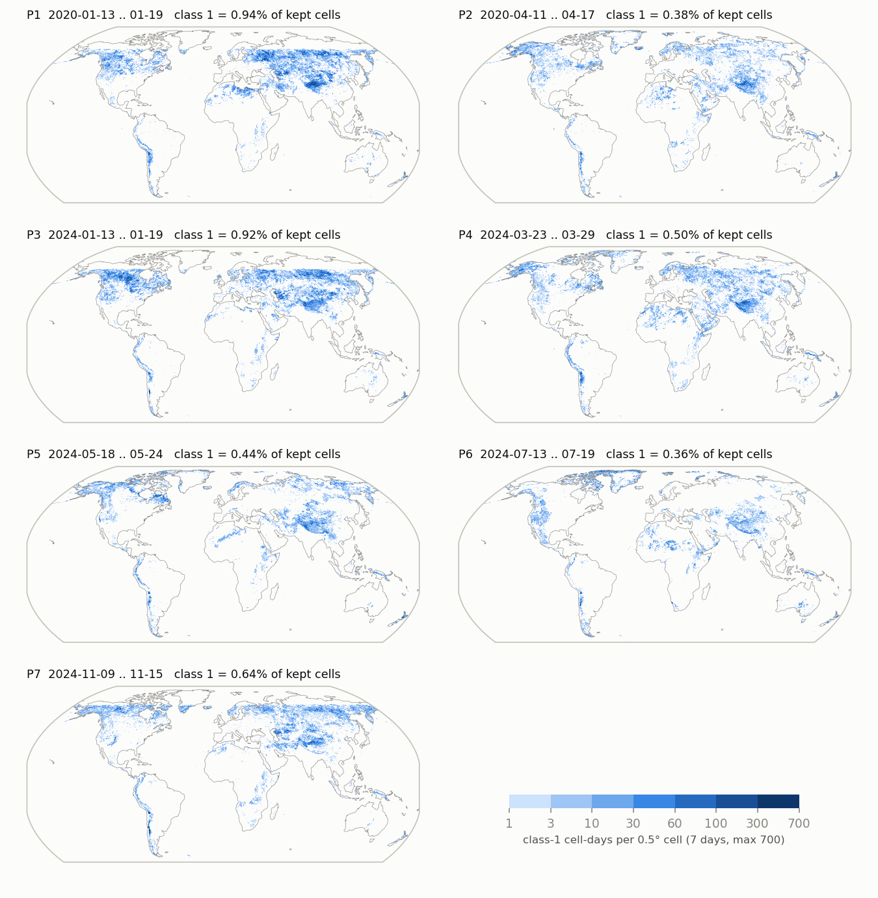
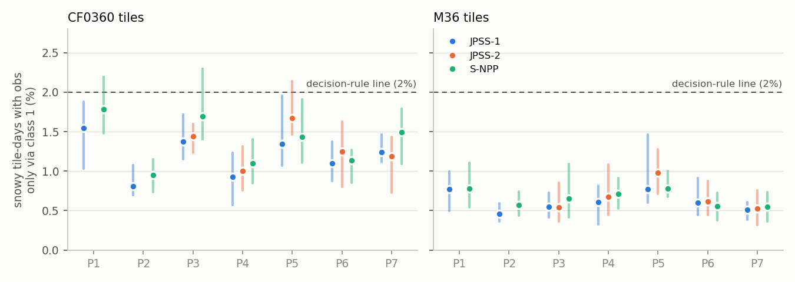
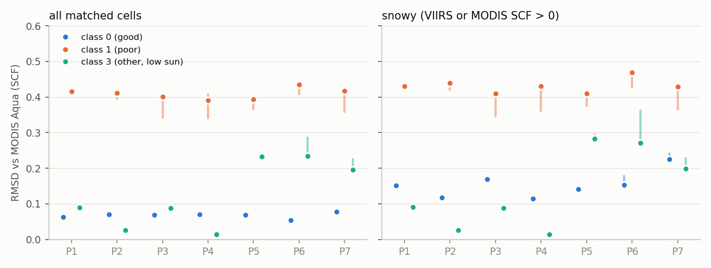
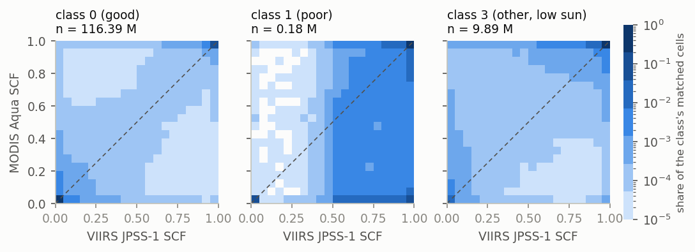
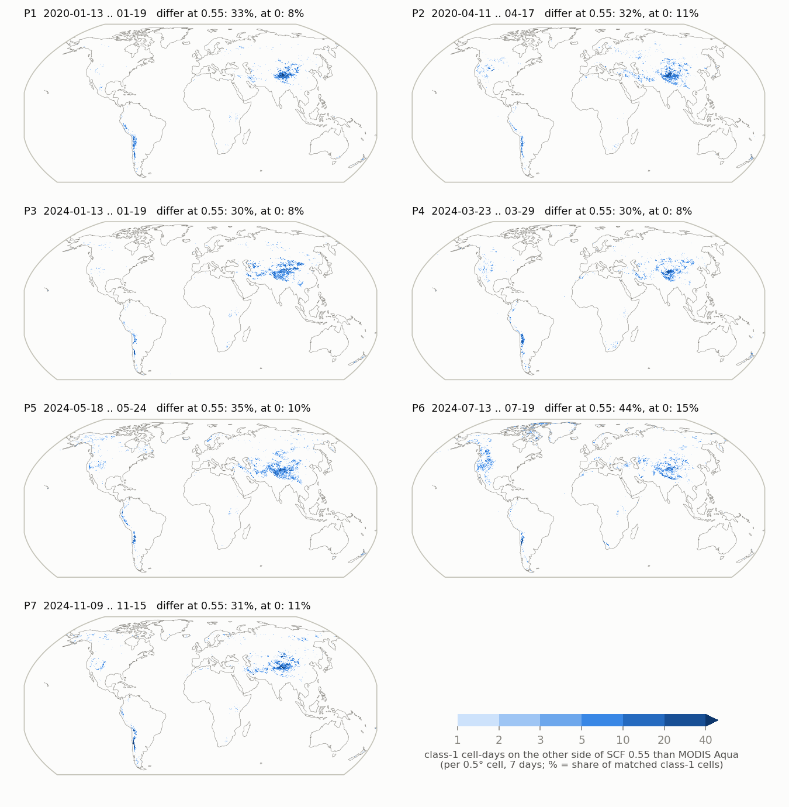

# VIIRS snow cover obs study: report

*Started 2026-11-04. Plan, periods and decision rule: [`viirs_obs_study_plan.md`](viirs_obs_study_plan.md). Code:
[`../scripts/viirs_obs_study/`](../scripts/viirs_obs_study/README.md). Sections are added as the parts are done.*

| Part | Status |
|---|---|
| A1 coverage of VIIRS `Basic_QA` class 1 | **done** (2026-11-04) |
| A2 agreement with MODIS (Aqua, Terra) | **done** (2026-11-05) |
| A3 IMS check | **done** (2026-11-16) |
| A4 effect on the snow update | not started |
| B J1 vs J2 (Q2 a, b; class 1 dropped) | **done** (2026-11-16) |

## Study periods

Seven periods of seven consecutive days (49 days), chosen before any results were looked at (plan, 2026-11-04) to
cover accumulation, mid-winter, melt and the Southern Hemisphere winter, in two years. 2024 has all three VIIRS
satellites, so it serves both questions (QA class 1; J1 vs J2) with the same downloads.

| Period | Dates | Season | VIIRS products | Used in |
|---|---|---|---|---|
| P1 | 2020-01-13 to 01-19 | Northern Hemisphere mid-winter (overlaps the CF0360 reader-test runs) | J1, S-NPP | A1, A2, A3 |
| P2 | 2020-04-11 to 04-17 | spring melt | J1, S-NPP | A1, A2, A3 |
| P3 | 2024-01-13 to 01-19 | mid-winter | J1, J2, S-NPP | A1, A2, A3, B |
| P4 | 2024-03-23 to 03-29 | early melt | J1, J2, S-NPP | A1, A2, A3, B |
| P5 | 2024-05-18 to 05-24 | late melt (high latitudes, mountains) | J1, J2, S-NPP | A1, A2, A3, B |
| P6 | 2024-07-13 to 07-19 | Southern Hemisphere winter (Andes, Australian Alps, New Zealand) | J1, J2, S-NPP (4 days: 13-15 July missing at NSIDC) | A1, A2, A3 (northern cells only), B |
| P7 | 2024-11-09 to 11-15 | early accumulation | J1, J2, S-NPP | A1, A2, A3, B |

- J1 = JPSS-1 / NOAA-20 (VJ110C1), J2 = JPSS-2 / NOAA-21 (VJ210C1, data from 2023-02-10, so none in 2020), S-NPP = VNP10C1.
  MODIS Aqua (MYD10C1) is the main reference, Terra (MOD10C1) the second, IMS (A3) the independent check.
- Part B (J1 vs J2) therefore uses P3 to P7 only.
- Pooled numbers weight the periods by their cells, so the snowy periods (P1, P3, P7 in the north; P6 in the south)
  dominate the snowy statistics. Seven days is a short sample of each season: one period is not a season.
- The periods are defined in `scripts/viirs_obs_study/periods.py`, shared by all scripts.

## Summary so far

- **Class 1 is a small share of the obs.** 0.24–1.1% of the cells the reader keeps, and 0.8–2.8% of the snowy cells
  (SCF > 0), across 7 periods, 2 years and 3 satellites. The share is highest in mid-winter north of 30°N (~2% of
  kept cells) and among the few snowy cells of the tropics and subtropics (6–8%; candidates for false snow, to check
  in A2).
- **Coverage leg of the decision rule: not met in any period.** Dropping class 1 removes the obs from 0.8–1.8% of
  snowy CF0360 tile-days and 0.5–1.0% of snowy M36 tile-days (per period, 7 days pooled). Closest to the 2% line:
  S-NPP P1 (1.78%), S-NPP P3 (1.69%), JPSS-2 P5 (1.67%). On single days it reaches 2.1–2.3% on CF0360 in P1 (S-NPP),
  P3 (S-NPP) and P5 (JPSS-2). So by itself, coverage would not keep class 1; the decision now rests on its error vs MODIS (A2).
- **Error leg of the decision rule: met (A2).** Against MODIS Aqua, the class-1 RMSD is 1.5–29× the class-3 RMSD
  in all 19 period-satellite cases (0.34–0.44 vs 0.01–0.29), and 4.6–8× the class-0 RMSD. Against Terra it is the
  same (1.6–39× class 3). **With both legs (2% per period, confirmed by amfox 2026-11-05), the rule says: drop class 1.** A3 (IMS) agrees (next bullet).
- **IMS agrees with MODIS about class 1 (A3).** Against IMS, VIIRS class-1 cells are 75–80% accurate (classes 0 and 3:
  ~97%): where class 1 reports SCF ≥ 0.55, IMS has no snow in 20–26% of the cells (class 0: 4%, class 3: 2%, MODIS
  Aqua: 4.7%). Where VIIRS class 1 has snow and MODIS Aqua does not, IMS sides with MODIS in 76% of the cells (IMS has
  snow in 24%; for classes 0 and 3 IMS sides with VIIRS in 63–65%). This covers all NH class-1 cells, not just the
  11–25% that MODIS also sees. Northern Hemisphere only; IMS is not fully independent of MODIS and VIIRS.
- **Class 1 errs one way: it sees snow that MODIS does not.** Bias +0.15 to +0.25. Where MODIS Aqua has SCF = 0,
  class-1 VIIRS has mean SCF 0.43. At the snow-removal threshold (0.55), 30% of class-1 cells are on the snowy
  side while MODIS is on the other, against 1% the other way (class 0: 0.4% and 0.6%). Where MODIS sees full
  snow, class 1 agrees as well as class 0. In the update, this would add snow or block its removal.
- **Class 1 is mostly where MODIS sees cloud.** Only 11–25% of class-1 cells have a usable MODIS Aqua cell the same
  day (class 0: 60–81%). The A2 statistics rest on that part. Together with where the disagreements are (Tibetan
  Plateau, Andes, western US mountains in July), this points to cloud or cloud shadow over high terrain taken as
  snow, but MODIS is a reference, not truth: A3 checks the disagreements against IMS.
- **Obs-to-tile mapping for CF0360 (updated 2026-11-16).** The CF0360 coverage numbers above use the cube-sphere
  mapping of GridComp PR #252 (they were first computed with develop's lat/lon pert-grid mapping, which dropped 38%
  of the land CMG cells; the decision-rule outcome did not change: the largest per-period share went from 1.96% to
  1.78%). Details under "Obs-to-tile mapping" below.

- **Part B, J1 vs J2 (class 1 dropped, 2026-11-16):** the two satellites agree closely (RMSD 0.057, bias +0.003,
  r 0.990; at SCF ≥ 0.55 they differ in 0.8% of matched cells), closer to each other than either is to MODIS Aqua
  (0.069–0.071), and neither is clearly better against Aqua (J2 slightly closer in P3–P5, J1 in P6–P7). J2 adds
  5–10% tile-days over J1 (CF0360 8.5%, M36 4.8%; snowy 10.0% and 5.0%), and averaging the two moves a tile to the
  other side of the 0.55 threshold in 1.6–1.8% of the snowy tile-days where both have an obs. The average fits MODIS
  Aqua slightly better than either alone (RMSD 0.065 vs 0.069 and 0.071) and ties against IMS. Details in section B.

## Method notes (A1)

- **Cells:** each VIIRS daily file (130 files: 49 days × 2–3 satellites, minus the 3 missing S-NPP days of P6) goes
  through all reader tests except `Basic_QA` (`scf_qc.viirs_qc_without_qa`, the mirror checked bit-identical against
  the Fortran reader); QA class is kept as a label. "Kept" = classes {0, 1, 3}, as the reader does now. "Snowy" =
  SCF > 0. Latitude bands as in the plan (a cell at latitude φ goes to the band with lower ≤ φ < upper).
- **Tiles:** cells are mapped to tiles as GEOSldas does (`lib/obs2tile.py`, next section). A tile has an obs on a day
  if at least one kept cell of that day's file maps to it; the reader averages all of them into one tile obs. A tile-
  day is "snowy" if that average (with {0, 1, 3}) is > 0. "Only via class 1": the tile has class-1 cells and no class
  0 or 3 cells, so dropping class 1 removes its obs. "Mixed": the tile has both; dropping class 1 changes its obs value
  but not whether it has one (this is for A4).
- The reader picks a daily file per assimilation window from the 13:30 local overpass, so a tile gets its obs from
  one daily file per day. Counting per daily file is therefore the same as counting per tile-day, up to tiles near the
  date line.
- Tile spaces: M36 from `LS_DAv8_M36_as_test3` (112,573 tiles); CF0360 from the `M21C_test_CF0360_jpss_5d4d636_*`
  runs (tilecoord of run A2, copied from Discover; its 1,188,020 land tiles).

## Obs-to-tile mapping

`lib/obs2tile.py` follows `get_tile_num_for_obs` → `get_tile_num_from_latlon` (`LDAS_TileCoordRoutines.F90`) with FOV = 0
(the SCF species in `LDASsa_DEFAULT_inputs_ensupd.nml`):

- **M36:** an obs goes to the tile of the EASEv2 M36 cell that contains it.
- **CF0360:** as GEOSldas_GridComp **PR #252** (`get_tile_num_from_latlon_c3`, head `e36655c`). The cube-sphere cell of
  the obs comes from `MAPL_GetGlobalHorzIJIndex` (reimplemented in `cs_ij`: gnomonic equiangular, π/18 shift).
  Among the tiles of that cell whose bounding box contains the obs, the one with the smallest `(dx/hx)² + (dy/hy)²`
  wins; if there is none, the cells of the 8 points at ±½ cell are searched the same way. Otherwise no tile.
- **Superseded (2026-11-16):** until PR #252, develop searched a lat/lon pert grid (1440 × 1080) for the nearest tile
  center and then dropped the obs outside that tile's bounding box. That lost 38% of land CMG cells (61.9% got a
  tile). The PR maps 100%. **A1 was rerun with the new mapping on 2026-11-16 (outcome unchanged). A2 works per CMG cell, not per tile, so
  the mapping does not touch it; rerun the same day, `stats.csv` is byte-identical.**

The map depends only on the tile space and is cached once per tilecoord file (`data/viirs_obs_study/tilemap/`).
Three details matter for an exact match:

- **Land tiles only.** The CF0360 tilecoord files of the M21C runs list 78,879 lake (typ 19) and 23,791 land-ice
  (typ 20) tiles after the 1,188,020 land tiles. ObsFcstAna tile numbers never exceed the land count, so only land
  tiles receive obs (`obs2tile.land_tiles`).
- **The run's own tilecoord.** The older local `M21C_test_CF0360.ldas_tilecoord.bin` has the same land tiles in the
  same order with the same centers, but different bounding boxes for 90% of them; with it, only 95–97% of the obs
  are reproduced.
- **Cell-center rounding.** The readers compute the CMG cell centers in real*4. Tile box edges often lie exactly on
  CMG cell centers (the BCS raster is 1/120°, the CMG centers are at odd multiples of 1/40°), so the inside/outside
  test depends on the last bit. The Discover build fuses the multiply-add (`c + k*0.05`, one rounding); mirroring
  that gives the exact match, while two roundings give 95.6% and float64 centers 97.9%.

**Check, M36** (`check_tile_map.py`; SCF to 1e-5 and averaged obs lon/lat to 1e-3°, which checks the exact cell set of
each tile; each obs compared with the raw files of the day before, of and after its window):

| Tile space, run, days | Product | ObsFcstAna obs reproduced |
|---|---|---|
| M36, `LS_DAv8_M36_as_test3`, 2020-05-06 | MYD10C1 | 17,827 / 17,827 |
| CF0360, `M21C_test_CF0360_jpss_5d4d636_OL` (monitoring), 2020-01-09..10 | MYD10C1 | 307,578 / 307,579 |
| | MOD10C1 | 392,970 / 392,971 |
| | VJ110C1 | 455,427 / 455,428 |
| | VNP10C1 | 450,102 / 450,103 |

M36 tile centers also all fall in their own EASE cell (112,573 / 112,573). The CF0360 rows above validate the
**old** pert-grid mapping (the old Python reproduced develop exactly).

**Check, CF0360 (PR #252).** The Python map equals the PR's Fortran on all 6,109,513 CMG cell centers near land
(offline harness `GEOSldas_develop/GEOSldas/c3_offline_harness/offline_map.x`, built from the PR's
`LDAS_TileCoordRoutines.F90`; tile space of run A2): 0 differences, none mapped by only one of them. The harness
queries must use the readers' fused-multiply-add centers (`_cmg_lonlat32`); plain real*4 centers differ in 38,504
points. As a control, the old Python equals develop's code in the same harness on all points. Also, all but 23 of
the 1,188,020 tile centers lie in their own `i_indg`/`j_indg` cube-sphere cell (the PR also reports 23).
Not yet checked against ObsFcstAna of a #252 CF0360 run (the Discover runs `M21C_test_CF0360_c3esmf_S_esmf`, set S,
exist only on Discover).

**CF0360, old mapping (superseded).** Before PR #252, GEOSldas assigned only 54.5% of the land CMG cells (41% north
of 60°N) to a CF0360 tile (61.9% on the dominant-tile land mask used for the PR check), and 17.5% of the CF0360 land
tiles could never get an SCF obs. Two mechanisms: north of 60°N the 0.25° pert cells are narrower than the cube-sphere
cells, so many had no tile center; at all latitudes the tile with the nearest center was often not the tile whose box
contains the obs, and with FOV = 0 the obs was dropped. With the PR mapping every land CMG cell gets a tile, and
about 20% of the land tiles still get no obs from a 0.05° cell (many tiles are smaller than a CMG cell). The A1
CF0360 tables below use the PR mapping.

## A1. Coverage of class 1

### Cells

| Period, satellite | kept cells / day (M) | class 3 % of kept | class 1 % of kept | class 1 % of snowy |
|---|---|---|---|---|
| P1 JPSS-1 | 3.17 | 24.1 | 0.94 | 2.25 |
| P1 S-NPP | 3.16 | 24.1 | 1.05 | 2.59 |
| P2 JPSS-1 | 4.00 | 3.0 | 0.38 | 0.84 |
| P2 S-NPP | 3.91 | 2.2 | 0.41 | 0.96 |
| P3 JPSS-1 | 3.20 | 25.5 | 0.92 | 2.19 |
| P3 JPSS-2 | 3.14 | 25.0 | 0.93 | 2.33 |
| P3 S-NPP | 3.18 | 25.2 | 1.09 | 2.67 |
| P4 JPSS-1 | 3.78 | 6.5 | 0.50 | 0.91 |
| P4 JPSS-2 | 3.67 | 4.8 | 0.52 | 1.05 |
| P4 S-NPP | 3.69 | 4.7 | 0.54 | 1.07 |
| P5 JPSS-1 | 3.83 | 0.7 | 0.44 | 1.56 |
| P5 JPSS-2 | 3.82 | 0.6 | 0.55 | 2.19 |
| P5 S-NPP | 3.84 | 0.6 | 0.40 | 1.60 |
| P6 JPSS-1 | 3.87 | 0.4 | 0.36 | 2.53 |
| P6 JPSS-2 | 3.84 | 0.5 | 0.30 | 2.83 |
| P6 S-NPP (4 days) | 3.18 | 2.3 | 0.24 | 2.02 |
| P7 JPSS-1 | 3.18 | 22.2 | 0.64 | 1.97 |
| P7 JPSS-2 | 3.11 | 21.3 | 0.56 | 1.92 |
| P7 S-NPP | 3.16 | 21.5 | 0.72 | 2.44 |

The three satellites agree closely; S-NPP has slightly more class 1 in winter. Class 1 cells are mostly snowy (40–66%
have SCF = 1, 31–47% partial snow, 3–12% snow-free, depending on the period).

JPSS-1 by latitude band (class-1 % of kept cells / of snowy cells; snowy kept cells per day in thousands):

| Band | P1 | P2 | P3 | P4 | P5 | P6 | P7 | snowy cells/day (k), range |
|---|---|---|---|---|---|---|---|---|
| 60–90°N | 2.1 / 2.1 | 0.5 / 0.5 | 2.3 / 2.3 | 0.5 / 0.5 | 0.8 / 1.0 | 0.8 / 2.7 | 2.1 / 2.1 | 250–1069 |
| 45–60°N | 1.9 / 2.0 | 0.4 / 0.6 | 1.9 / 2.0 | 0.7 / 0.8 | 0.5 / 2.1 | 0.1 / 1.0 | 0.8 / 1.0 | 71–735 |
| 30–45°N | 1.6 / 2.6 | 0.7 / 3.4 | 1.2 / 2.5 | 0.8 / 3.0 | 0.6 / 4.3 | 0.3 / 2.8 | 0.7 / 3.0 | 81–304 |
| 0–30°N | 0.1 / 1.0 | 0.2 / 3.4 | 0.1 / 1.8 | 0.2 / 3.4 | 0.2 / 6.3 | 0.3 / 7.7 | 0.1 / 1.4 | 10–18 |
| 0–30°S | 0.2 / 7.5 | 0.2 / 6.2 | 0.2 / 7.9 | 0.3 / 7.9 | 0.1 / 6.1 | 0.1 / 6.1 | 0.2 / 8.6 | 9–14 |
| 30–45°S | 0.2 / 3.9 | 0.2 / 3.5 | 0.3 / 8.1 | 0.2 / 2.6 | 0.3 / 1.6 | 0.3 / 1.1 | 0.6 / 10.7 | 5–20 |
| 45–60°S | 0.4 / 2.2 | 0.7 / 2.4 | 0.7 / 4.0 | 0.5 / 1.6 | 0.5 / 0.7 | 1.2 / 1.3 | 0.9 / 2.5 | 2–15 |

South of 60°S, the few cells that pass the QC (sub-Antarctic islands; Antarctica is excluded by `Clear_Index`) have up
to 36% class 1, but they are not in either tile space.



*Figure A1-2. Where class 1 occurs: class-1 cell-days per 0.5° cell (100 CMG cells, 7 days, so at most 700), JPSS-1.
Class 1 clusters over the Tibetan Plateau and the Andes in all periods, across the northern mid-latitudes and the
boreal forest in winter (P1, P3, P7), and over bright deserts (Sahara, Arabia, Horn of Africa) in spring and summer
(P4–P6).*

### Tiles



*Figure A1-1. Share of snowy tile-days whose obs comes only from class-1 cells, so that dropping class 1 removes the
obs. Dot: 7 days pooled; bar: range of the single days. Dashed: the 2% of the decision rule.*

| Period, satellite | CF0360: snowy, only via class 1 (%) | CF0360: max day (%) | CF0360: all tile-days, only via class 1 (%) | M36: snowy, only via class 1 (%) | M36: max day (%) | M36: snowy, mixed (%) |
|---|---|---|---|---|---|---|
| P1 JPSS-1 | 1.54 | 1.88 | 0.62 | 0.77 | 0.99 | 13.7 |
| P1 S-NPP | 1.78 | 2.19 | 0.67 | 0.78 | 1.11 | 14.9 |
| P2 JPSS-1 | 0.81 | 1.08 | 0.30 | 0.46 | 0.60 | 9.3 |
| P2 S-NPP | 0.95 | 1.15 | 0.32 | 0.57 | 0.74 | 9.9 |
| P3 JPSS-1 | 1.37 | 1.72 | 0.54 | 0.55 | 0.73 | 13.7 |
| P3 JPSS-2 | 1.44 | 1.59 | 0.53 | 0.54 | 0.86 | 14.7 |
| P3 S-NPP | 1.69 | 2.29 | 0.64 | 0.65 | 1.09 | 15.0 |
| P4 JPSS-1 | 0.93 | 1.23 | 0.42 | 0.60 | 0.82 | 9.8 |
| P4 JPSS-2 | 1.00 | 1.31 | 0.39 | 0.67 | 1.08 | 10.2 |
| P4 S-NPP | 1.10 | 1.40 | 0.44 | 0.71 | 0.91 | 10.2 |
| P5 JPSS-1 | 1.34 | 1.95 | 0.33 | 0.77 | 1.46 | 11.0 |
| P5 JPSS-2 | 1.67 | 2.14 | 0.32 | 0.98 | 1.28 | 12.4 |
| P5 S-NPP | 1.43 | 1.91 | 0.28 | 0.78 | 1.00 | 11.6 |
| P6 JPSS-1 | 1.10 | 1.37 | 0.22 | 0.60 | 0.91 | 9.7 |
| P6 JPSS-2 | 1.25 | 1.63 | 0.15 | 0.61 | 0.88 | 9.6 |
| P6 S-NPP (4 days) | 1.13 | 1.27 | 0.17 | 0.55 | 0.73 | 8.7 |
| P7 JPSS-1 | 1.24 | 1.46 | 0.38 | 0.51 | 0.61 | 12.7 |
| P7 JPSS-2 | 1.19 | 1.43 | 0.33 | 0.53 | 0.76 | 12.5 |
| P7 S-NPP | 1.49 | 1.79 | 0.40 | 0.55 | 0.73 | 13.6 |

- CF0360 tiles are small (median 3 CMG cells), so a tile more often depends on its class-1 cells alone: about twice the
  M36 share. M36 tiles hold ~60 cells, so class 1 rarely decides whether a tile has an obs (0.5–1%), but it is part of
  the tile mean in 9–15% of snowy M36 tile-days (CF0360: 2.4–4.4%). That is where A4 (the effect on the update) matters.
- **Against the decision rule** ("…unless dropping it removes obs from more than 2% of snowy tiles"): no period
  exceeds 2% on either tile space when the 7 days are pooled. On single days, CF0360 goes over 2% in P1 (S-NPP),
  P3 (S-NPP) and P5 (JPSS-2). The 2% is per period (amfox, 2026-11-05), so
  the single days over 2% do not count against dropping class 1.

### Reproduce

```bash
cd /Users/amfox/Desktop/geosldas-analysis/projects/snow_da
PY=/Users/amfox/mamba/envs/regrid/bin/python
$PY scripts/viirs_obs_study/check_tile_map.py           # builds + checks the tile maps (~10 s)
$PY scripts/viirs_obs_study/coverage.py --workers 4      # ~1 min, writes data/viirs_obs_study/out/coverage/
$PY scripts/viirs_obs_study/coverage_report.py           # tables (stdout) + figures A1-1, A1-2
```

## A2. Agreement with MODIS

### Method

- **Matching:** for each day of each period, every VIIRS cell that passes all reader tests except `Basic_QA`
  (`scf_qc.viirs_qc_without_qa`) is paired with the MODIS cell of the same CMG cell and day, if that cell passes the
  MODIS reader QC (`scf_qc.modis_scf`). Main reference MODIS Aqua (`MYD10C1`, same 13:30 overpass); second MODIS
  Terra (`MOD10C1`, 10:30). Each VIIRS satellite separately. Class 2 (dropped by the reader) is kept for reference.
- **Statistics** per period, satellite, QA class, latitude band and MODIS SCF class (= 0, 0–1, = 1): N, bias
  (VIIRS − MODIS), RMSD, correlation. "All matched cells" is the sum over the MODIS SCF classes; "snowy" is the
  subset where VIIRS or MODIS SCF > 0.
- **Snow / no-snow agreement** at the thresholds of the rule-based update (`clsm_ensupd_glob_param.F90`): at SCF > 0
  (with no model snow, any obs SCF > 0 adds snow, since snow is added if forecast asnow < `SCF_ANA_ALPHA` (0.60) ×
  obs) and at `SCF_ANA_BETA` = 0.55 (below it, snow is removed).
- The decision rule compares class 1 with class 3. Class 3 is not a fixed population: in winter and early spring
  (P1–P4) it is mostly high-latitude full snow cover that both sensors get right (RMSD 0.01–0.10), which inflates the
  ratio; in P5–P7 it is a different set of low-sun cells with RMSD 0.20–0.29. Class 0 is the steadier yardstick, so the
  class-1/class-0 ratio is also given.
- Cells, not tiles. The tile mean (A4) averages class 1 with class 0/3 cells in 9–15% of snowy M36 tile-days (A1).

### Decision-rule leg: RMSD of class 1 vs class 3

| period, satellite | class 1 matched (k) | matched % of kept, class 0 | class 1 | class 3 | RMSD 0 | RMSD 1 | RMSD 3 | 1 / 3 | 1 / 3 snowy | 1 / 0 | bias 1 |
|---|---|---|---|---|---|---|---|---|---|---|---|
| P1 JPSS-1 | 22.35 | 75.88 | 10.65 | 52.95 | 0.06 | 0.42 | 0.09 | 4.62 | 4.72 | 6.67 | 0.24 |
| P1 S-NPP | 26.46 | 75.64 | 11.41 | 53.10 | 0.06 | 0.41 | 0.10 | 4.33 | 4.41 | 6.51 | 0.22 |
| P2 JPSS-1 | 25.87 | 76.31 | 24.08 | 87.70 | 0.07 | 0.41 | 0.03 | 15.99 | 17.05 | 5.91 | 0.20 |
| P2 S-NPP | 22.44 | 76.93 | 19.78 | 87.78 | 0.07 | 0.40 | 0.02 | 17.76 | 18.86 | 5.70 | 0.20 |
| P3 JPSS-1 | 28.67 | 73.29 | 13.90 | 51.69 | 0.07 | 0.40 | 0.09 | 4.56 | 4.63 | 5.85 | 0.22 |
| P3 JPSS-2 | 29.40 | 73.63 | 14.37 | 53.62 | 0.07 | 0.34 | 0.09 | 3.65 | 3.68 | 5.15 | 0.16 |
| P3 S-NPP | 30.43 | 73.04 | 12.52 | 52.49 | 0.07 | 0.39 | 0.09 | 4.32 | 4.37 | 5.80 | 0.19 |
| P4 JPSS-1 | 22.89 | 59.99 | 17.28 | 64.43 | 0.07 | 0.39 | 0.01 | 28.30 | 31.21 | 5.53 | 0.19 |
| P4 JPSS-2 | 19.90 | 60.04 | 14.97 | 64.31 | 0.07 | 0.34 | 0.01 | 22.74 | 24.15 | 4.89 | 0.15 |
| P4 S-NPP | 18.49 | 60.21 | 13.33 | 64.97 | 0.07 | 0.41 | 0.01 | 29.42 | 31.69 | 5.88 | 0.20 |
| P5 JPSS-1 | 27.23 | 79.12 | 23.19 | 65.50 | 0.07 | 0.39 | 0.23 | 1.69 | 1.45 | 5.71 | 0.20 |
| P5 JPSS-2 | 22.75 | 79.18 | 15.54 | 65.34 | 0.07 | 0.37 | 0.23 | 1.58 | 1.30 | 5.43 | 0.17 |
| P5 S-NPP | 20.95 | 79.28 | 19.37 | 68.07 | 0.07 | 0.38 | 0.24 | 1.59 | 1.32 | 5.46 | 0.17 |
| P6 JPSS-1 | 22.97 | 80.99 | 23.79 | 51.49 | 0.05 | 0.44 | 0.23 | 1.86 | 1.73 | 8.01 | 0.25 |
| P6 JPSS-2 | 17.15 | 81.42 | 21.38 | 55.12 | 0.05 | 0.41 | 0.24 | 1.71 | 1.53 | 7.47 | 0.24 |
| P6 S-NPP | 7.71 | 80.76 | 24.71 | 69.39 | 0.06 | 0.43 | 0.29 | 1.50 | 1.24 | 7.01 | 0.24 |
| P7 JPSS-1 | 29.82 | 78.68 | 21.07 | 42.25 | 0.08 | 0.42 | 0.20 | 2.12 | 2.15 | 5.37 | 0.22 |
| P7 JPSS-2 | 26.81 | 79.29 | 21.87 | 44.69 | 0.08 | 0.36 | 0.23 | 1.59 | 1.60 | 4.57 | 0.16 |
| P7 S-NPP | 31.07 | 78.71 | 19.58 | 43.81 | 0.08 | 0.39 | 0.21 | 1.83 | 1.83 | 4.88 | 0.19 |

*"Matched % of kept": share of the kept cells of each class (A1, `cells.csv`) that have a usable MODIS Aqua cell the
same day. "1 / 3", "1 / 0": ratio of the class RMSDs. "1 / 3 snowy": the same on the snowy subset.*

- **Class-1 RMSD > 1.5 × class-3 RMSD in 19 of 19 period-satellite cases** (all matched cells; 1.50–29.4). On the
  snowy subset, 15 of 19 (P5 all satellites, 1.30–1.45, and P6 S-NPP, 1.24, fall below). Either way "most periods".
  Lowest case, P6 S-NPP at 1.50: S-NPP has only 4 days in P6, and its class 3 there behaves unlike J1/J2 (bias +0.10
  vs −0.09); not investigated.
- Against class 0, class 1 is 4.6–8.0 × worse in every case (snowy: 1.6–3.9 ×).
- The class-1 RMSD is the same in every period (0.34–0.44) and for all three satellites; JPSS-2 is slightly lower
  (0.34–0.41).



*Figure A2-1. RMSD of VIIRS SCF vs MODIS Aqua per period and QA class. Dot: JPSS-1; bar: range over the satellites
of the period (JPSS-1, S-NPP, and JPSS-2 from P3). Left: all matched cells; right: cells where either SCF > 0.*

**Against MODIS Terra** the picture is the same, with larger differences for all classes (Terra passes 3 h earlier):

| period, satellite | RMSD 0 | RMSD 1 | RMSD 3 | 1 / 3 | bias 1 |
|---|---|---|---|---|---|
| P1 JPSS-1 | 0.07 | 0.50 | 0.09 | 5.64 | 0.29 |
| P1 S-NPP | 0.06 | 0.48 | 0.09 | 5.24 | 0.27 |
| P2 JPSS-1 | 0.07 | 0.48 | 0.03 | 19.30 | 0.26 |
| P2 S-NPP | 0.07 | 0.52 | 0.03 | 19.92 | 0.31 |
| P3 JPSS-1 | 0.08 | 0.48 | 0.10 | 5.02 | 0.27 |
| P3 JPSS-2 | 0.08 | 0.42 | 0.10 | 4.11 | 0.21 |
| P3 S-NPP | 0.08 | 0.47 | 0.10 | 4.82 | 0.25 |
| P4 JPSS-1 | 0.07 | 0.48 | 0.01 | 36.19 | 0.26 |
| P4 JPSS-2 | 0.07 | 0.45 | 0.01 | 30.38 | 0.22 |
| P4 S-NPP | 0.07 | 0.51 | 0.01 | 38.76 | 0.28 |
| P5 JPSS-1 | 0.07 | 0.46 | 0.28 | 1.64 | 0.25 |
| P5 JPSS-2 | 0.07 | 0.45 | 0.26 | 1.70 | 0.23 |
| P5 S-NPP | 0.07 | 0.47 | 0.28 | 1.66 | 0.25 |
| P6 JPSS-1 | 0.05 | 0.53 | 0.30 | 1.74 | 0.37 |
| P6 JPSS-2 | 0.05 | 0.47 | 0.30 | 1.59 | 0.29 |
| P6 S-NPP | 0.05 | 0.53 | 0.29 | 1.83 | 0.35 |
| P7 JPSS-1 | 0.07 | 0.51 | 0.17 | 3.07 | 0.30 |
| P7 JPSS-2 | 0.07 | 0.47 | 0.19 | 2.41 | 0.24 |
| P7 S-NPP | 0.07 | 0.52 | 0.18 | 2.88 | 0.30 |

### Where class 1 goes wrong

| MODIS SCF class, VIIRS QA | n (k) | mean VIIRS | mean MODIS | bias | RMSD |
|---|---|---|---|---|---|
| MODIS 0, class 0 (good) | 92951.078 | 0.002 | 0.000 | 0.002 | 0.029 |
| MODIS 0, class 1 (poor) | 35.268 | 0.432 | 0.000 | 0.432 | 0.613 |
| MODIS 0, class 3 (other, low sun) | 273.792 | 0.028 | 0.000 | 0.028 | 0.128 |
| MODIS 0–1, class 0 (good) | 7552.843 | 0.247 | 0.291 | -0.044 | 0.221 |
| MODIS 0–1, class 1 (poor) | 93.879 | 0.808 | 0.536 | 0.273 | 0.418 |
| MODIS 0–1, class 3 (other, low sun) | 1191.090 | 0.568 | 0.644 | -0.076 | 0.279 |
| MODIS 1, class 0 (good) | 15890.720 | 0.990 | 1.000 | -0.010 | 0.070 |
| MODIS 1, class 1 (poor) | 50.647 | 0.963 | 1.000 | -0.037 | 0.096 |
| MODIS 1, class 3 (other, low sun) | 8425.875 | 0.988 | 1.000 | -0.012 | 0.068 |
| either > 0, class 0 (good) | 26307.192 | 0.678 | 0.688 | -0.010 | 0.141 |
| either > 0, class 1 (poor) | 162.821 | 0.859 | 0.620 | 0.240 | 0.430 |
| either > 0, class 3 (other, low sun) | 9673.257 | 0.931 | 0.950 | -0.019 | 0.119 |

*JPSS-1, all periods pooled, by MODIS Aqua SCF class. n in thousands.*

- When MODIS sees no snow, class-1 VIIRS has mean SCF 0.43; class 0 has 0.002, class 3 0.03.
- In partial snow, class 1 is +0.27 above MODIS; class 0 and 3 are slightly below (−0.04, −0.08).
- When MODIS sees full snow, class 1 is as good as class 0 (RMSD 0.10 vs 0.07).



*Figure A2-2. VIIRS JPSS-1 vs MODIS Aqua SCF, share of the class's matched cells per 0.05 × 0.05 bin (log scale),
all periods pooled. Class 0 and 3 lie along the diagonal and the two axes' corners; class 1 spreads across the lower
right: VIIRS snow where MODIS has little or none.*

**Snow / no snow, as the update sees it** (JPSS-1 vs Aqua, all matched cells):

| period | agree SCF>0 / =0 (%), class 0 | agree SCF>0 / =0 (%), class 1 | agree SCF>0 / =0 (%), class 3 | VIIRS snow, MODIS none (%), class 0 | VIIRS snow, MODIS none (%), class 1 | VIIRS snow, MODIS none (%), class 3 | agree at 0.55 (%), class 0 | agree at 0.55 (%), class 1 | agree at 0.55 (%), class 3 |
|---|---|---|---|---|---|---|---|---|---|
| P1 | 97.1 | 91.9 | 98.3 | 1.9 | 8.1 | 0.6 | 99.0 | 67.3 | 98.3 |
| P2 | 96.5 | 88.7 | 99.9 | 2.2 | 11.3 | 0.1 | 99.0 | 68.3 | 99.9 |
| P3 | 96.7 | 91.8 | 99.4 | 2.0 | 8.2 | 0.3 | 98.9 | 70.0 | 98.4 |
| P4 | 96.7 | 91.8 | 100.0 | 2.0 | 8.2 | 0.0 | 98.9 | 69.8 | 100.0 |
| P5 | 94.9 | 90.0 | 86.8 | 3.3 | 10.0 | 7.1 | 99.1 | 64.9 | 86.1 |
| P6 | 94.9 | 85.1 | 91.5 | 3.0 | 14.7 | 3.6 | 99.5 | 55.7 | 87.8 |
| P7 | 95.5 | 89.1 | 97.2 | 2.0 | 10.9 | 0.9 | 98.9 | 68.9 | 91.4 |

- Pooled over all periods and satellites, at 0.55: **29.5% of class-1 cells have VIIRS ≥ 0.55 and MODIS < 0.55;
  1.1% the reverse.** Class 0: 0.4% and 0.6%. Class 3: 0.7% and 3.0%. So class 1 would mostly prevent snow removal
  (or add snow) where MODIS would remove it.
- At SCF > 0: 9.0% of class-1 cells have VIIRS snow and MODIS none; 0.0% the reverse.

**By latitude band** (JPSS-1 vs Aqua, all periods):

| band | n (k), class 0 | n (k), class 1 | n (k), class 3 | RMSD, class 0 | RMSD, class 1 | RMSD, class 3 | bias, class 0 | bias, class 1 | bias, class 3 |
|---|---|---|---|---|---|---|---|---|---|
| N00-30 | 34407.29 | 17.99 | 0.00 | 0.02 | 0.26 |  | -0.00 | 0.10 |  |
| N30-45 | 22757.92 | 74.37 | 0.17 | 0.09 | 0.54 | 0.09 | -0.00 | 0.37 | 0.01 |
| N45-60 | 15339.11 | 21.27 | 4873.20 | 0.11 | 0.32 | 0.14 | -0.01 | 0.12 | -0.03 |
| N60-90 | 16945.94 | 33.90 | 4839.48 | 0.07 | 0.24 | 0.08 | -0.00 | 0.06 | -0.01 |
| S00-30 | 21456.64 | 22.34 | 0.00 | 0.02 | 0.34 |  | -0.00 | 0.17 |  |
| S30-45 | 5186.64 | 9.29 | 54.97 | 0.05 | 0.29 | 0.20 | -0.00 | 0.11 | -0.07 |
| S45-60 | 300.86 | 0.62 | 122.69 | 0.13 | 0.40 | 0.25 | -0.02 | 0.21 | -0.10 |
| S60-90 | 0.26 | 0.03 | 0.25 | 0.09 | 0.15 | 0.17 | -0.02 | 0.05 | 0.05 |

Class 1 is worst at 30–45°N (RMSD 0.54, bias +0.37: Tibetan Plateau, Himalaya, Tian Shan) and best north of 60°N
(0.24), but worse than class 0 and 3 in every band.



*Figure A2-3. Class-1 cell-days (JPSS-1) on the other side of SCF 0.55 from MODIS Aqua, per 0.5° cell. Title: share
of the matched class-1 cells that differ at 0.55 and at 0. The disagreements cluster over the Tibetan Plateau and the
Andes in every period, the western US mountains and southern African highlands in P5–P6, and the Canadian Rockies in
P7. These are the cells for the IMS check (A3).*

### Other findings

- **Class 1 is mostly unmatched.** 11–25% of class-1 cells have a usable MODIS Aqua cell the same day, against
  60–81% for class 0 and 42–88% for class 3. MODIS drops a cell when it is cloudy (`Day_CMG_Clear_Index` ≤ 20) or
  has poor `Snow_Spatial_QA`. So VIIRS calls these cells clear where MODIS mostly does not. The statistics above
  describe the matched 11–25%; the unmatched rest cannot be checked against MODIS (A3 can check them against IMS).
- **Class 2, which the reader already drops, is biased the other way** (−0.03 to −0.36, RMSD 0.16–0.51): it misses
  snow. This supports dropping it.
- **Class 3 outside winter** (P5, P6: 0.4–0.7% of kept cells) has RMSD 0.23–0.29, bias about −0.09 (VIIRS low; S-NPP P6 +0.10). In P7,
  where it is 21% of the kept cells, its snowy RMSD (0.20) is no worse than class 0's (0.23). Not a reason to revisit
  class 3.

### Reproduce

```bash
cd /Users/amfox/Desktop/geosldas-analysis/projects/snow_da
PY=/Users/amfox/mamba/envs/regrid/bin/python
$PY scripts/viirs_obs_study/agreement.py --workers 4      # ~1.5 min, writes data/viirs_obs_study/out/agreement/
$PY scripts/viirs_obs_study/agreement_report.py           # tables (stdout) + figures A2-1..3 (needs coverage.py output)
```

## A3. IMS check

### Method

IMS (NOAA/NIC Interactive Multisensor Snow and Ice, 4 km, Northern Hemisphere, categories sea / land / sea ice /
snow) is used as a snow / no-snow reference for the cells of A1 and A2. It is an analyst product that draws on many
sources, among them MODIS and VIIRS imagery, so it is not fully independent of the obs tested here; its errors are
those of an analysis (snow line, shallow and patchy snow, mountains).

- **Data:** `ims<YYYY><DDD>_00UTC_4km_v1.3.asc.gz` for the 49 study days (`get_ims.py`, public NSIDC G02156, 247 MB
  with the 4 km lat/lon grids). Paired by file name with the obs day, as in `projects/IMS`. The header of a file says
  "Julian day of IMS data log" is the day before, so a one-day offset is possible; the results with the file of
  day + 1 (6 of 7 days per period) are the same to within 1 point (below).
- **IMS to CMG:** the IMS pixel nearest to each 0.05° cell center (polar stereographic, true at 60°N, central
  meridian −80°; pixel centers reproduce the IMS lat/lon file to 4 m). Only land and snow pixels are used. Two IMS
  states: *nearest* (nearest pixel is snow) and *decisive* (the 3×3 window around it is all snow or all no snow;
  this drops the snow-line edge, where a 4 km and a 5 km pixel cannot be expected to agree). Both give the same
  picture; *nearest* is quoted, *decisive* is in the tables of `ims_report.py`.
- **Cells:** north of the equator only (IMS covers the Northern Hemisphere). P6 (Southern Hemisphere winter) therefore
  has no reference for the Andes, Australia and New Zealand; its northern cells are mostly snow-free.
- **Snow definitions** as in A2: SCF ≥ 0.55 (below it the update removes snow) and SCF > 0 (adds snow). The 0.55
  results are quoted; the SCF > 0 results are the same in sign.
- **Two checks:** (1) every kept cell of each product against IMS (no MODIS needed), per QA class; (2) the cells where
  VIIRS and MODIS Aqua are both kept, split into both snow / VIIRS only / MODIS only / neither, with the share of
  these cells where IMS has snow.

### Result 1: VIIRS classes against IMS

SCF ≥ 0.55, nearest pixel, all periods, all kept NH cells (`false snow`: obs has snow, IMS has none; `missed
snow`: IMS has snow, obs has none):

| Product, class | Cells (M) | Accuracy % | False snow % of obs snow | Missed snow % of IMS snow |
|---|---|---|---|---|
| JPSS-1 class 0 | 117.2 | 96.8 | 4.2 | 8.6 |
| **JPSS-1 class 1** | 0.90 | **75.4** | **26.2** | 0.8 |
| JPSS-1 class 3 | 18.0 | 96.5 | 2.2 | 1.5 |
| JPSS-2 class 0 | 83.5 | 97.1 | 3.8 | 9.7 |
| **JPSS-2 class 1** | 0.62 | **80.5** | **20.1** | 0.4 |
| JPSS-2 class 3 | 11.0 | 95.8 | 2.3 | 2.2 |
| S-NPP class 0 | 106.1 | 96.5 | 4.0 | 9.0 |
| **S-NPP class 1** | 0.94 | **78.7** | **22.2** | 0.4 |
| S-NPP class 3 | 17.2 | 96.1 | 2.2 | 2.0 |
| MODIS Aqua (benchmark) | 107.6 | 96.7 | 4.7 | 7.6 |
| MODIS Terra (benchmark) | 115.2 | 96.9 | 3.9 | 6.7 |

- Class 1 has five to twelve times the false-snow rate of classes 0 and 3 and of MODIS, and almost never misses snow
  (0.4–0.8%): the same one-sided bias as in A2. Classes 0 and 3 and MODIS miss 1.5–10% of IMS snow instead.
- **By latitude (all VIIRS products, 0.55):** north of 45°N class 1 is 91–93% accurate with 6.5–9% false snow (class 3:
  1.7–2.7%, class 0: 1.0–5.3%), so it is better there but still worse than the other classes. The damage is at
  30–45°N (accuracy 39%, false snow 65%; the band with the Tibetan Plateau, Himalaya and Rockies; not broken down by month or region here) and in the
  subtropics (0–30°N: 75%, false snow 81%, 147k cells).
- **By period:** class-1 false snow is 16–29% in P1–P5 and P7 and 57% in P6 (July, northern mountains); class 0 is
  2–8% (P7: 25%) and class 3 0–6%, except P6 (70%, but only 0.2M cells, mostly snow-free).

### Result 2: who is right where VIIRS and MODIS disagree

Cells where VIIRS and MODIS Aqua are both kept, SCF ≥ 0.55, all VIIRS products and periods; share of the cells where
IMS has snow:

| QA class | VIIRS snow only: cells | IMS has snow | MODIS snow only: cells | IMS has snow | Both snow: IMS has snow | Neither: IMS has snow |
|---|---|---|---|---|---|---|
| 0 | 1,030,857 | 62.6% | 1,519,301 | 45.8% | 97.8% | 2.3% |
| **1** | **113,356** | **23.7%** | 3,284 | 35.7% | 79.6% | 3.8% |
| 3 | 164,476 | 64.6% | 624,524 | 46.2% | 98.0% | 13.6% |

- In the cells where class 1 has snow and MODIS does not, IMS has snow in 24%: IMS sides with MODIS in 76%. For
  classes 0 and 3 the split is about 2:1 for VIIRS. The decisive-window version is 18% for class 1.
- Class 1 has 34 times as many VIIRS-only as MODIS-only cells (113k vs 3.3k; class 0: 0.7, class 3: 0.3). Where both
  have snow, IMS confirms it in 80% of class-1 cells (98% for classes 0 and 3).
- By period, the share of class-1 VIIRS-only cells where IMS has snow is 12–43% (P1 43%, P6 12%, P7 17%).
- The disagreement cells are 11–25% of all class-1 cells; Result 1 covers all of them.

### Checks and caveats

- **IMS day offset:** with the IMS file of day + 1 (6 of 7 days per period), class-1 false snow is 26.3% (JPSS-1; 26.2%
  with day 0) and the VIIRS-only cells with IMS snow 23.1% (23.7%).
- **SCF > 0:** class-1 false snow is 21–27% (class 3: 4.5–5.1%, class 0: 17–22%, where tiny SCF values count as snow); where VIIRS class 1 has any snow and MODIS has none, IMS has snow in 8% (class 0: 19%).
- IMS is a coarser, analyst-based reference. It does not prove that class 1 is wrong in each cell, but the two
  independent-ish references (MODIS in A2, IMS here) agree on the direction and size of the error.
- Not checked: Southern Hemisphere, and class 1 where neither IMS nor MODIS has a usable cell.

### Reproduce

```bash
cd /Users/amfox/Desktop/geosldas-analysis/projects/snow_da
PY=/Users/amfox/mamba/envs/regrid/bin/python
$PY scripts/viirs_obs_study/get_ims.py                    # 49 IMS 4 km files + lat/lon, 247 MB, data/viirs_obs_study/ims/
$PY scripts/viirs_obs_study/ims_check.py --workers 4      # ~1.5 min, writes data/viirs_obs_study/out/ims/
$PY scripts/viirs_obs_study/ims_check.py --shift 1        # sensitivity: IMS file of day + 1 (out/ims_shift1/)
$PY scripts/viirs_obs_study/ims_report.py                 # tables (stdout); --dir ims_shift1 for the sensitivity run
```

## B. JPSS-1 vs JPSS-2

QA class 1 is dropped here (amfox, 2026-11-16): VIIRS cells are kept with `Basic_QA` in {0, 3}, and every other
reader test as before (`scf_qc.viirs_qc_without_qa`). Periods P3–P7 (J2 data start 2023-02-10); J1 = VJ110C1
(NOAA-20), J2 = VJ210C1 (NOAA-21); MODIS Aqua as the reference. Tile spaces M36 and CF0360 with the PR #252 mapping.
Tile obs of J1+J2 is what the update gets: the average of the two species' tile means.

### B1. Agreement

P3–P7 pooled; "snowy" = either value > 0. The Aqua comparison uses the cells where J1, J2 and Aqua are all kept, so
J1 and J2 are scored on the same cells.

| Comparison | Cells (M) | Bias | RMSD | r | Snowy cells (M) | Snowy bias | Snowy RMSD | Snowy r |
|---|---|---|---|---|---|---|---|---|
| J1 vs J2 | 107.8 | +0.003 | 0.057 | 0.990 | 31.8 | +0.011 | 0.105 | 0.963 |
| J1 vs Aqua | 83.4 | −0.004 | 0.069 | 0.983 | 20.9 | −0.015 | 0.138 | 0.945 |
| J2 vs Aqua | 83.4 | −0.007 | 0.071 | 0.982 | 20.1 | −0.027 | 0.145 | 0.938 |

- J1 and J2 agree better with each other than with MODIS, and J1 is slightly higher than J2 (+0.003; +0.011 on snowy cells).
- **Snow / no snow:** at SCF ≥ 0.55 they differ in 0.81% of the matched cells (J1 only 562k, J2 only 315k), 3.5% of the
  snow cells; at SCF > 0, 3.3% and 11.2% (small SCF values).
- **Against Aqua neither wins.** Pooled, J1 is closer by 0.002 RMSD (snowy 0.138 vs 0.145), but by period J2 is
  closer in P3–P5 (by 0.0003–0.0011) and J1 in P6 (0.0012) and P7 (0.009: J2 is lower than J1 by 0.005 more). By band the
  RMSD of J1 vs J2 is largest at 45–60°N among the bands with many cells (0.091, snowy 0.119).
- The differences between J1 and J2 are small against the error of either against MODIS.

### B2. Added coverage

Tile-days (a tile has an obs on a day if at least one kept cell maps to it; P3–P7 pooled):

| Grid | J1 only | J2 only | Both | J2 adds, % of J1 tile-days | Snowy: J2 adds, % of J1 |
|---|---|---|---|---|---|
| CF0360 | 2.23M | 1.92M | 20.38M | 8.5 | 10.0 |
| M36 | 0.19M | 0.15M | 2.88M | 4.8 | 5.0 |

- J1 alone is slightly better than J2 alone: J1 adds 10.0% (CF0360) and 6.3% (M36) over J2.
- J2 adds 3.5–16% by band and period on CF0360 (largest at 45–60°N in P7, 16%; up to 23% at 45–60°S, few tiles) and 2.0–10% on M36 (up to 12% at 45–60°S).
- **Over a 7-day period, in tiles that are snowy on at least one day:** the mean number of days with an obs rises from
  4.66 to 5.15 on CF0360 and from 5.58 to 5.90 on M36; tiles with an obs on all 7 days from 14.8% to 22.8% (CF0360)
  and from 33.1% to 42.9% (M36). On CF0360 no snowy tile is left without an obs for the whole week with J1 or J2
  (0.6% with J1 alone).
- CF0360 gains more than M36 because its tiles are small and a swath gap or a cloud hits a whole tile.

### B3. Effect on the update side

Tile-days where J1 and J2 both have an obs: how often the J1+J2 average is on the other side of a threshold than
J1 alone (snowy tile-days = either > 0; SCF ≥ 0.55 is the removal threshold, SCF > 0 adds snow):

| Grid | Snowy tile-days (M) | J1+J2 vs J1 changes side at 0.55 | at > 0 | J1 vs J2 differ at 0.55 | at > 0 | Mean abs(J1+J2 − J1) |
|---|---|---|---|---|---|---|
| CF0360 | 5.46 | 1.75% | 4.26% | 3.35% | 19.5% | 0.023 |
| M36 | 1.11 | 1.59% | 3.51% | 3.02% | 17.4% | 0.020 |

- At the removal threshold the second satellite changes the side in about 1.6–1.8% of the snowy tile-days where both
  have an obs (by period 0.9–2.5%). At SCF > 0 it is 3.5–4.3% (by period 1.4–12%; P6 has little snow and the
  differences are small SCF values).
- This is the obs side only: the update also depends on the forecast `asnow` (add if `asnow < 0.60 × obs`).
- Together with B2: the second satellite adds 5–10% tile-days and moves a small share of the obs across a threshold.
  Part C would be testing a small effect; the largest relative gain in coverage is at 45–60°N in P7 (16% on CF0360).

### B4. Does the average fit MODIS and IMS better?

GEOSldas gives the update the average of the species' tile obs (B3), so I also scored the average itself. On the
cells where J1 and J2 are both kept (and Aqua too for the Aqua comparison, so J1, J2 and the average are scored on the
same cells), the cell-level average 0.5 × (J1 + J2) against J1 and J2 alone, P3–P7 (`jpss_average_check.py`):

| Obs | RMSD vs Aqua | Snowy RMSD vs Aqua | Bias vs Aqua | IMS accuracy % | IMS false snow % | IMS missed snow % |
|---|---|---|---|---|---|---|
| J1 | 0.0689 | 0.1378 | −0.004 | 97.22 | 2.94 | 6.58 |
| J2 | 0.0709 | 0.1445 | −0.007 | 97.18 | 2.54 | 7.11 |
| **Average** | **0.0651** | **0.1287** | −0.005 | **97.30** | 2.55 | 6.70 |

(83.4 M cells for Aqua; 83.1 M Northern Hemisphere cells for IMS; SCF ≥ 0.55, nearest IMS pixel; the decisive-window
IMS version gives the same ordering.)

- **MODIS:** the average has 5–8% lower RMSD than J1 or J2 alone (6% against J1; snowy cells 0.129 vs 0.138 and
  0.145), as expected from averaging two noisy estimates of the same scene. The bias lies between the two.
- **IMS:** a tie. The average is marginally best on accuracy (about 0.1 point), with the false-snow rate of J2 and a
  missed-snow rate close to J1's.
- GEOSldas averages per tile (the species' tile means), the same idea one step later; this tests the obs, not the
  update.

### Caveats

- A tile "has an obs on a day" if the day's file has a kept cell in it, as in A1 (exact except at the date line).
- B3 averages the species' tile means as GEOSldas does; it does not test the update itself.
- Aqua is a reference, not truth; B1 compares J1 and J2 with it on the same cells.
- Southern Hemisphere is included (no IMS needed); P6 (Southern Hemisphere winter) is in all numbers.

### Reproduce

```bash
cd /Users/amfox/Desktop/geosldas-analysis/projects/snow_da
PY=/Users/amfox/mamba/envs/regrid/bin/python
$PY scripts/viirs_obs_study/jpss_compare.py        # ~1 min, writes data/viirs_obs_study/out/jpss/ (one worker per period)
$PY scripts/viirs_obs_study/jpss_report.py         # tables (stdout)
$PY scripts/viirs_obs_study/jpss_average_check.py  # B4: average of J1 and J2 vs Aqua and IMS (~2 min; needs the IMS files of get_ims.py)
```
