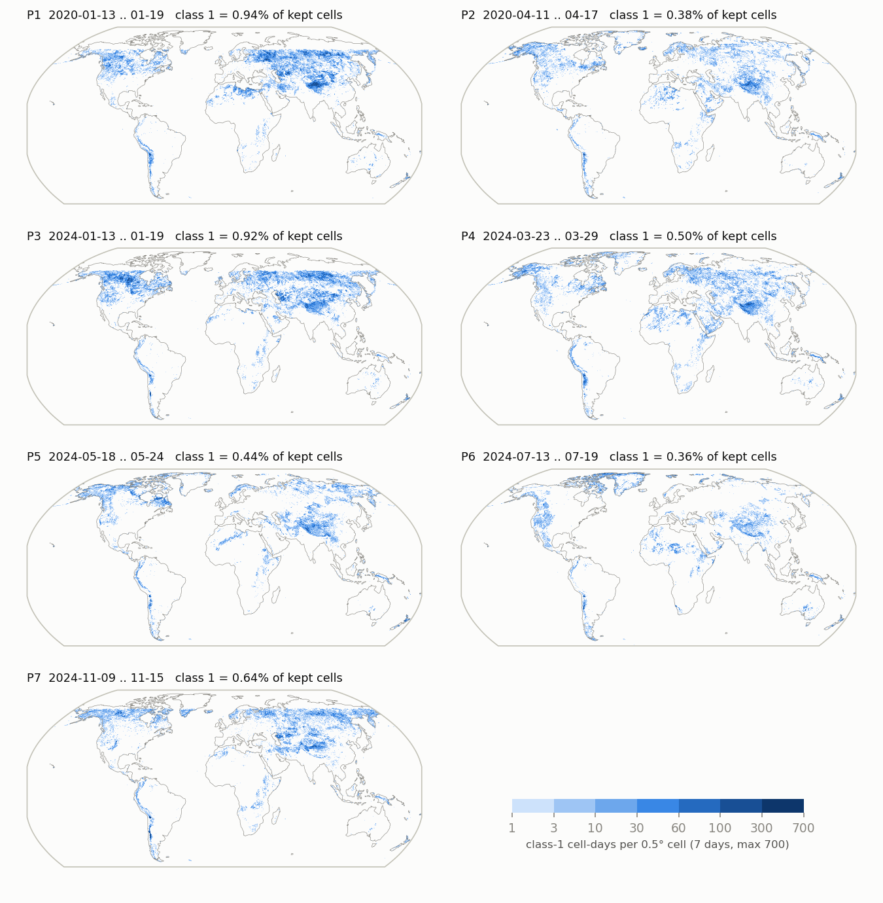
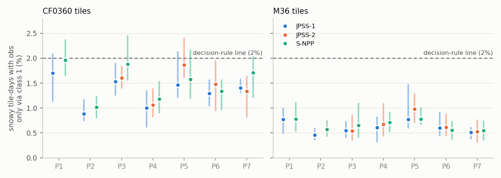
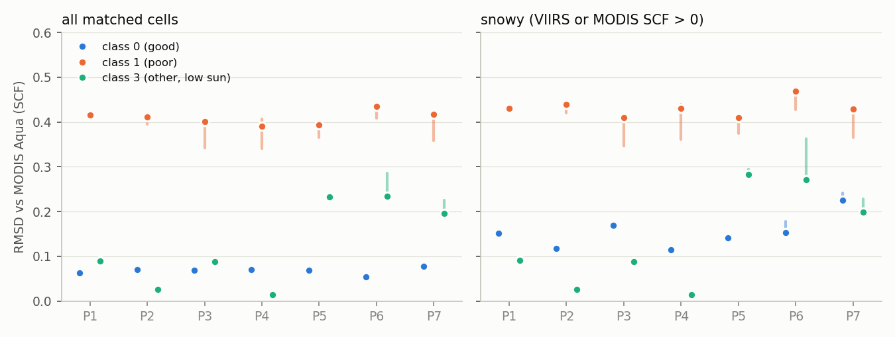
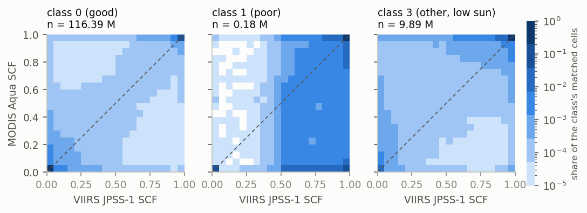
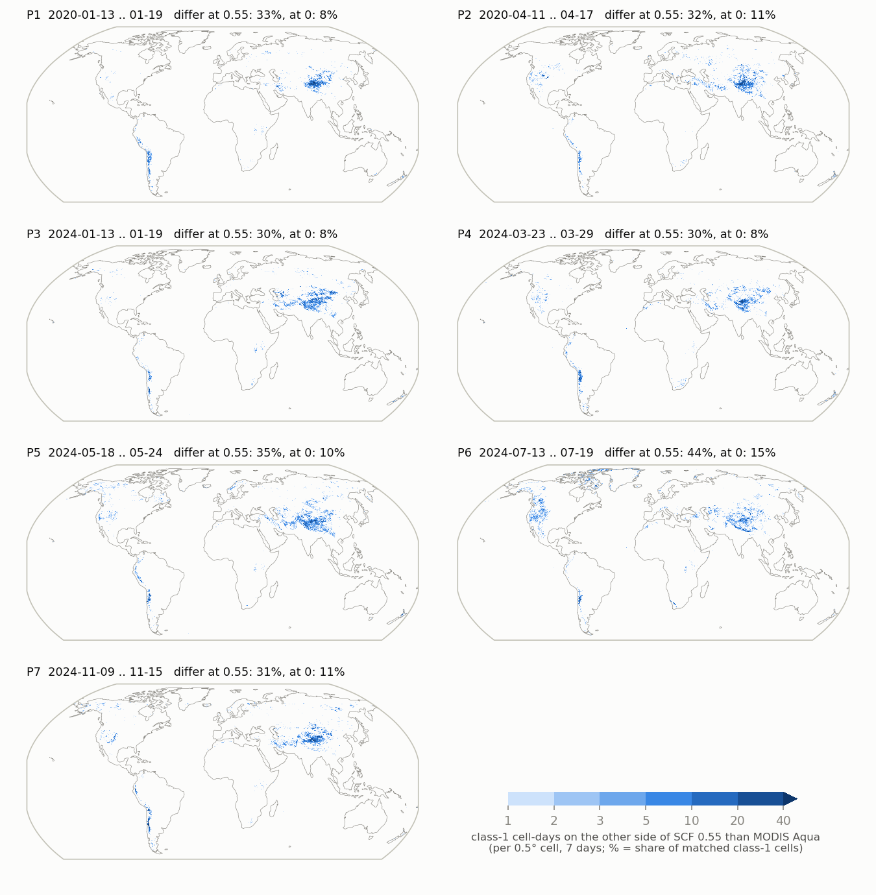

# VIIRS snow cover obs study: report

*Started 2026-11-04. Plan, periods and decision rule: [`viirs_obs_study_plan.md`](viirs_obs_study_plan.md). Code:
[`../scripts/viirs_obs_study/`](../scripts/viirs_obs_study/README.md). Sections are added as the parts are done.*

| Part | Status |
|---|---|
| A1 coverage of VIIRS `Basic_QA` class 1 | **done** (2026-11-04) |
| A2 agreement with MODIS (Aqua, Terra) | **done** (2026-11-05) |
| A3 IMS check | not started |
| A4 effect on the snow update | not started |
| B J1 vs J2 | not started |

## Summary so far

- **Class 1 is a small share of the obs.** 0.24–1.1% of the cells the reader keeps, and 0.8–2.8% of the snowy cells
  (SCF > 0), across 7 periods, 2 years and 3 satellites. The share is highest in mid-winter north of 30°N (~2% of
  kept cells) and among the few snowy cells of the tropics and subtropics (6–8%; candidates for false snow, to check
  in A2).
- **Coverage leg of the decision rule: not met in any period.** Dropping class 1 removes the obs from 0.9–2.0% of
  snowy CF0360 tile-days and 0.5–1.0% of snowy M36 tile-days (per period, 7 days pooled). Closest to the 2% line:
  S-NPP P1 (1.96%), S-NPP P3 (1.88%), JPSS-2 P5 (1.86%). On single days it reaches 2.0–2.4% on CF0360 in P1, P3,
  P5 and P7. So by itself, coverage would not keep class 1; the decision now rests on its error vs MODIS (A2).
- **Error leg of the decision rule: met (A2).** Against MODIS Aqua, the class-1 RMSD is 1.5–29× the class-3 RMSD
  in all 19 period-satellite cases (0.34–0.44 vs 0.01–0.29), and 4.6–8× the class-0 RMSD. Against Terra it is the
  same (1.6–39× class 3). **With both legs (2% per period, confirmed by amfox 2026-11-05), the rule says: drop class 1.** A3 (IMS) is still
  to come.
- **Class 1 errs one way: it sees snow that MODIS does not.** Bias +0.15 to +0.25. Where MODIS Aqua has SCF = 0,
  class-1 VIIRS has mean SCF 0.43. At the snow-removal threshold (0.55), 30% of class-1 cells are on the snowy
  side while MODIS is on the other, against 1% the other way (class 0: 0.4% and 0.6%). Where MODIS sees full
  snow, class 1 agrees as well as class 0. In the update, this would add snow or block its removal.
- **Class 1 is mostly where MODIS sees cloud.** Only 11–25% of class-1 cells have a usable MODIS Aqua cell the same
  day (class 0: 60–81%). The A2 statistics rest on that part. Together with where the disagreements are (Tibetan
  Plateau, Andes, western US mountains in July), this points to cloud or cloud shadow over high terrain taken as
  snow, but MODIS is a reference, not truth: A3 checks the disagreements against IMS.
- **Side finding on the obs-to-tile mapping for CF0360 (confirmed against GEOSldas output):** with FOV = 0,
  GEOSldas assigns only 54.5% of the land CMG cells (41% north of 60°N) to a CF0360 tile; the rest are dropped, and
  17.5% of the CF0360 land tiles can never get an SCF obs. This affects MODIS and VIIRS alike and is not related to
  the QA question. The mapping code reproduces the SCF obs of CF0360 and M36 ObsFcstAna files exactly (all but 1
  obs per product in 2 days). Details under "Obs-to-tile mapping" below.

## Method notes (A1)

- **Cells:** each VIIRS daily file (130 files: 49 days × 2–3 satellites, minus the 3 missing S-NPP days of P6) goes
  through all reader tests except `Basic_QA` (`scf_qc.viirs_qc_without_qa`, the mirror checked bit-identical against
  the Fortran reader); QA class is kept as a label. "Kept" = classes {0, 1, 3}, as the reader does now. "Snowy" =
  SCF > 0. Latitude bands as in the plan (a cell at latitude φ goes to the band with lower ≤ φ < upper).
- **Tiles:** cells are mapped to tiles as GEOSldas does (`lib/obs2tile.py`, next section). A tile has an obs on a day
  if at least one kept cell of that day's file maps to it; the reader averages all of them into one tile obs. A tile-
  day is "snowy" if that average (with {0, 1, 3}) is > 0. "Only via class 1": the tile has class-1 cells and no class
  0 or 3 cells, so dropping class 1 removes its obs. "Mixed": the tile has both; dropping class 1 changes its obs value
  but not whether it has one (this is for A4).
- The reader picks a daily file per assimilation window from the 13:30 local overpass, so a tile gets its obs from
  one daily file per day. Counting per daily file is therefore the same as counting per tile-day, up to tiles near the
  date line.
- Tile spaces: M36 from `LS_DAv8_M36_as_test3` (112,573 tiles); CF0360 from the `M21C_test_CF0360_jpss_5d4d636_*`
  runs (tilecoord of run A2, copied from Discover; its 1,188,020 land tiles).

## Obs-to-tile mapping

`lib/obs2tile.py` follows `get_tile_num_for_obs` → `get_tile_num_from_latlon` (`LDAS_TileCoordRoutines.F90`) with the
pert grid of `get_pert_grid` and FOV = 0 (the SCF species in `LDASsa_DEFAULT_inputs_ensupd.nml`):

- **M36:** an obs goes to the tile of the EASEv2 M36 cell that contains it.
- **CF0360:** the search grid is the global 1440 × 1080 lat/lon pert grid (0.25° × 1/6°). Each tile is listed only in
  the pert cell that contains its center (`get_number_of_tiles_in_cell_ij`, keyed on `pert_i_indg`, `pert_j_indg`).
  An obs goes to the tile of its pert cell with the nearest center (|Δlon| + |Δlat|).
- In both, the obs is dropped if it is outside that tile's bounding box (with FOV = 0, `max_dist` = 0).

The map depends only on the tile space and is cached once per tilecoord file (`data/viirs_obs_study/tilemap/`).
Three details matter for an exact match:

- **Land tiles only.** The CF0360 tilecoord files of the M21C runs list 78,879 lake (typ 19) and 23,791 land-ice
  (typ 20) tiles after the 1,188,020 land tiles. ObsFcstAna tile numbers never exceed the land count, so only land
  tiles receive obs (`obs2tile.land_tiles`).
- **The run's own tilecoord.** The older local `M21C_test_CF0360.ldas_tilecoord.bin` has the same land tiles in the
  same order with the same centers, but different bounding boxes for 90% of them; with it, only 95–97% of the obs
  are reproduced.
- **Cell-center rounding.** The readers compute the CMG cell centers in real*4. Tile box edges often lie exactly on
  CMG cell centers (the BCS raster is 1/120°, the CMG centers are at odd multiples of 1/40°), so the inside/outside
  test depends on the last bit. The Discover build fuses the multiply-add (`c + k*0.05`, one rounding); mirroring
  that gives the exact match, while two roundings give 95.6% and float64 centers 97.9%.

**Check** (`check_tile_map.py`; SCF to 1e-5 and averaged obs lon/lat to 1e-3°, which checks the exact cell set of
each tile; each obs compared with the raw files of the day before, of and after its window):

| Tile space, run, days | Product | ObsFcstAna obs reproduced |
|---|---|---|
| M36, `LS_DAv8_M36_as_test3`, 2020-05-06 | MYD10C1 | 17,827 / 17,827 |
| CF0360, `M21C_test_CF0360_jpss_5d4d636_OL` (monitoring), 2020-01-09..10 | MYD10C1 | 307,578 / 307,579 |
| | MOD10C1 | 392,970 / 392,971 |
| | VJ110C1 | 455,427 / 455,428 |
| | VNP10C1 | 450,102 / 450,103 |

M36 tile centers also all fall in their own EASE cell (112,573 / 112,573).

**CF0360, cells that get no tile.** Of the 6.78M land CMG cells (those with an M36 tile), the CF0360 map assigns
3.70M (54.5%):

| Latitude | assigned to a tile | pert cell has no tile center | outside the nearest tile's box |
|---|---|---|---|
| 60–90°N | 40.9% | 36.2% | 22.9% |
| 45–60°N | 61.1% | 6.5% | 32.4% |
| 30–45°N | 60.2% | 4.2% | 35.6% |
| 0–30°N | 58.2% | 5.2% | 36.6% |
| 0–30°S | 58.5% | 5.3% | 36.2% |
| 30–45°S | 58.3% | 6.9% | 34.7% |
| 45–60°S | 47.3% | 26.9% | 25.8% |

On 15 Jan 2024, 3.13M VIIRS JPSS-1 cells pass the reader QC; 1.99M of them map to a CF0360 tile, and 3.13M to an M36
tile. 208k CF0360 land tiles (17.5%) can never get an obs because no CMG cell maps to them. Two mechanisms cause the
loss: (1) north of 60°N, the 0.25° pert cells are narrower than the cube-sphere cells, so many have no tile center, and
their obs are lost; (2) at all latitudes, the tile with the nearest center is often not the tile whose box contains
the obs (several catchment tiles share a cube cell), and with FOV = 0 the obs is then dropped instead of going to the
neighbouring tile. Because the obs-to-tile code reproduces GEOSldas exactly, this is what GEOSldas does: on CF0360 the
SCF DA discards ~45% of the obs, most of all in the snowy north. This matters more for the SCF DA on CF0360 than the QA
class-1 question. Possible fixes, on the GridComp side: a small positive FOV for the SCF species, or listing each tile
in every pert cell its bounding box overlaps (not tested here).

For A1 these losses affect both QA groups equally, so the class-1 shares on CF0360 are still valid. They are the
shares of the obs GEOSldas actually uses.

## A1. Coverage of class 1

### Cells

| Period, satellite | kept cells / day (M) | class 3 % of kept | class 1 % of kept | class 1 % of snowy |
|---|---|---|---|---|
| P1 JPSS-1 | 3.17 | 24.1 | 0.94 | 2.25 |
| P1 S-NPP | 3.16 | 24.1 | 1.05 | 2.59 |
| P2 JPSS-1 | 4.00 | 3.0 | 0.38 | 0.84 |
| P2 S-NPP | 3.91 | 2.2 | 0.41 | 0.96 |
| P3 JPSS-1 | 3.20 | 25.5 | 0.92 | 2.19 |
| P3 JPSS-2 | 3.14 | 25.0 | 0.93 | 2.33 |
| P3 S-NPP | 3.18 | 25.2 | 1.09 | 2.67 |
| P4 JPSS-1 | 3.78 | 6.5 | 0.50 | 0.91 |
| P4 JPSS-2 | 3.67 | 4.8 | 0.52 | 1.05 |
| P4 S-NPP | 3.69 | 4.7 | 0.54 | 1.07 |
| P5 JPSS-1 | 3.83 | 0.7 | 0.44 | 1.56 |
| P5 JPSS-2 | 3.82 | 0.6 | 0.55 | 2.19 |
| P5 S-NPP | 3.84 | 0.6 | 0.40 | 1.60 |
| P6 JPSS-1 | 3.87 | 0.4 | 0.36 | 2.53 |
| P6 JPSS-2 | 3.84 | 0.5 | 0.30 | 2.83 |
| P6 S-NPP (4 days) | 3.18 | 2.3 | 0.24 | 2.02 |
| P7 JPSS-1 | 3.18 | 22.2 | 0.64 | 1.97 |
| P7 JPSS-2 | 3.11 | 21.3 | 0.56 | 1.92 |
| P7 S-NPP | 3.16 | 21.5 | 0.72 | 2.44 |

The three satellites agree closely; S-NPP has slightly more class 1 in winter. Class 1 cells are mostly snowy (40–66%
have SCF = 1, 31–47% partial snow, 3–12% snow-free, depending on the period).

JPSS-1 by latitude band (class-1 % of kept cells / of snowy cells; snowy kept cells per day in thousands):

| Band | P1 | P2 | P3 | P4 | P5 | P6 | P7 | snowy cells/day (k), range |
|---|---|---|---|---|---|---|---|---|
| 60–90°N | 2.1 / 2.1 | 0.5 / 0.5 | 2.3 / 2.3 | 0.5 / 0.5 | 0.8 / 1.0 | 0.8 / 2.7 | 2.1 / 2.1 | 250–1069 |
| 45–60°N | 1.9 / 2.0 | 0.4 / 0.6 | 1.9 / 2.0 | 0.7 / 0.8 | 0.5 / 2.1 | 0.1 / 1.0 | 0.8 / 1.0 | 71–735 |
| 30–45°N | 1.6 / 2.6 | 0.7 / 3.4 | 1.2 / 2.5 | 0.8 / 3.0 | 0.6 / 4.3 | 0.3 / 2.8 | 0.7 / 3.0 | 81–304 |
| 0–30°N | 0.1 / 1.0 | 0.2 / 3.4 | 0.1 / 1.8 | 0.2 / 3.4 | 0.2 / 6.3 | 0.3 / 7.7 | 0.1 / 1.4 | 10–18 |
| 0–30°S | 0.2 / 7.5 | 0.2 / 6.2 | 0.2 / 7.9 | 0.3 / 7.9 | 0.1 / 6.1 | 0.1 / 6.1 | 0.2 / 8.6 | 9–14 |
| 30–45°S | 0.2 / 3.9 | 0.2 / 3.5 | 0.3 / 8.1 | 0.2 / 2.6 | 0.3 / 1.6 | 0.3 / 1.1 | 0.6 / 10.7 | 5–20 |
| 45–60°S | 0.4 / 2.2 | 0.7 / 2.4 | 0.7 / 4.0 | 0.5 / 1.6 | 0.5 / 0.7 | 1.2 / 1.3 | 0.9 / 2.5 | 2–15 |

South of 60°S, the few cells that pass the QC (sub-Antarctic islands; Antarctica is excluded by `Clear_Index`) have up
to 36% class 1, but they are not in either tile space.



*Figure A1-2. Where class 1 occurs: class-1 cell-days per 0.5° cell (100 CMG cells, 7 days, so at most 700), JPSS-1.
Class 1 clusters over the Tibetan Plateau and the Andes in all periods, across the northern mid-latitudes and the
boreal forest in winter (P1, P3, P7), and over bright deserts (Sahara, Arabia, Horn of Africa) in spring and summer
(P4–P6).*

### Tiles



*Figure A1-1. Share of snowy tile-days whose obs comes only from class-1 cells, so that dropping class 1 removes the
obs. Dot: 7 days pooled; bar: range of the single days. Dashed: the 2% of the decision rule.*

| Period, satellite | CF0360: snowy, only via class 1 (%) | CF0360: max day (%) | CF0360: all tile-days, only via class 1 (%) | M36: snowy, only via class 1 (%) | M36: max day (%) | M36: snowy, mixed (%) |
|---|---|---|---|---|---|---|
| P1 JPSS-1 | 1.70 | 2.08 | 0.66 | 0.77 | 0.99 | 13.7 |
| P1 S-NPP | 1.96 | 2.36 | 0.71 | 0.78 | 1.11 | 14.9 |
| P2 JPSS-1 | 0.88 | 1.17 | 0.31 | 0.46 | 0.60 | 9.3 |
| P2 S-NPP | 1.01 | 1.23 | 0.33 | 0.57 | 0.74 | 9.9 |
| P3 JPSS-1 | 1.53 | 1.90 | 0.58 | 0.55 | 0.73 | 13.7 |
| P3 JPSS-2 | 1.61 | 1.84 | 0.57 | 0.54 | 0.86 | 14.7 |
| P3 S-NPP | 1.88 | 2.44 | 0.68 | 0.65 | 1.09 | 15.0 |
| P4 JPSS-1 | 1.00 | 1.34 | 0.43 | 0.60 | 0.82 | 9.8 |
| P4 JPSS-2 | 1.06 | 1.38 | 0.40 | 0.67 | 1.08 | 10.2 |
| P4 S-NPP | 1.18 | 1.53 | 0.45 | 0.71 | 0.91 | 10.2 |
| P5 JPSS-1 | 1.46 | 2.12 | 0.33 | 0.77 | 1.46 | 11.0 |
| P5 JPSS-2 | 1.86 | 2.39 | 0.32 | 0.98 | 1.28 | 12.4 |
| P5 S-NPP | 1.58 | 2.16 | 0.28 | 0.78 | 1.00 | 11.6 |
| P6 JPSS-1 | 1.29 | 1.56 | 0.22 | 0.60 | 0.91 | 9.7 |
| P6 JPSS-2 | 1.48 | 1.95 | 0.15 | 0.61 | 0.88 | 9.6 |
| P6 S-NPP (4 days) | 1.33 | 1.56 | 0.16 | 0.55 | 0.73 | 8.7 |
| P7 JPSS-1 | 1.40 | 1.58 | 0.40 | 0.51 | 0.61 | 12.7 |
| P7 JPSS-2 | 1.34 | 1.63 | 0.34 | 0.53 | 0.76 | 12.5 |
| P7 S-NPP | 1.71 | 2.02 | 0.43 | 0.55 | 0.73 | 13.6 |

- CF0360 tiles are small (median 3 CMG cells), so a tile more often depends on its class-1 cells alone: about twice the
  M36 share. M36 tiles hold ~60 cells, so class 1 rarely decides whether a tile has an obs (0.5–1%), but it is part of
  the tile mean in 9–15% of snowy M36 tile-days (CF0360: 1.5–3%). That is where A4 (the effect on the update) matters.
- **Against the decision rule** ("…unless dropping it removes obs from more than 2% of snowy tiles"): no period
  exceeds 2% on either tile space when the 7 days are pooled. On single days, CF0360 goes over 2% in P1 (JPSS-1, S-NPP),
  P3 (S-NPP), P5 (all three) and P7 (S-NPP). The 2% is per period (amfox, 2026-11-05), so
  the single days over 2% do not count against dropping class 1.

### Reproduce

```bash
cd /Users/amfox/Desktop/geosldas-analysis/projects/snow_da
PY=/Users/amfox/mamba/envs/regrid/bin/python
$PY scripts/viirs_obs_study/check_tile_map.py           # builds + checks the tile maps (~10 s)
$PY scripts/viirs_obs_study/coverage.py --workers 4      # ~1 min, writes data/viirs_obs_study/out/coverage/
$PY scripts/viirs_obs_study/coverage_report.py           # tables (stdout) + figures A1-1, A1-2
```

## A2. Agreement with MODIS

### Method

- **Matching:** for each day of each period, every VIIRS cell that passes all reader tests except `Basic_QA`
  (`scf_qc.viirs_qc_without_qa`) is paired with the MODIS cell of the same CMG cell and day, if that cell passes the
  MODIS reader QC (`scf_qc.modis_scf`). Main reference MODIS Aqua (`MYD10C1`, same 13:30 overpass); second MODIS
  Terra (`MOD10C1`, 10:30). Each VIIRS satellite separately. Class 2 (dropped by the reader) is kept for reference.
- **Statistics** per period, satellite, QA class, latitude band and MODIS SCF class (= 0, 0–1, = 1): N, bias
  (VIIRS − MODIS), RMSD, correlation. "All matched cells" is the sum over the MODIS SCF classes; "snowy" is the
  subset where VIIRS or MODIS SCF > 0.
- **Snow / no-snow agreement** at the thresholds of the rule-based update (`clsm_ensupd_glob_param.F90`): at SCF > 0
  (with no model snow, any obs SCF > 0 adds snow, since snow is added if forecast asnow < `SCF_ANA_ALPHA` (0.60) ×
  obs) and at `SCF_ANA_BETA` = 0.55 (below it, snow is removed).
- The decision rule compares class 1 with class 3. Class 3 is not a fixed population: in winter and early spring
  (P1–P4) it is mostly high-latitude full snow cover that both sensors get right (RMSD 0.01–0.10), which inflates the
  ratio; in P5–P7 it is a different set of low-sun cells with RMSD 0.20–0.29. Class 0 is the steadier yardstick, so the
  class-1/class-0 ratio is also given.
- Cells, not tiles. The tile mean (A4) averages class 1 with class 0/3 cells in 9–15% of snowy M36 tile-days (A1).

### Decision-rule leg: RMSD of class 1 vs class 3

| period, satellite | class 1 matched (k) | matched % of kept, class 0 | class 1 | class 3 | RMSD 0 | RMSD 1 | RMSD 3 | 1 / 3 | 1 / 3 snowy | 1 / 0 | bias 1 |
|---|---|---|---|---|---|---|---|---|---|---|---|
| P1 JPSS-1 | 22.35 | 75.88 | 10.65 | 52.95 | 0.06 | 0.42 | 0.09 | 4.62 | 4.72 | 6.67 | 0.24 |
| P1 S-NPP | 26.46 | 75.64 | 11.41 | 53.10 | 0.06 | 0.41 | 0.10 | 4.33 | 4.41 | 6.51 | 0.22 |
| P2 JPSS-1 | 25.87 | 76.31 | 24.08 | 87.70 | 0.07 | 0.41 | 0.03 | 15.99 | 17.05 | 5.91 | 0.20 |
| P2 S-NPP | 22.44 | 76.93 | 19.78 | 87.78 | 0.07 | 0.40 | 0.02 | 17.76 | 18.86 | 5.70 | 0.20 |
| P3 JPSS-1 | 28.67 | 73.29 | 13.90 | 51.69 | 0.07 | 0.40 | 0.09 | 4.56 | 4.63 | 5.85 | 0.22 |
| P3 JPSS-2 | 29.40 | 73.63 | 14.37 | 53.62 | 0.07 | 0.34 | 0.09 | 3.65 | 3.68 | 5.15 | 0.16 |
| P3 S-NPP | 30.43 | 73.04 | 12.52 | 52.49 | 0.07 | 0.39 | 0.09 | 4.32 | 4.37 | 5.80 | 0.19 |
| P4 JPSS-1 | 22.89 | 59.99 | 17.28 | 64.43 | 0.07 | 0.39 | 0.01 | 28.30 | 31.21 | 5.53 | 0.19 |
| P4 JPSS-2 | 19.90 | 60.04 | 14.97 | 64.31 | 0.07 | 0.34 | 0.01 | 22.74 | 24.15 | 4.89 | 0.15 |
| P4 S-NPP | 18.49 | 60.21 | 13.33 | 64.97 | 0.07 | 0.41 | 0.01 | 29.42 | 31.69 | 5.88 | 0.20 |
| P5 JPSS-1 | 27.23 | 79.12 | 23.19 | 65.50 | 0.07 | 0.39 | 0.23 | 1.69 | 1.45 | 5.71 | 0.20 |
| P5 JPSS-2 | 22.75 | 79.18 | 15.54 | 65.34 | 0.07 | 0.37 | 0.23 | 1.58 | 1.30 | 5.43 | 0.17 |
| P5 S-NPP | 20.95 | 79.28 | 19.37 | 68.07 | 0.07 | 0.38 | 0.24 | 1.59 | 1.32 | 5.46 | 0.17 |
| P6 JPSS-1 | 22.97 | 80.99 | 23.79 | 51.49 | 0.05 | 0.44 | 0.23 | 1.86 | 1.73 | 8.01 | 0.25 |
| P6 JPSS-2 | 17.15 | 81.42 | 21.38 | 55.12 | 0.05 | 0.41 | 0.24 | 1.71 | 1.53 | 7.47 | 0.24 |
| P6 S-NPP | 7.71 | 80.76 | 24.71 | 69.39 | 0.06 | 0.43 | 0.29 | 1.50 | 1.24 | 7.01 | 0.24 |
| P7 JPSS-1 | 29.82 | 78.68 | 21.07 | 42.25 | 0.08 | 0.42 | 0.20 | 2.12 | 2.15 | 5.37 | 0.22 |
| P7 JPSS-2 | 26.81 | 79.29 | 21.87 | 44.69 | 0.08 | 0.36 | 0.23 | 1.59 | 1.60 | 4.57 | 0.16 |
| P7 S-NPP | 31.07 | 78.71 | 19.58 | 43.81 | 0.08 | 0.39 | 0.21 | 1.83 | 1.83 | 4.88 | 0.19 |

*"Matched % of kept": share of the kept cells of each class (A1, `cells.csv`) that have a usable MODIS Aqua cell the
same day. "1 / 3", "1 / 0": ratio of the class RMSDs. "1 / 3 snowy": the same on the snowy subset.*

- **Class-1 RMSD > 1.5 × class-3 RMSD in 19 of 19 period-satellite cases** (all matched cells; 1.50–29.4). On the
  snowy subset, 15 of 19 (P5 all satellites, 1.30–1.45, and P6 S-NPP, 1.24, fall below). Either way "most periods".
  Lowest case, P6 S-NPP at 1.50: S-NPP has only 4 days in P6, and its class 3 there behaves unlike J1/J2 (bias +0.10
  vs −0.09); not investigated.
- Against class 0, class 1 is 4.6–8.0 × worse in every case (snowy: 1.6–3.9 ×).
- The class-1 RMSD is the same in every period (0.34–0.44) and for all three satellites; JPSS-2 is slightly lower
  (0.34–0.41).



*Figure A2-1. RMSD of VIIRS SCF vs MODIS Aqua per period and QA class. Dot: JPSS-1; bar: range over the satellites
of the period (JPSS-1, S-NPP, and JPSS-2 from P3). Left: all matched cells; right: cells where either SCF > 0.*

**Against MODIS Terra** the picture is the same, with larger differences for all classes (Terra passes 3 h earlier):

| period, satellite | RMSD 0 | RMSD 1 | RMSD 3 | 1 / 3 | bias 1 |
|---|---|---|---|---|---|
| P1 JPSS-1 | 0.07 | 0.50 | 0.09 | 5.64 | 0.29 |
| P1 S-NPP | 0.06 | 0.48 | 0.09 | 5.24 | 0.27 |
| P2 JPSS-1 | 0.07 | 0.48 | 0.03 | 19.30 | 0.26 |
| P2 S-NPP | 0.07 | 0.52 | 0.03 | 19.92 | 0.31 |
| P3 JPSS-1 | 0.08 | 0.48 | 0.10 | 5.02 | 0.27 |
| P3 JPSS-2 | 0.08 | 0.42 | 0.10 | 4.11 | 0.21 |
| P3 S-NPP | 0.08 | 0.47 | 0.10 | 4.82 | 0.25 |
| P4 JPSS-1 | 0.07 | 0.48 | 0.01 | 36.19 | 0.26 |
| P4 JPSS-2 | 0.07 | 0.45 | 0.01 | 30.38 | 0.22 |
| P4 S-NPP | 0.07 | 0.51 | 0.01 | 38.76 | 0.28 |
| P5 JPSS-1 | 0.07 | 0.46 | 0.28 | 1.64 | 0.25 |
| P5 JPSS-2 | 0.07 | 0.45 | 0.26 | 1.70 | 0.23 |
| P5 S-NPP | 0.07 | 0.47 | 0.28 | 1.66 | 0.25 |
| P6 JPSS-1 | 0.05 | 0.53 | 0.30 | 1.74 | 0.37 |
| P6 JPSS-2 | 0.05 | 0.47 | 0.30 | 1.59 | 0.29 |
| P6 S-NPP | 0.05 | 0.53 | 0.29 | 1.83 | 0.35 |
| P7 JPSS-1 | 0.07 | 0.51 | 0.17 | 3.07 | 0.30 |
| P7 JPSS-2 | 0.07 | 0.47 | 0.19 | 2.41 | 0.24 |
| P7 S-NPP | 0.07 | 0.52 | 0.18 | 2.88 | 0.30 |

### Where class 1 goes wrong

| MODIS SCF class, VIIRS QA | n (k) | mean VIIRS | mean MODIS | bias | RMSD |
|---|---|---|---|---|---|
| MODIS 0, class 0 (good) | 92951.078 | 0.002 | 0.000 | 0.002 | 0.029 |
| MODIS 0, class 1 (poor) | 35.268 | 0.432 | 0.000 | 0.432 | 0.613 |
| MODIS 0, class 3 (other, low sun) | 273.792 | 0.028 | 0.000 | 0.028 | 0.128 |
| MODIS 0–1, class 0 (good) | 7552.843 | 0.247 | 0.291 | -0.044 | 0.221 |
| MODIS 0–1, class 1 (poor) | 93.879 | 0.808 | 0.536 | 0.273 | 0.418 |
| MODIS 0–1, class 3 (other, low sun) | 1191.090 | 0.568 | 0.644 | -0.076 | 0.279 |
| MODIS 1, class 0 (good) | 15890.720 | 0.990 | 1.000 | -0.010 | 0.070 |
| MODIS 1, class 1 (poor) | 50.647 | 0.963 | 1.000 | -0.037 | 0.096 |
| MODIS 1, class 3 (other, low sun) | 8425.875 | 0.988 | 1.000 | -0.012 | 0.068 |
| either > 0, class 0 (good) | 26307.192 | 0.678 | 0.688 | -0.010 | 0.141 |
| either > 0, class 1 (poor) | 162.821 | 0.859 | 0.620 | 0.240 | 0.430 |
| either > 0, class 3 (other, low sun) | 9673.257 | 0.931 | 0.950 | -0.019 | 0.119 |

*JPSS-1, all periods pooled, by MODIS Aqua SCF class. n in thousands.*

- When MODIS sees no snow, class-1 VIIRS has mean SCF 0.43; class 0 has 0.002, class 3 0.03.
- In partial snow, class 1 is +0.27 above MODIS; class 0 and 3 are slightly below (−0.04, −0.08).
- When MODIS sees full snow, class 1 is as good as class 0 (RMSD 0.10 vs 0.07).



*Figure A2-2. VIIRS JPSS-1 vs MODIS Aqua SCF, share of the class's matched cells per 0.05 × 0.05 bin (log scale),
all periods pooled. Class 0 and 3 lie along the diagonal and the two axes' corners; class 1 spreads across the lower
right: VIIRS snow where MODIS has little or none.*

**Snow / no snow, as the update sees it** (JPSS-1 vs Aqua, all matched cells):

| period | agree SCF>0 / =0 (%), class 0 | agree SCF>0 / =0 (%), class 1 | agree SCF>0 / =0 (%), class 3 | VIIRS snow, MODIS none (%), class 0 | VIIRS snow, MODIS none (%), class 1 | VIIRS snow, MODIS none (%), class 3 | agree at 0.55 (%), class 0 | agree at 0.55 (%), class 1 | agree at 0.55 (%), class 3 |
|---|---|---|---|---|---|---|---|---|---|
| P1 | 97.1 | 91.9 | 98.3 | 1.9 | 8.1 | 0.6 | 99.0 | 67.3 | 98.3 |
| P2 | 96.5 | 88.7 | 99.9 | 2.2 | 11.3 | 0.1 | 99.0 | 68.3 | 99.9 |
| P3 | 96.7 | 91.8 | 99.4 | 2.0 | 8.2 | 0.3 | 98.9 | 70.0 | 98.4 |
| P4 | 96.7 | 91.8 | 100.0 | 2.0 | 8.2 | 0.0 | 98.9 | 69.8 | 100.0 |
| P5 | 94.9 | 90.0 | 86.8 | 3.3 | 10.0 | 7.1 | 99.1 | 64.9 | 86.1 |
| P6 | 94.9 | 85.1 | 91.5 | 3.0 | 14.7 | 3.6 | 99.5 | 55.7 | 87.8 |
| P7 | 95.5 | 89.1 | 97.2 | 2.0 | 10.9 | 0.9 | 98.9 | 68.9 | 91.4 |

- Pooled over all periods and satellites, at 0.55: **29.5% of class-1 cells have VIIRS ≥ 0.55 and MODIS < 0.55;
  1.1% the reverse.** Class 0: 0.4% and 0.6%. Class 3: 0.7% and 3.0%. So class 1 would mostly prevent snow removal
  (or add snow) where MODIS would remove it.
- At SCF > 0: 9.0% of class-1 cells have VIIRS snow and MODIS none; 0.0% the reverse.

**By latitude band** (JPSS-1 vs Aqua, all periods):

| band | n (k), class 0 | n (k), class 1 | n (k), class 3 | RMSD, class 0 | RMSD, class 1 | RMSD, class 3 | bias, class 0 | bias, class 1 | bias, class 3 |
|---|---|---|---|---|---|---|---|---|---|
| N00-30 | 34407.29 | 17.99 | 0.00 | 0.02 | 0.26 |  | -0.00 | 0.10 |  |
| N30-45 | 22757.92 | 74.37 | 0.17 | 0.09 | 0.54 | 0.09 | -0.00 | 0.37 | 0.01 |
| N45-60 | 15339.11 | 21.27 | 4873.20 | 0.11 | 0.32 | 0.14 | -0.01 | 0.12 | -0.03 |
| N60-90 | 16945.94 | 33.90 | 4839.48 | 0.07 | 0.24 | 0.08 | -0.00 | 0.06 | -0.01 |
| S00-30 | 21456.64 | 22.34 | 0.00 | 0.02 | 0.34 |  | -0.00 | 0.17 |  |
| S30-45 | 5186.64 | 9.29 | 54.97 | 0.05 | 0.29 | 0.20 | -0.00 | 0.11 | -0.07 |
| S45-60 | 300.86 | 0.62 | 122.69 | 0.13 | 0.40 | 0.25 | -0.02 | 0.21 | -0.10 |
| S60-90 | 0.26 | 0.03 | 0.25 | 0.09 | 0.15 | 0.17 | -0.02 | 0.05 | 0.05 |

Class 1 is worst at 30–45°N (RMSD 0.54, bias +0.37: Tibetan Plateau, Himalaya, Tian Shan) and best north of 60°N
(0.24), but worse than class 0 and 3 in every band.



*Figure A2-3. Class-1 cell-days (JPSS-1) on the other side of SCF 0.55 from MODIS Aqua, per 0.5° cell. Title: share
of the matched class-1 cells that differ at 0.55 and at 0. The disagreements cluster over the Tibetan Plateau and the
Andes in every period, the western US mountains and southern African highlands in P5–P6, and the Canadian Rockies in
P7. These are the cells for the IMS check (A3).*

### Other findings

- **Class 1 is mostly unmatched.** 11–25% of class-1 cells have a usable MODIS Aqua cell the same day, against
  60–81% for class 0 and 42–88% for class 3. MODIS drops a cell when it is cloudy (`Day_CMG_Clear_Index` ≤ 20) or
  has poor `Snow_Spatial_QA`. So VIIRS calls these cells clear where MODIS mostly does not. The statistics above
  describe the matched 11–25%; the unmatched rest cannot be checked against MODIS (A3 can check them against IMS).
- **Class 2, which the reader already drops, is biased the other way** (−0.03 to −0.36, RMSD 0.16–0.51): it misses
  snow. This supports dropping it.
- **Class 3 outside winter** (P5, P6: 0.4–0.7% of kept cells) has RMSD 0.23–0.29, bias about −0.09 (VIIRS low; S-NPP P6 +0.10). In P7,
  where it is 21% of the kept cells, its snowy RMSD (0.20) is no worse than class 0's (0.23). Not a reason to revisit
  class 3.

### Reproduce

```bash
cd /Users/amfox/Desktop/geosldas-analysis/projects/snow_da
PY=/Users/amfox/mamba/envs/regrid/bin/python
$PY scripts/viirs_obs_study/agreement.py --workers 4      # ~1.5 min, writes data/viirs_obs_study/out/agreement/
$PY scripts/viirs_obs_study/agreement_report.py           # tables (stdout) + figures A2-1..3 (needs coverage.py output)
```
