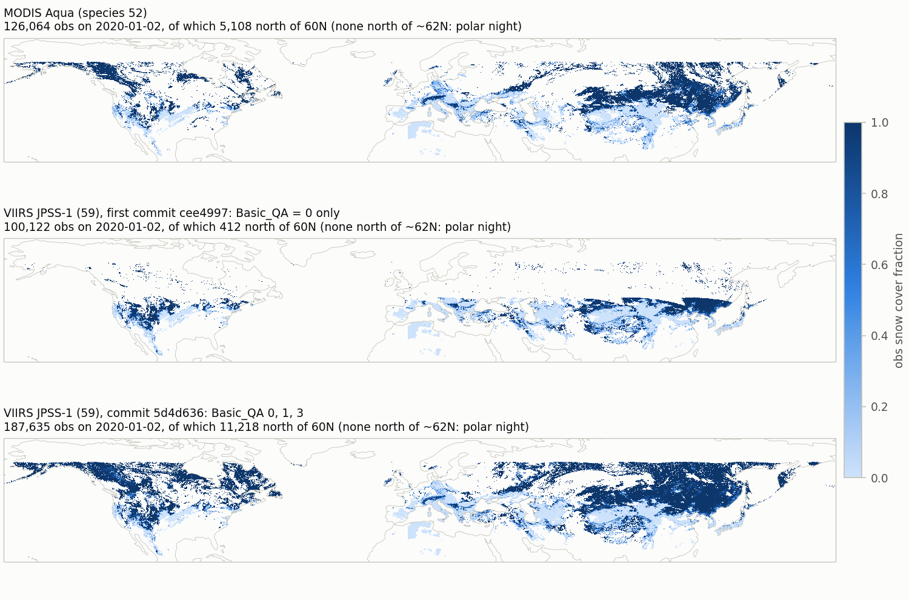
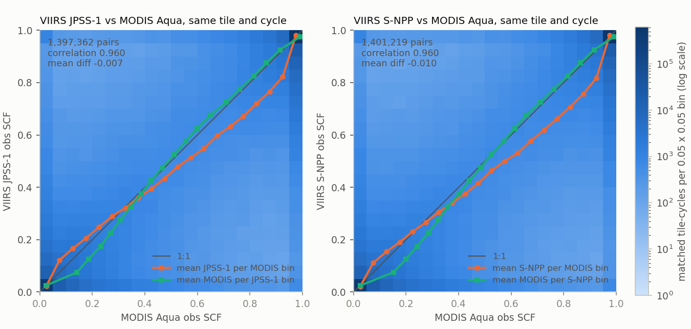
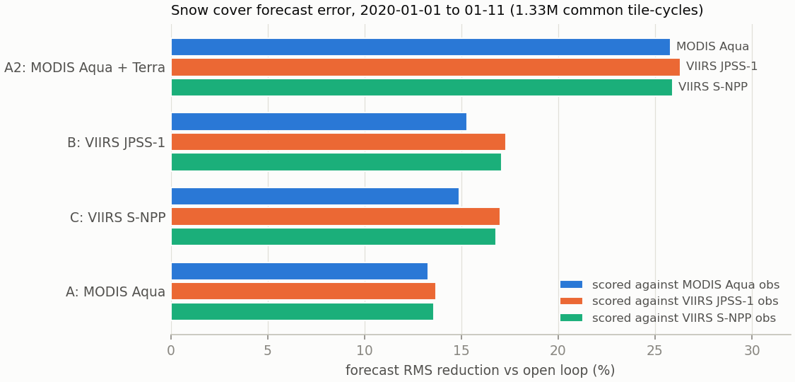
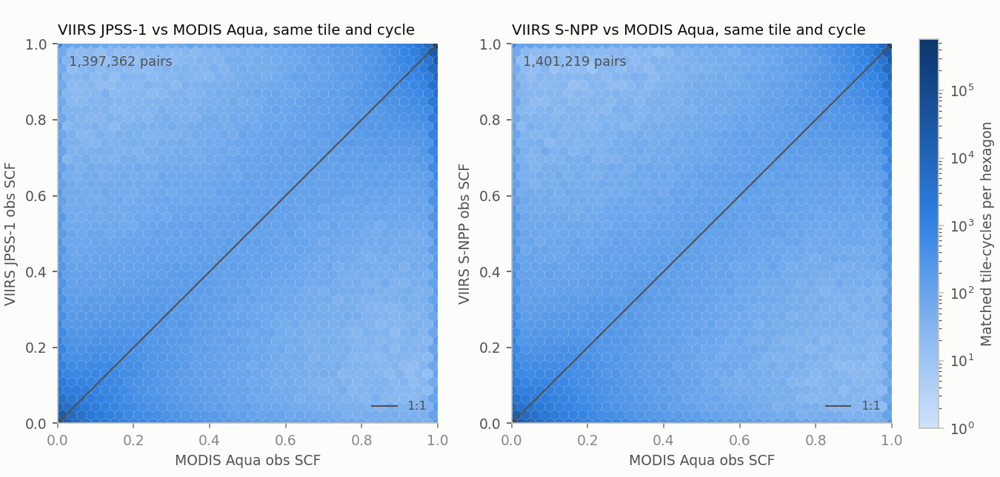
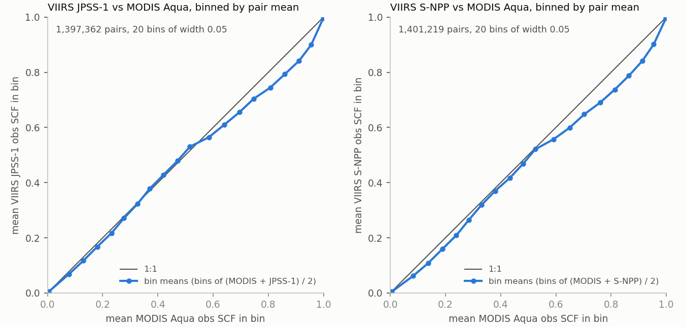

# VIIRS snow cover (SCF) reader test in GEOSldas

*2026-11-02. GEOSldas_GridComp branch `feature/amfox/jpss_hdf5_reader` (commits `cee4997` → `5d4d636`), CF0360 cubed-sphere,
1 member, 2020-01-01 to 2020-01-11, on Discover.*

## Summary

- **The new reader works.**
  - `read_obs_JPSS_SCF` reads VIIRS JPSS-1 (`VJ110C1`, species 59) and S-NPP (`VNP10C1`, 61) obs in every analysis cycle.
  - Two-file cycles (dateline crossing) occur at 00z and 03z, as expected.
  - JPSS-2 (`VJ210C1`, 60) is correctly skipped before its data begin (2023-02-10).
  - There are no errors, missing files or new warnings.
- **The first QC was too strict.**
  - Keeping only `Basic_QA = 0` (commit `cee4997`) dropped 99% of the usable VIIRS cells north of 60°N and most of the 45–62°N snow
    belt (figure 1).
  - Commit `5d4d636` keeps QA 0, 1 and 3 and caps obs SCF at 1. With it, VIIRS covers the same snow as MODIS Aqua.
- **VIIRS agrees closely with MODIS Aqua.** Both pass at about 13:30 local time. Over 1.4M matched tile-cycles in 10 days:
  - the correlation is 0.96, and the mean difference is −0.007 (JPSS-1) and −0.010 (S-NPP);
  - in partly snow-covered tiles the correlation is 0.80, and VIIRS sees slightly less snow (−0.017 and −0.028); most of
    the scatter there is noise in both sensors (figure 2), with a VIIRS-low bias that grows to 0.06–0.08 at SCF 0.7–0.9
    (figure 5);
  - no day exceeds a 0.05 bias in any snow class.
- **Assimilating VIIRS improves the snow forecast.** Against an open loop (OL), on the same 1.33M tile-cycles (figure 3):
  - VIIRS-only DA reduces the forecast RMS error by 15–17%, and MODIS Aqua-only by 13–14%;
  - VIIRS-only gives the larger gain even when scored against MODIS Aqua obs, which it never assimilates;
  - our usual MODIS Aqua + Terra setup reduces it by 26%.

## Setup

| Item | Value |
|---|---|
| Restart | qliu's 1-member CF0360 open-loop spin `M21c_land_spin` (BCS v14, no exclude file), 2020-01-01 |
| Period | 2020-01-01 00z to 2020-01-11 00z, 80 three-hourly analysis cycles |
| Analysis | `update_type = 11`: 1d rule-based snow analysis (Toure et al. 2018), not an EnKF; `LANDASSIM_DT` = 3 h |
| Ensemble | 1 member, no perturbations |
| Processors | 120 Milan tasks, debug qos; about 1 min wall time per model day |
| Obs | VIIRS CMG v2 files downloaded from NSIDC and renamed (see `get_snow_cmg_obs.py`); MODIS v6.1 from `/discover/nobackup/projects/S2SHMA/MODIS/` |

| Run | Assimilated species | Build |
|---|---|---|
| OL | none; innovations only (`getinnov`) for 52, 53, 59, 61 | `5d4d636` |
| A | 52 `MYD10C1` (MODIS Aqua) | `cee4997` (MODIS reader unchanged in later commits) |
| A2 | 52 + 53 `MOD10C1` (MODIS Aqua + Terra, as in our all-species runs) | `5d4d636` |
| B | 59 `VJ110C1` (VIIRS JPSS-1) | `cee4997` (5 days), then `5d4d636` |
| C | 60 `VJ210C1` + 61 `VNP10C1` (VIIRS JPSS-2 + S-NPP) | `cee4997` (5 days), then `5d4d636` |

## 1. QC fix: `cee4997` → `5d4d636`

In January most usable high-latitude VIIRS cells have `Basic_QA = 3` ("other", low sun). On 2020-01-02 this is 92% of the
cells north of 60°N and 62% at 40–60°N. Commit `cee4997` dropped them. Commit `ca6b377` keeps QA 0, 1 and 3, adds an explicit
`Clear_Index <= 100` check (Antarctica has `Snow_Cover = 100` and `Clear_Index = 243`), and fixes the QC comments. Commit
`5d4d636` then caps obs SCF at 1.



*Figure 1. Obs SCF in the ObsFcstAna files on 2020-01-02 (all 8 cycles), per model tile. Top: MODIS Aqua. Middle: VIIRS
JPSS-1 with `cee4997` (QA 0 only). Bottom: VIIRS JPSS-1 with `5d4d636`.*

5 days (2020-01-01 to 01-06), obs in ObsFcstAna:

| Species | Commit | Obs | Share at 60–90°N | Mean obs SCF | Obs > 1 |
|---|---|---|---|---|---|
| MODIS Aqua (52) | – | 711,018 | 5.0% | 0.530 | 0 |
| VIIRS JPSS-1 (59) | `cee4997` | 531,759 | 0.5% | 0.371 | 52,048 |
| VIIRS JPSS-1 (59) | `5d4d636` | 1,015,805 | 6.2% | 0.607 | 0 |
| VIIRS S-NPP (61) | `cee4997` | 528,299 | 0.4% | 0.367 | 51,851 |
| VIIRS S-NPP (61) | `5d4d636` | 1,018,563 | 6.3% | 0.605 | 0 |
| VIIRS JPSS-2 (60) | both | 0 | – | – | – |

South of 40°N the VIIRS counts are unchanged, so the fix only adds obs at high latitudes. VIIRS now has about 1.4 times as
many obs as MODIS Aqua.

## 2. VIIRS vs MODIS Aqua obs, 10 days

Obs of the same tile in the same cycle (`5d4d636` B and C vs A), by MODIS SCF class:

| Pair | Class | Pairs | Correlation | Mean diff (VIIRS − MODIS) |
|---|---|---|---|---|
| JPSS-1 vs Aqua | all | 1,397,362 | 0.960 | −0.007 |
| | MODIS = 0 | 392,318 | – | +0.016 |
| | 0 < MODIS < 1 | 357,809 | 0.804 | −0.017 |
| | MODIS = 1 | 647,235 | – | −0.015 |
| S-NPP vs Aqua | all | 1,401,219 | 0.960 | −0.010 |
| | MODIS = 0 | 393,782 | – | +0.015 |
| | 0 < MODIS < 1 | 359,326 | 0.805 | −0.028 |
| | MODIS = 1 | 648,111 | – | −0.014 |

- **Day to day:** the correlation is 0.94–0.97 overall and 0.73–0.86 for partial snow.
- **Bias in partial snow:** the largest daily bias is −0.049 (S-NPP, 01-04). JPSS-1 ranges from −0.043 to +0.004.
- **Classes 0 and 1:** the correlation is not given, because MODIS is nearly constant within them.



*Figure 2. Matched obs SCF (same tile and cycle, 10 days): VIIRS JPSS-1 (left) and S-NPP (right) against MODIS Aqua. Shading:
number of pairs per 0.05 bin (log scale). Orange: mean VIIRS SCF per MODIS bin. Green: mean MODIS SCF per VIIRS bin.*

- **Most pairs agree.** About 60% agree exactly (both 0 or both 1), and 75% fall in the two corner bins.
- **The S-shaped curves are mostly noise, not bias.** Binning on one sensor flattens the curve of the other (regression
  dilution), even when neither is biased. The two curves straddle the 1:1 line almost symmetrically, and for pairs where
  both sensors see partial snow the fitted slope is the same both ways (0.77 and 0.78, for both satellites), as is the
  spread (std 0.34).
- **A real bias remains.** The orange curve sits further below the line than the green one sits above it at SCF 0.6–0.9,
  so VIIRS reads lower than MODIS there. Figure 5, which bins on the pair mean, puts the size at 0.03–0.08, largest at
  SCF 0.7–0.9.

## 3. Effect on the snow forecast, vs open loop

Each run's forecast SCF (before the analysis) is scored against each sensor's obs from the OL file. All runs use the same 1.33M
tile-cycles (13:30 overpasses).



*Figure 3. Reduction in the RMS of obs minus forecast SCF, relative to the open loop, 2020-01-01 to 01-11.*

| Run | vs MODIS Aqua obs | vs VIIRS JPSS-1 obs | vs VIIRS S-NPP obs |
|---|---|---|---|
| OL | 0.269 | 0.262 | 0.261 |
| A (Aqua) | 0.233 (−13.3%) | 0.226 (−13.7%) | 0.225 (−13.6%) |
| B (JPSS-1) | 0.228 (−15.3%) | 0.217 (−17.3%) | 0.216 (−17.1%) |
| C (S-NPP) | 0.229 (−14.9%) | 0.217 (−17.0%) | 0.217 (−16.8%) |
| A2 (Aqua + Terra) | 0.199 (−25.8%) | 0.193 (−26.3%) | 0.193 (−25.9%) |

- **Terra obs:** they fall in other cycles than the 13:30 sensors, so only OL and A2 have forecasts there. A2 reduces the RMS
  by 17.0% (0.264 → 0.219, 1.96M tile-cycles).
- **Bias:** the model has too little snow in all runs. Mean obs − forecast is +0.050 to +0.059 for the OL and +0.035 to +0.051
  with DA.
- **Why A2 is best:** probably Terra's second daily look (10:30) about 3 hours before the 13:30 cycle, and more obs. This is
  not tested.

## 4. VIIRS vs MODIS Aqua obs: density and symmetric binning

These two figures use the same matched tile-cycles and the same 10 days as figure 2 (1,397,362 pairs for JPSS-1 and
1,401,219 for S-NPP). MODIS Aqua is on the x-axis and VIIRS on the y-axis.



*Figure 4. Matched obs SCF as hexagonal bins in SCF space (not geographic bins): 40 hexagons across SCF 0–1 horizontally
(`gridsize = 40`, centre spacing 0.025 SCF). Colour: matched tile-cycles per hexagon, on one logarithmic scale for both
satellites. Empty hexagons would be blank; in this sample every hexagon holds at least one pair.*

- **Agreement:** 86% of pairs differ by no more than 0.1 SCF, and 8% by more than 0.2.
- **Large disagreements are rare, and slightly more often VIIRS-low.** Pairs with VIIRS more than 0.2 below MODIS outnumber
  those with VIIRS more than 0.2 above: 62,790 against 49,353 (JPSS-1) and 66,766 against 45,417 (S-NPP). Beyond ±0.5
  (about 1.9% of pairs) the two sides are closer: 13,612 against 12,222 (JPSS-1) and 14,447 against 11,669 (S-NPP).



*Figure 5. Pairs grouped by their mean SCF, (MODIS + VIIRS) / 2, in 20 bins of width 0.05 (the last bin includes 1). Each
point is the mean MODIS SCF (x) and the mean VIIRS SCF (y) of the same pairs in one bin, connected in bin order. Bin values:
[`fig05_pair_mean_bins.csv`](viirs_scf_reader_test_report_figures/fig05_pair_mean_bins.csv).*

Figure 5 bins on the pair mean, so neither sensor is chosen as the reference. Figure 2 bins on one sensor at a time, which
flattens the other sensor's curve. Figure 5 shows how the two sensors agree on average within groups of similar snow cover.
It does **not** show which sensor is correct, and it does not remove the effects of measurement error.

- **Both ends agree.** In the lowest and highest bins (pair mean below 0.05 or above 0.95; 78% of pairs) the mean
  difference is within ±0.004.
- **VIIRS is lower at high partial snow cover.** At pair mean 0.60–0.95, VIIRS is 0.03–0.07 lower than MODIS for JPSS-1 and
  0.05–0.08 lower for S-NPP, largest at 0.75–0.90 (JPSS-1) and 0.70–0.90 (S-NPP).
- **At low partial snow cover the difference is small:** −0.01 to −0.015 for JPSS-1 and −0.02 to −0.03 for S-NPP at pair
  mean 0.05–0.25.
- **The kink at pair mean 0.50–0.55** comes from hard disagreements, where one sensor reports 0 and the other 1 (pair mean
  exactly 0.5). They are about 6% of that bin, mostly VIIRS = 1 and MODIS = 0: 542 against 145 (JPSS-1) and 467 against 178
  (S-NPP). Without them, the bin's mean difference is −0.021 (JPSS-1) and −0.031 (S-NPP), in line with its neighbours.

## Caveats and open items

- **Short and simple test:** 1 member, 10 days, one January, and a rule-based snow update. The DA results show the reader is fit
  for use; they are not a skill assessment.
- **QA labels:** the commit comments label `Basic_QA` as "0=best, 1=good, 2=poor, 3=other". The VIIRS files' own
  `key_to_QA_values` attribute says "0=good, 1=poor, 2=bad, 3=other". The code is right either way (it drops only 2), but the
  comment should follow the authoritative source.
- **Fair VIIRS counterpart:** a run assimilating JPSS-1 + S-NPP together would compare with A2 (MODIS Aqua + Terra).
- **Default obs path:** `/discover/nobackup/projects/gmao/polarm/JPSS/<product>/` is still empty. This test used its own
  renamed copy in `$NOBACKUP/snow_cmg_obs/`.

## Reproduce

Configs (exeinp, SPECIAL ensupd namelists, batch input, build scripts) are in
[`../runs/viirs_scf_reader_test/configs/`](../runs/viirs_scf_reader_test/configs/), and the text outputs of all checks are in
[`../runs/viirs_scf_reader_test/results/`](../runs/viirs_scf_reader_test/results/). Experiments:
`/discover/nobackup/projects/land_da/M21C_testing/M21C_test_CF0360_jpss_*`. Runs A, B and C were extended from 5 to 10 days
by setting `END_DATE: 20200111 000000` in `run/CAP.rc` and resubmitting.

Scripts in [`../scripts/viirs_scf_reader_test/`](../scripts/viirs_scf_reader_test/) (Discover GEOSpyD py3.13), run from the
experiment root:

```
P=/usr/local/other/GEOSpyD/25.3.1-0/2025-10-07/envs/py3.13/bin/python3
S=<repo>/projects/snow_da/scripts/viirs_scf_reader_test
X=M21C_test_CF0360_jpss
python3 $S/get_snow_cmg_obs.py $NOBACKUP/snow_cmg_obs 2019-12-31 2020-01-12 VJ110C1 VNP10C1   # login node, ~/.netrc
$P $S/check_jpss_logs.py ${X}_5d4d636_B                                                    # reader log checks
$P $S/check_jpss_ofa_v2.py 20200107 map.png A=${X}_cee4997_A:MYD10C1 B=${X}_5d4d636_B:VJ110C1 \
   C=${X}_5d4d636_C:VJ210C1,VNP10C1                                                        # sections 1-2
$P $S/compare_vs_ol.py OL=${X}_5d4d636_OL A=${X}_cee4997_A A2=${X}_5d4d636_A2 \
   B=${X}_5d4d636_B C=${X}_5d4d636_C                                                       # section 3
$P $S/make_report_figures.py . <results>/compare_vs_ol_10d.txt <docs>/viirs_scf_reader_test_report_figures
```
