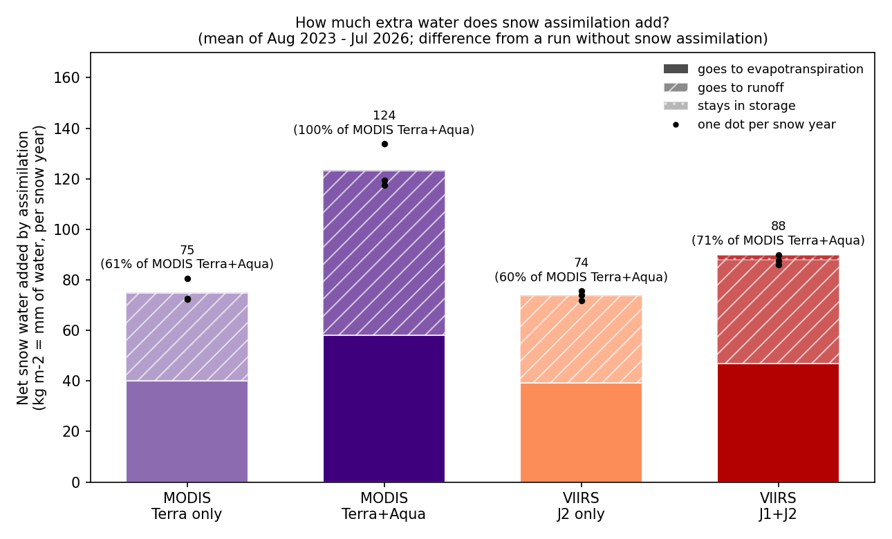
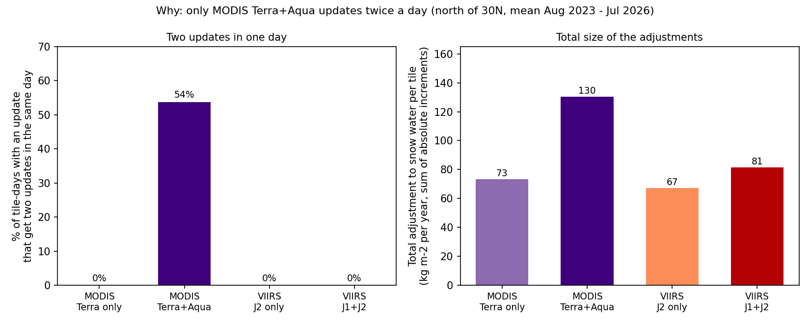
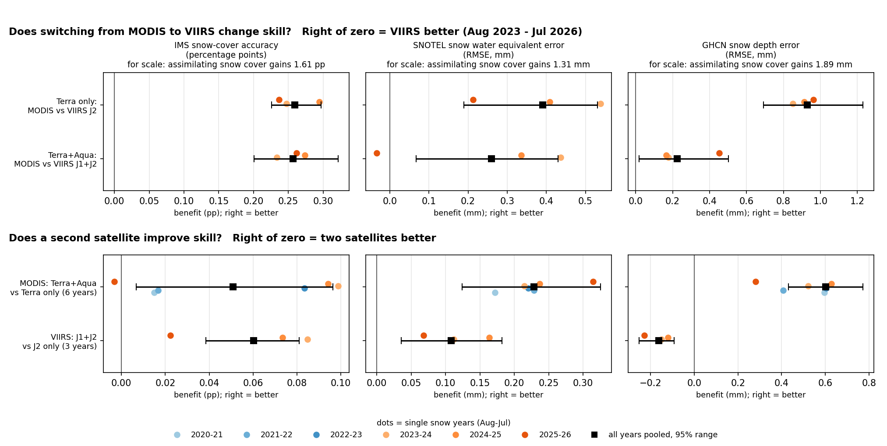

# MODIS vs VIIRS, and one satellite vs two: decision brief

**For:** choosing the operational snow-cover assimilation configuration. **Date:** 2026-11-23 (draft).
**Full detail:** `viirs_transition_report.md` (analyses, caveats, every number). This brief only answers two questions,
each for snow skill and for the water balance.

1. What changes when we switch from **MODIS** to **VIIRS**?
2. What changes when we go from **two satellites** to **one**?

## Key points

- **The big effect is on the water balance, and it comes from having two MODIS satellites.** MODIS Terra+Aqua adds about
  124 kg m-2 of snow water per year through assimilation, against about 75 for MODIS Terra only (+64%). The extra goes
  mostly to runoff (about 62%) and evapotranspiration (about 35%), and raises root-zone soil moisture by about 0.007 m3 m-3.
- **Switching to VIIRS barely changes the water balance if you compare one sensor with one sensor** (MODIS Terra 75 vs
  VIIRS J2 74 kg m-2 per year: no clear difference). **Two VIIRS satellites (J1+J2) add only 88**, about 14 more than J2 alone
  (+19%), and 29% less than MODIS Terra+Aqua. The reason: MODIS Terra+Aqua updates the snow twice a day on 54% of tile-days; the
  two VIIRS satellites share one update window and are averaged into one observation, so VIIRS never updates twice.
- **Skill hardly changes with any of these choices.** Assimilating snow cover improves skill a little (for example SNOTEL
  snow water error by 1.3 mm out of about 208 mm). Every difference between configurations is a fraction of that: VIIRS is
  slightly better than MODIS (+0.26 percentage points of IMS accuracy, +0.2 to +0.4 mm on SNOTEL water equivalent), and a
  second satellite helps by about 0.1 to 0.6 mm on most measures, with two cases going the other way (SNOTEL depth for MODIS, GHCN depth for VIIRS).
- **So a second MODIS satellite costs a lot of added water for almost no skill; a second VIIRS satellite costs much less.**
  If the aim is to avoid a big change in the water balance, a single satellite (MODIS Terra or VIIRS J2) or VIIRS J1+J2 keeps
  it close to the level of a one-sensor run; MODIS Terra+Aqua is the outlier.
- **Limits:** one model member, one transition, three snow years for the VIIRS comparisons, and the model is low-biased
  against SNOTEL snow water (about -134 mm), so more added water is not automatically worse. See Caveats.

## Summary table

Differences are the first configuration minus the second, as a mean over the snow years shown. "Clear" = same direction in
every year and bigger than 10% of the effect of assimilating snow cover (water), or same direction every year with a 95% range
that excludes zero (skill).

| Question | Net snow water added per year (kg m-2) | Skill (benefit of the second option) | Verdict |
|---|---|---|---|
| **MODIS -> VIIRS, one satellite** (Terra vs J2), Aug 2023 - Jul 2026 | 75 -> 74 (-1, -2%); no clear difference | IMS +0.26 pp; SNOTEL water equivalent +0.39 mm; GHCN depth +0.93 mm (all in VIIRS's favour, all small) | Water: no difference. Skill: VIIRS marginally better. |
| **MODIS -> VIIRS, two satellites** (Terra+Aqua vs J1+J2), Aug 2023 - Jul 2026 | 124 -> 88 (-36, -29%); clear, every year; 63% runoff, 31% ET; soil moisture -0.005 m3 m-3 | IMS +0.26 pp; SNOTEL water equivalent +0.26 mm (reverses in 2025-26); GHCN depth +0.23 mm | Water: VIIRS adds clearly less. Skill: about equal. |
| **Two -> one satellite, MODIS** (Terra+Aqua vs Terra only), Aug 2020 - Jul 2026 | 117 -> 71 over six years (-46, -43 to -53 each year); -48 (-39%) over 2023-26 (124 -> 75); clear; 62% runoff, 35% ET; soil moisture -0.007 m3 m-3 | Terra+Aqua better by IMS +0.05 pp, SNOTEL water equivalent +0.23 mm, GHCN depth +0.60 mm; worse by SNOTEL depth 0.53 mm | Water: large change. Skill: tiny, mixed sign. |
| **Two -> one satellite, VIIRS** (J1+J2 vs J2 only), Aug 2023 - Jul 2026 | 88 -> 74 (-14, -16%); clear, every year | IMS +0.06 pp; SNOTEL water equivalent +0.11 mm; GHCN depth -0.16 mm (J2 only slightly better) | Water: modest change. Skill: negligible. |

## How many observations?

Observation counts are similar across configurations, so they do not explain the differences above. Averaged over Aug 2023 -
Jul 2026 (domain total, 112,573 tiles; at most one observation per tile per satellite per day), about 21,800 tiles per day
are assimilated for MODIS Terra only and 21,300 for VIIRS J2 only. Two satellites roughly double that: about 40,100 for
Terra+Aqua and 42,900 for J1+J2. Counting tiles that have at least one available observation, VIIRS covers about 23,200 tiles
per day against about 24,900 for MODIS (7% fewer). Terra and Aqua both observe about 60% of the tiles that MODIS covers on a
given day, which is where the double updates in Figure 2 come from. The J1+J2 count is higher than Terra+Aqua because it counts each satellite
separately; J1 and J2 are then averaged into one observation per tile, so it is not 43,000 separate updates (source:
`viirs_transition_report_figures/obs_availability_summary.md`).

**Spatial coverage.** Almost all observations are north of 30N (under 1,200 tiles per day in the southern hemisphere and under 600
in 0-30N, against 4,000-8,000 per band further north; Aug 2023 - Jul 2025), and the four sensors have the same latitude profile. A second satellite
mostly adds tiles rather than revisits: J1+J2 covers about 23,200 tiles per day against about 21,300 for J2 alone (+1,900
tiles, +9%), because J1 sees about 1,900 tiles that J2 misses on a given day (they overlap on about 84% of VIIRS-covered
tiles). So J1+J2 is better than J2 only in coverage, by a modest amount. For MODIS the gain from Aqua is larger: Terra+Aqua
covers about 24,900 tiles against about 21,800 for Terra alone (+3,100, +14%). We have not mapped where the added tiles are, so
we cannot say whether they fall in the regions that matter most for snow water (for example mountain snowpack).

## Figure 1: how much extra water does each configuration add?

Bars are the mean over Aug 2023 - Jul 2026 of the difference from a run with no snow assimilation; dots are the individual
years. MODIS Terra+Aqua is about 1.6 times the others. Evapotranspiration and runoff take most of the added water; very little
stays in storage.

## Figure 2: why MODIS Terra+Aqua adds more

MODIS Terra+Aqua gets two updates on 54% of the tile-days that have any update (the other three configurations get none).
The pair mostly agrees (69-75% same direction) but a third of the adjustment cancels. Total adjustment per tile is 130 kg m-2
per year for MODIS Terra+Aqua, against 73 (Terra only), 67 (J2 only) and 81 (J1+J2). VIIRS J1 and J2 are averaged into one
observation per tile, so the second VIIRS satellite adds much less than Aqua does.

## Figure 3: does skill change?

Right of zero always means better: VIIRS in the top row, two satellites in the bottom row. Units are percentage points for IMS
accuracy and mm for the two station error measures (root mean square error). Each column title gives the size of the
improvement from assimilating snow cover itself for scale (1.61 percentage points, 1.31 mm and 1.89 mm). Axes differ between
rows. Every effect here is a small fraction of that improvement, and against station errors of 114 to 208 mm
(under 1%) these are tiny.

## What to take from this for the decision

- **If the priority is limiting the change to the water balance:** MODIS Terra+Aqua is the configuration that moves it most
  (about +64% relative to MODIS Terra only). One satellite, or VIIRS with both J1 and J2, stays within about 0-20% of a
  one-satellite run.
- **If skill is the priority:** there is no strong case for any of the four. Two satellites give at most a few tenths of a mm
  or hundredths of a percentage point, and not on every measure.
- **VIIRS J1+J2 vs VIIRS J2 only** is the cheapest way to get two satellites of coverage (J2 adds about 7% more tiles than J1),
  at +14 kg m-2 per year.

## Caveats

- One model member, M36 resolution, snow assimilation only, Aug 2020 - Jul 2026. The VIIRS comparisons use only the three
  snow years after the switch (Aug 2023 onward) and one transition, so year-to-year variability is not captured.
- A MODIS-vs-VIIRS difference is a difference of the **whole configuration** (sensor, overpass time, quality screening and
  number of updates per day), not of the sensors alone. The VIIRS J1+J2 vs J2-only comparison starts from different states
  (different histories before 2023), so the MODIS Terra+Aqua vs Terra comparison is the cleaner one-vs-two estimate.
- IMS is not independent of MODIS and VIIRS imagery; SNOTEL covers only the western US and Alaska, GHCN is sparse. IMS values
  use the corrected 2024+ arrays (the 2024-2026 IMS files were flipped north-south in the original scoring).
- The model has a large low bias in snow water at SNOTEL (about -134 mm), and observations on average show more snow than the
  model, so more added water is not necessarily worse. These skill measures cannot say which amount is "right".
- Some input files are missing in the shared archive (about 34 + 7 days); removing the original 34 days from every arm changed
  the water-balance results by 1-2%.

Figures and numbers are generated by `scripts/viirs_transition/decision_brief_figures.py` from `D_budget_tables.csv`,
`B_summary.md`, `C_skill_contrasts.csv` and `IMS_skill_contrasts_fixed.csv`. Terms: **net snow water added** = `I_snow`;
**root-zone soil moisture** = RZMC; **no snow assimilation** = the open-loop run.
